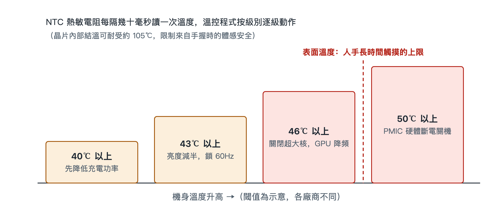

# 6.2 溫度牆與熱節流（Thermal Throttling）：密閉空間的自保藝術

夏天在陽光下打開導航，同時插著充電線，再開一局大型遊戲，過不了多久，你會注意到一連串變化：充電速度明顯變慢，螢幕自己暗了下來，畫面不再像剛開始那樣順暢，嚴重時甚至跳出「手機溫度過高」的提示。這些變化並不是故障，而是手機在按預先寫好的規則保護自己。工程上把這套規則稱為熱節流（Thermal Throttling），觸發它的溫度門檻叫作「溫度牆」。

## 6.2.1 兩條紅線：晶片能扛多熱，手能握多熱

理解溫控，先要分清兩個溫度。

第一個是**晶片接面溫度**，也就是晶片內部電晶體所在區域的溫度。矽晶片的耐熱能力比人們想像的強，內部接面溫度可以耐受到 105℃ 左右。僅從晶片本身看，它還有不少餘裕。

第二個是**人體觸感溫度**，也就是機身外殼貼著手掌、臉頰時的溫度。智慧型手機要長時間握在手裡、貼在耳邊，皮膚長時間接觸過熱的表面會造成低溫燙傷。所以安全標準對可觸摸表面的溫度有限制，限值按材料和接觸時間分級；廠商通常把長時間手持的表面溫度控制在 40 多攝氏度。

兩條紅線中間隔著將近 60℃。真正卡住手機效能的，往往不是晶片的承受極限，而是人手的承受極限。可以打個比方：汽車引擎內部能承受很高的溫度，但駕駛艙必須讓乘客舒適。手機沒有風扇，也沒有進風口，它是一個密閉的玻璃金屬盒子，熱量只能靠導熱材料和外殼慢慢散出去。晶片一旦持續滿載，外殼溫度遲早會逼近人體紅線，系統只能主動減少發熱。

## 6.2.2 遍布主機板的「溫度哨兵」

要控制溫度，先得知道溫度。手機主機板上分布著一組 **NTC 熱敏電阻**。NTC 是 Negative Temperature Coefficient 的縮寫，意為「負溫度係數」：溫度越高，它的電阻值越低。電路測出它的電阻，就能換算出所在位置的溫度。

這些熱敏電阻不會只放一個，而是組成陣列，分別靠近 SoC、電池、充電晶片、相機模組等主要熱源。系統**每隔幾十毫秒**讀取一次各點溫度，相當於在機身裡布了一圈哨兵，隨時回報哪裡在升溫、升得多快。

負責彙整這些資料並做決策的，是作業系統中的**溫控常駐程式**。「常駐程式」（守護行程）指在背景持續執行、不直接和使用者互動的系統程式。它不處理照片，也不載入遊戲，只盯著溫度表，按規則下達降溫指令。

## 6.2.3 四級階梯：先砍最不影響體驗的

溫控常駐程式不會一發現升溫就全面降速，而是按一套**固定的級聯階梯**逐級執行，越往上越嚴厲：

| 溫度閾值 | 採取的措施 | 你能感受到的變化 |
|---|---|---|
| 超過 40℃（示意） | 優先降低充電功率 | 充電變慢，電量上升速度下降 |
| 超過 43℃ | 螢幕亮度強制減半，更新率鎖定 60Hz | 螢幕變暗，滑動不如高刷順暢 |
| 超過 46℃ | 關閉超大核，GPU 降頻 | 遊戲掉幀，應用程式回應變慢 |
| 超過 50℃ | PMIC 觸發硬體斷電關機 | 手機直接關機 |

這個順序體現了一種取捨：**先犧牲使用者最不容易察覺的，再犧牲使用者感受最明顯的。**

**第一級，砍充電。**充電時，電池內部的化學反應和充電晶片的能量轉換都會發熱，快充時更明顯。降低充電功率，只是讓充滿時間變長，不會打斷你正在做的事，代價最小。而且電池本身怕熱，高溫下大電流充電會加速老化，這一步同時保護了電池。

**第二級，壓螢幕。**螢幕是手機裡面積最大、持續耗電的元件之一，高亮度和高更新率都意味著更多功耗。把亮度減半、更新率鎖到 60Hz，你會覺得螢幕暗了、沒那麼流暢，但內容仍然能看、操作仍然能用。

**第三級，動算力。**到 46℃，前兩步已經壓不住，系統開始直接限制運算核心：關閉發熱最大的超大核，讓 GPU（圖形處理器）降低頻率。這一步對遊戲玩家最明顯，畫面幀率下降，出現卡頓。上一節講到的 EAS 排程會配合這一步，把任務轉移到更省電的核心上。

**第四級，斷電。**若溫度仍然衝過 50℃，說明軟體手段已經失效，可能是環境極端或存在異常。這時由 **PMIC**（Power Management IC，電源管理晶片）在硬體層面直接切斷供電，強制關機。這一步不依賴作業系統，即使軟體當機，硬體保護也能動作，是最後一道保險。

## 6.2.4 為什麼要「分級」而不是「一刀切」

如果設計者偷懶，只設一個閾值，超過就全面降速，使用者會經歷「滿血」和「殘血」之間的突然切換，體驗很差。分級階梯的好處在於：

- **漸進**：溫度小幅上升時只做輕微調整，多數時候使用者察覺不到；
- **對症**：先處理充電、螢幕這類可以讓步的負載，盡量保住核心任務；
- **兜底**：軟體層層退讓之後，還有硬體斷電作為最終保護。

這也解釋了一個常見現象：同一款手機，新機評測時跑分很高，長時間遊戲後幀率卻下滑。發表會上的峰值效能，是溫度牆之下的短時表現；能持續多久，取決於散熱設計和溫控策略。看懂這一點，就能更理性地理解「滿幀」「持續效能」這類宣傳。

## 6.2.5 小結

熱節流不是效能缺陷，而是手機在沒有風扇的密閉空間裡做出的工程選擇：晶片能耐受 105℃，但必須服從人手能長時間觸摸的溫度上限。NTC 熱敏電阻負責感知，溫控常駐程式負責決策，（以示意的）40℃、43℃、46℃、50℃ 四級階梯從充電、螢幕、算力一路退到硬體斷電。下次手機變暗、變慢時，你可以判斷它正處在哪一級。溫度只是手機感知的物理量之一，下一節將看到，系統如何把加速度、角速度、磁場等多路感測器訊號融合在一起，得到可靠的結果。
