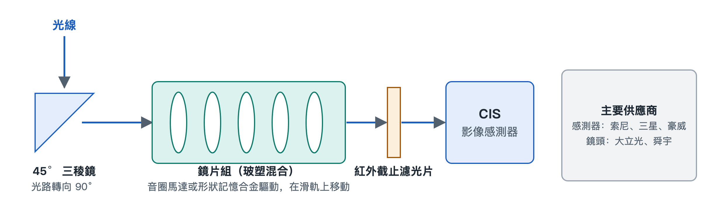

# 7.2 相機模組實物解剖與產業圖譜

翻過手機，背面那塊凸起的鏡頭區域，往往是整部機器上最顯眼的部位。幾顆圓形鏡頭排在一起，有的旁邊還有一個方形的「窗口」。它們看起來只是幾塊玻璃，拆開後卻各自連著一整條精密的光學與半導體鏈條。本節先按光線走過的路線拆開一個潛望長焦模組，再看感光晶片和鏡頭背後由哪些企業撐起。

## 7.2.1 方形窗口裡的祕密：潛望長焦模組的四段光路

長焦鏡頭要把遠處的景物「拉近」，需要較長的焦距。焦距可以粗略理解為鏡片到感光面之間需要的光學距離。手機機身厚度不足一公分，鏡頭如果直直地朝裡排，根本放不下。工程師的辦法是讓光線轉彎，這就是潛望式（Periscope）結構的由來。它和潛水艇的潛望鏡道理相同，都是用一塊反射元件把光路轉個方向。

一束光從進入方形窗口到變成電訊號，要依序經過四個部件：

1. **45° 轉向三稜鏡**：光線從機身背面垂直射入，碰到斜放 45° 的稜鏡後被折轉 90°，改為沿機身長邊方向橫著走。原本需要「豎著」佔用的長度，就這樣被放平到機身內部更寬裕的方向上。
2. **懸浮鏡片組**：橫向傳播的光穿過一組鏡片完成對焦。這組鏡片並不固定，而是安裝在微型滑軌上，由馬達推動前後移動。常見的驅動方式有兩種：一種是**音圈馬達**（Voice Coil Motor，VCM），利用線圈通電後在磁場中受力的原理推動鏡片，和揚聲器振膜的發聲原理相近；另一種是**形狀記憶合金**（Shape Memory Alloy，SMA），這種金屬絲受熱後會收縮回預設長度，透過控制電流加熱，就能精確地拉動鏡片。
3. **紅外線截止濾光片**（IR-cut Filter）：感光晶片對人眼看不見的紅外光也會產生反應。如果不過濾，照片會偏色、發灰。這片薄玻璃的作用是只讓可見光通過。
4. **CMOS 影像感測器**（CMOS Image Sensor，CIS）：光路的終點。這塊晶片表面排布著數以千萬計的像素，負責把光子轉換成電荷，再變成數位訊號，交給後面的影像訊號處理器。

這四段部件的配合可以用「取景—轉向—聚焦—過濾—記錄」來概括：

| 部件 | 光路中的角色 | 生活類比 |
|---|---|---|
| 45° 轉向三稜鏡 | 把垂直入射光折轉 90° | 樓梯間轉角處的反光鏡 |
| SMA / VCM 懸浮鏡片組 | 移動鏡片完成對焦與防手震 | 望遠鏡上調焦的旋鈕 |
| 紅外線截止濾光片 | 濾除紅外光，確保色彩準確 | 墨鏡擋掉刺眼的成分 |
| CIS 影像感測器 | 把光訊號轉為電訊號 | 底片相機裡的底片 |

## 7.2.2 感光晶片三巨頭：各自押注的技術路線

決定畫質上限的核心是 CIS。目前這個領域有三家代表性廠商，它們選擇了不同的技術方向。

**索尼半導體（LYTIA 品牌）**的代表作是 1 吋的 LYT-900。它是堆疊式感測器，大尺寸感光面積帶來更多進光量。索尼在堆疊式感測器上的一項代表性技術是 2021 年發表的**雙層電晶體像素**。傳統感測器裡，負責收光的光電二極體和負責讀出訊號的電晶體擠在同一層矽片上，互相爭奪面積。索尼把兩者分別製作在兩片晶圓上，再上下垂直鍵合在一起。可以把它想成一棟樓：原來店面和倉庫擠在同一層，現在倉庫搬到樓下，樓上整層都用來「接光」。光電二極體有了更大的空間，能容納的電荷更多，按索尼的說法飽和訊號量約提高一倍，動態範圍隨之擴大。動態範圍指的是同一畫面中同時記錄亮部和暗部細節的能力，逆光拍人時臉不發黑、天空不過曝，靠的就是它。

**三星半導體（ISOCELL 品牌）**走的是超高畫素路線，代表產品是 2 億畫素的 HP2。像素數量多，單一像素就必然很小，暗光下每個像素收到的光很少。三星的對策是**十六合一像素重排**：光線不足時，把相鄰 16 個小像素合併當作一個大像素使用，以犧牲解析度換取進光量；光線充足時，再拆開輸出全像素的高清細節。這套方法類似一支球隊，平時 16 個人各守一塊位置，遇到強敵時抱成一團集中防守。

**豪威科技（OmniVision）**的代表產品是 OV50H 和 OV50K，首創了 **LOFIC 超高動態技術**。LOFIC 的全稱是 Lateral Overflow Integration Capacitor，意為橫向溢出積分電容。強光下，光電二極體很快就會被電荷「灌滿」，多出來的電荷會流失，畫面亮部變成一片死白。LOFIC 在像素旁邊加了一個電容，專門接住溢出的電荷，就像在水杯旁邊加了一個溢水盆，滿出來的水不會白白流走。這樣，亮部細節也能被保留下來。

| 廠商 | 品牌 / 代表產品 | 核心技術 | 主要解決的問題 |
|---|---|---|---|
| 索尼半導體 | LYTIA / 1 吋 LYT-900 | 1 吋堆疊式；索尼另有雙層電晶體像素技術 | 進光量與動態範圍 |
| 三星半導體 | ISOCELL / 2 億畫素 HP2 | 十六合一像素重排 | 高畫素與暗光進光量兼顧 |
| 豪威科技 | OmniVision / OV50H、OV50K | LOFIC 橫向溢出電容 | 強光下亮部不過曝 |

讀發表會參數時，「1 吋大底」「2 億畫素」「超高動態」這三類說法，往往分別對應上述三條路線。它們之間沒有簡單的優劣，各自在面積、像素數量和電荷容量上做了不同的取捨。

## 7.2.3 鏡頭裡的「玻璃＋塑膠」：1G+6P 玻塑混合

感測器前方的鏡頭由多片微型鏡片疊成。手機鏡片多數是精密射出成型的塑膠（Plastic，簡寫 P），輕巧、成本低，可以做成複雜的非球面形狀；玻璃（Glass，簡寫 G）透光性好，受溫度影響小，但加工難度高。**1G+6P** 的意思是用 1 片玻璃鏡片加 6 片塑膠鏡片組合成一個鏡頭，用一片玻璃補足塑膠在色散和穩定性上的短板，同時保留塑膠輕薄的優勢。

這種直徑只有幾公釐、要求極高精度的玻塑混合鏡頭，製造被**大立光**與**舜宇光學**牢牢掌握。鏡片的面形誤差和多片之間的對位精度，直接決定照片是否銳利，這正是少數廠商能長期佔據這一環節的原因。

## 7.2.4 小結

一個攝影鏡頭模組，從外到內串起了光學設計、精密機械、材料科學和半導體製程：稜鏡解決空間問題，馬達解決對焦問題，濾光片解決色彩問題，CIS 解決光電轉換問題，玻塑鏡頭解決成像銳利度問題。每一環背後都有專門的廠商。下一節將轉向手機正面那塊面積最大的部件，看看可撓式螢幕與蓋板玻璃遵循著怎樣的標準。
