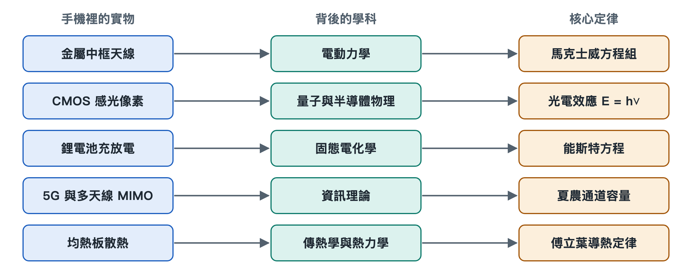

# 8.5 智慧型手機實物與基礎學科理論映射全景

把手機翻過來，背面朝上放在桌上。金屬中框上那幾道細細的塑膠縫，鏡頭模組裡一塊指甲大小的感光晶片，玻璃背蓋下面一塊扁平的電池，主機板上一枚負責 5G 的基頻晶片，還有緊貼處理器的一片薄薄的金屬散熱板，這些部件都看得見、摸得著。本章前四節分別沿著其中四條線索，一直追到教科書裡的方程式。這一節把四條線索收攏，再補上散熱這一條，畫成一張完整的映射圖。讀者往後再看到手機上的某個現象，就能找到它對應的學科、定理和奠基人。

## 8.5.1 一張表：從零件到定律

下表按「實物或現象—學科—核心定理或模型—代表人物」四欄排列。每一列都可以當作一條從手機內部通往基礎科學的路徑來讀。

| 手機內部實體元件 / 關鍵現象 | 背後支撐的學科領域 | 核心物理定理 / 數學模型 | 最具代表性的科學奠基人 |
|---|---|---|---|
| 金屬中框天線、高頻射頻發射 | 古典電動力學 / 射頻工程 | 馬克士威方程組（電磁波輻射）、波動方程式 | 詹姆斯·馬克士威、赫茲 |
| CMOS 感光二極體、夜景雜訊 | 量子力學 / 半導體物理 | 愛因斯坦光電效應（E=hν）、卜瓦松散粒雜訊 | 普朗克、愛因斯坦、肖克利 |
| 鋰離子電池充放電、快充析鋰 | 物理化學 / 固態電化學 | 能斯特方程式（平衡電位）、阿瑞尼斯擴散定律 | 能斯特、阿瑞尼斯、古迪納夫 |
| 5G 高速通訊、MIMO 多天線 | 資訊理論 / 矩陣代數與統計學 | 夏農通道容量公式、空間通道矩陣奇異值分解 | 克勞德·夏農、奈奎斯特 |
| 均熱板相變散熱、晶片接面溫度 | 熱傳學 / 古典熱力學 | 熱傳導傅立葉定律、相變潛熱熱力學平衡方程式 | 傅立葉、克勞修斯 |

這張表並非隨意拼湊，五列恰好對應手機最基本的五種「流動」：電磁波向外流動，光子向內流動，鋰離子在正負極之間流動，資訊在空間通道中流動，熱量從晶片向外殼流動。第五章講「系統脈動」時介紹過這些流動在工程上的樣子，本章講的是它們為什麼必須這樣流。

## 8.5.2 五條路徑逐一回顧

**第一條：中框縫隙與電磁波。** 中框上的斷縫把整圈金屬分成幾段，每一段都是一根經過精心計算的天線。馬克士威方程組說明，變化的電流會激發變化的磁場，變化的磁場又會激發電場，兩者交替推進就形成向外傳播的電磁波。波動方程式決定了波長和頻率的關係，因此天線長度要與工作頻段匹配。頻率越高，波長越短，越容易被牆體和人手削弱，所以工程師要在機身四周布置多根天線，讓它們輪流接力。

**第二條：感光像素與光子。** 一個光子打進 CMOS 感光二極體，能量為 E=hν。只要能量足夠，就能把一個電子激發出來，這是愛因斯坦解釋過的光電效應。光子的到達本身是隨機的，服從卜瓦松分布：平均到達 N 個光子時，起伏大約是 √N。夜裡光少，N 小，起伏相對更大，畫面就顯出雜訊。「大底」和「大光圈」的作用是多收集光子，讓統計起伏變得相對微小。

**第三條：電池與晶格裡的離子。** 鋰電池的電壓由正負極材料的電化學勢差決定，能斯特方程式描述了電位如何隨濃度和溫度變化。鋰離子在電極晶格中擴散的速度遵從阿瑞尼斯規律，溫度一低，擴散就呈指數式變慢。冬天電量顯示還有餘量卻突然關機，快充時必須控制電流、防止鋰在負極表面析出，都能從這裡找到解釋。古迪納夫等人對正極材料的研究，奠定了今天手機電池的基礎。

**第四條：多天線與通道容量。** 夏農公式規定，一條通道在給定頻寬和訊雜比下能傳輸的資訊有上限。5G 要提速，一是拓寬頻寬，二是使用 MIMO（多輸入多輸出）技術，用多根天線同時收發。從數學上看，空間通道可以寫成一個矩陣，對它做奇異值分解，就能把一條擁擠的通道拆成幾條近似並行的「子通道」。奈奎斯特關於取樣與符元速率的工作，則為數位通訊的節拍定下了規矩。

**第五條：均熱板與接面溫度。** 這一條在前面各節沒有單列，這裡補充說明。晶片工作時，電晶體翻轉會產生熱量。傅立葉定律指出，熱流的大小與溫度梯度、材料導熱能力成正比，所以要用銅、石墨這類導熱好的材料把熱迅速攤開。均熱板內部封有少量液體：液體在熱端吸熱汽化，蒸汽流到冷端放熱凝結，再沿毛細結構回流。相變潛熱讓很薄的一層金屬板也能搬運大量熱量。克勞修斯總結的熱力學規律則提醒我們，熱量只會從高溫流向低溫，手機散熱的極限最終取決於機身與周圍空氣之間的溫差。

## 8.5.3 為什麼要畫這張全景圖

單看某一個零件，容易把它當成孤立的技術點。放進這張表之後，可以看出三層關係：

1. **限制來自定律，而非廠商。** 訊號穿牆變弱、夜景出現雜訊、低溫掉電、發熱降頻，都受到上表中某條定律的約束。工程只能在定律允許的範圍內騰挪。
2. **同一支手機在調用多個學科。** 一次視訊通話，同時用到了電動力學、半導體物理、電化學、資訊理論和熱傳學，這正是「高整合」的含義。
3. **參數背後有物理量。** 發表會上的「更大底」「更快充」「更強 5G」「更好散熱」，都可以翻譯回光子數、離子擴散、通道容量和熱流。

## 8.5.4 AI 協同介面：從實物現象逆向溯源

這張表也可以反過來用：先看到現象，再追問它屬於哪一列。下面的提示詞可以直接交給 AI 助理，方括號內替換成你觀察到的現象。

> 我正在閱讀《AI時代系統知識基礎讀物：智慧型手機》第八章關於原理溯源的內容。我觀察到了手機使用中的一個具體物理現象：[輸入你的具體現象，例如：為什麼冬天在室外，手機電量明明還有 30% 卻突然自動關機？／為什麼 5G 訊號隔了一堵承重牆之後衰減得比 4G 嚴重得多？／為什麼手機鏡頭光圈做得越大、感測器尺寸越大，夜景雜訊就越少？]。
> 請基於本章的學科溯源框架，幫我復盤其底層的科學機理：
> 1. 【核心科學定律】：該現象受制於哪一條物理學、化學或資訊理論定理（如阿瑞尼斯方程式、馬克士威方程組、能斯特方程式或卜瓦松分布）？
> 2. 【微觀物理推演】：請用通俗但嚴謹的微觀物理過程，解釋溫度／晶格／光子／電磁波在這一瞬間發生了什麼變化？
> 3. 【工程妥協方案】：現代手機工程師與演算法科學家，在硬體設計或作業系統層面運用了什麼手段來對抗這一物理極限？

拿到回答後，可以對照上表核對 AI 給出的學科歸屬是否準確，再回到本章相應小節檢查推演過程。這樣，AI 起的是陪練作用，最終判斷仍由你自己完成。

## 8.5.5 小結

本章從四個方程式出發，最後落到這一張五列的表上。它把手機內部看得見的零件，和幾百年來物理、化學、資訊理論累積的成果連在了一起。下一章將系統介紹如何借助 AI，把這種從實物到原理的追問變成日常習慣。
