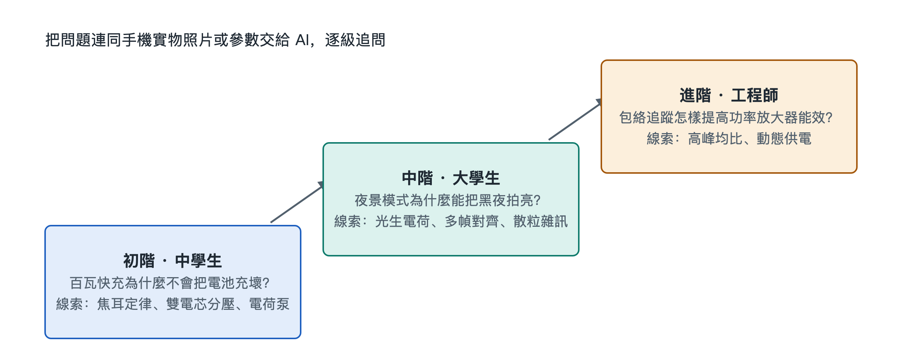

# 9.2 三階認知進階探索：從中學生到工程師的問題階梯

上一節我們讓 AI 認出了拆機照片裡的每一顆晶片。可是「認出來」只是開始。真正有收穫的學習，是帶著一個好問題，讓 AI 陪你一路追問下去，直到摸到原理的底層。問題提得淺，AI 的回答就停在表面。問題提得準，它就能把你領進一條完整的系統鏈路。

本節設計了一架三級問題階梯，分別對應中學生、大學生和工程師三種知識背景。三道題都取自手機日常使用中最常見的現象：充電、夜拍、5G 通話。台階越往上，涉及的物理和工程概念越深。你可以從自己所在的台階起步，也可以把三道題連起來看，體會同一部手機在不同深度下呈現的樣子。

## 9.2.1 階梯總覽：同一部手機的三種深度

| 台階 | 讀者視角 | 核心問題 | 需調用的知識 | 對應本書章節 |
|---|---|---|---|---|
| 初階 | 中學生 | 百瓦快充為什麼不會把電池充爆炸？ | 國中焦耳定律、串聯電路分壓 | 5.2、8.3 |
| 中階 | 大學生 | 夜景拍照為什麼能把黑夜拍成白天？ | 光電效應、機率統計、影像對齊 | 5.3、8.2 |
| 進階 | 工程師 | 5G 包絡追蹤如何提升功放能效？ | 調變理論、電源設計、訊號頻寬 | 5.1、8.4 |

使用時有一個原則：**不要一次性要答案，而要讓 AI 按步驟引導你。**比如在提問前加一句：「請不要直接告訴我結論，先問我已經知道什麼，再一步步提示我。」這樣 AI 就成了陪練，不再只是一本會說話的百科全書。

## 9.2.2 初階：百瓦快充為什麼不會把電池充爆炸？

**起點場景**：你看到發表會寫著「百瓦快充」，第一反應可能是擔心：功率這麼大，電池會不會過熱起火？

**推薦的追問路徑**：

1. **先回到焦耳定律。**國中物理告訴我們，電流通過導體產生的熱量 Q = I²Rt。熱量和電流的平方成正比。所以影響發熱的主要因素是電流，功率本身倒在其次。你可以問 AI：「如果功率不變，把電壓提高一倍、電流降低一半，發熱會怎樣變化？」答案是：在電阻不變時，發熱降為原來的四分之一。
2. **再看串聯雙電芯分壓。**許多快充手機把電池做成兩節電芯串聯。串聯後總電壓翻倍，同樣的充電功率下，流經電池迴路的電流就可以減小。這正是「提電壓、降電流」的思路落在電池上的做法。可以追問 AI：「為什麼不乾脆用一塊大電芯？串聯兩節有什麼代價？」這會引出電芯一致性和均衡管理的話題。
3. **最後看電荷泵直充。**充電器送來的電壓要經過手機內部轉換才能進電池。傳統電感式降壓電路會有可觀的損耗，變成熱量留在機身裡。電荷泵（Charge Pump）用電容按比例切換來轉換電壓，轉換效率可以做到 98% 左右。也就是說，絕大部分能量進入電池，只有很小一部分變成熱。

**本台階的收穫**：快充的安全性來自一整套組合設計，單靠「電池更耐操」是做不到的。降低電流從源頭上減少熱量，高效轉換減少中間損耗，再配合第六章講過的溫度監控，熱量始終處在可控範圍內。一個國中公式就能解釋發表會上最醒目的參數。

## 9.2.3 中階：夜景拍照為什麼能把黑夜拍成白天？

**起點場景**：深夜按下快門，螢幕提示「請保持穩定」，一兩秒後，照片亮得像傍晚。光線明明那麼少，亮度從哪裡來？

**推薦的追問路徑**：

1. **從光生電荷出發。**每個像素本質上是一個光電二極體。光子打進矽片，按光電效應激發出電子，這些電子就是光生電荷（Photo-generated Charge）。暗處光子少，每個像素收集到的電荷也少，訊號就弱。你可以問 AI：「像素收集的電荷數和最終亮度是什麼關係？」
2. **認識泊松散粒雜訊。**光子到達像素是隨機事件，服從泊松分布。這種由光的粒子性帶來的起伏叫散粒雜訊（Shot Noise）。它的一個重要性質是：訊號越弱，雜訊相對越明顯。這就是夜景照片滿是彩色雜點的根源。請 AI 解釋：「為什麼把 N 張照片疊加後，訊噪比會按 √N 提高？」這一步就是機率統計在相機裡的直接應用。
3. **理解 RAW 域光流對齊。**多張疊加有個前提：每張要嚴絲合縫地對齊。手持拍攝時手會抖，畫面裡的人和車也在動。手機在 RAW 域，也就是尚未做色彩處理的原始感測器資料裡，用光流（Optical Flow）演算法估算每一塊像素的位移，把多幀逐塊對齊後再融合。選擇在 RAW 域操作，是因為這裡的資料最接近真實的光子統計，雜訊特性還沒有被後續處理扭曲。

**本台階的收穫**：所謂「把黑夜拍成白天」，並沒有憑空增加光，只是把多張照片裡分散的光子按統計規律累積起來，再把隨機雜訊平均掉。整個過程把第五章講的毫秒級計算攝影接力和第八章的半導體成像物理串在了一起。

## 9.2.4 進階：5G 包絡追蹤如何提升功放能效？

**起點場景**：5G 手機在訊號弱時明顯發熱、掉電快，其中一個大頭是射頻功率放大器（Power Amplifier，PA）。工程上怎樣讓它少浪費電？

**推薦的追問路徑**：

1. **認識高峰均比的挑戰。**5G 使用高階調變，比如 1024-QAM（正交振幅調變）。它在一個符號裡塞進更多位元，訊號振幅也隨之劇烈起伏，峰值功率遠高於平均功率，這就是高峰均比（PAPR）。PA 必須按峰值準備供電電壓，但大部分時間訊號只在平均水準附近，多餘的電壓就變成熱量。
2. **理解包絡追蹤的思路。**包絡追蹤（Envelope Tracking，ET）讓 PA 的供電電壓隨訊號包絡即時變化：訊號大時給高壓，訊號小時給低壓。類比一下，固定供電像全程開著大水龍頭，ET 則是按需轉閥門。可以請 AI 畫出「固定供電」與「ET 供電」下電壓曲線和訊號包絡的對比示意。
3. **深入動態供電的速度要求。**5G 訊號頻寬可達 100MHz，包絡變化極快。ET 電源晶片必須有足夠高的迴轉率（Slew Rate），在微秒級甚至更短的時間尺度內完成電壓調諧，還要和射頻訊號嚴格同步。時序一旦錯位，就會引入失真，反而惡化通訊品質。這裡可以追問 AI：「ET 調變器的頻寬不足時，會在頻譜上產生什麼問題？」

**本台階的收穫**：能效問題最終落在調變方式、電源響應速度和訊號同步三者的協同上。它把第五章的射頻電磁流和第八章夏農定理背後「用更複雜的調變換更高速率」的代價聯繫了起來。

## 9.2.5 小結：階梯的價值在於連通

三道題看似分屬電池、相機和射頻三個領域，底層邏輯卻很一致：在物理約束下，用系統設計把能量和資訊的損耗降到最低。中學生從焦耳定律出發，大學生借助機率統計，工程師掌握訊號與電源的動態協同，三人看的都是手裡這部手機，只是深淺不同。

把一個現象追問到原理層，再從原理回到實物驗證，這個往返過程就是「系統透視眼」的訓練方式。下一節，我們會把這種追問能力放進完整的業務場景，從一次真實操作出發，推演整部手機的全鏈路運行。
