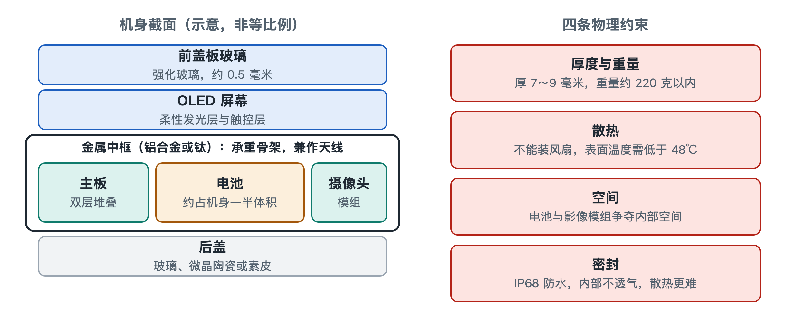

# 1.1 智能手机的物理形态与系统折中

把手机平放在桌上，最直观的印象是一块会发光的长方形玻璃板。这块板子看起来简单，却是工业设计与机械工程长期演进的结果。它的厚度、重量、材料和开孔位置，都是在极小空间里反复权衡后的妥协。读懂这些妥协，是建立“系统透视眼”的第一步。

## 1.1.1 经典三明治：三层材料各司其职

拿起手机，用指甲沿侧边轻轻划一圈，能摸到正面玻璃、侧面金属边框和背面材质之间细微的接缝。绝大多数主流手机都采用这种“屏幕盖板 + 金属中框 + 后盖”的夹层结构，工程师常把它叫作“三明治架构”。

| 层级 | 常见材料 | 主要职责 |
|---|---|---|
| 前盖板玻璃 | 铝硅酸盐强化玻璃，代表厂商为美国康宁（大猩猩玻璃）、德国肖特 | 保护屏幕，抵御刮擦与跌落 |
| 结构中框 | 航空级 6000/7000 系铝合金或钛金属 | 承重骨架，兼作天线辐射体 |
| 后盖板 | 玻璃、微晶陶瓷或素皮 | 让无线充电的电磁波穿过，兼顾散热与握感 |

**前盖板**厚度约 0.5 毫米，比一张银行卡还薄。它经过化学强化和微晶硬化处理，表面形成一层压应力，像给玻璃预先绷紧了一层“铠甲”，裂纹不容易扩展。

**中框**是整机的承重骨架。屏幕、主板、电池都直接或间接固定在它上面，跌落时冲击力也主要由它分散。它还有一项不太为人注意的兼职：侧边那几道细细的塑料缝隙，是用纳米注塑工艺填入的绝缘材料，把一整圈金属切成几段，每一段就成了一根天线。骨架和天线合二为一，正是空间极度紧张时的典型做法，第四章会专门讨论。

**后盖**为什么越来越少用整块金属？因为金属会屏蔽电磁场，无线充电线圈的能量穿不过去。玻璃、陶瓷、素皮对电磁波“透明”，同时可以通过不同的表面处理改善手感和观感。材料选择背后，其实是充电、散热、握持三种需求的折中。

## 1.1.2 折叠屏：让屏幕学会弯腰

近年来普及的折叠屏手机打破了刚性长方体的形态。屏幕要反复弯折，带来了全新的材料与机械难题。

- **超薄柔性玻璃（Ultra-Thin Glass，UTG）**：厚度只有 30 微米左右，接近一根头发丝的一半。玻璃一旦薄到这种程度，就能像纸一样弯曲。再经过化学强化，它可以弯折数十万次而不出现机械疲劳。部分机型也会使用透明聚酰亚胺薄膜（Colorless Polyimide，CPI）作为柔性盖板。
- **水滴铰链**：如果屏幕被硬生生对折成一条直线，弯折处会发生塑性形变，留下永久折痕。水滴铰链在合拢时为屏幕留出一个水滴形的收容腔，让弯曲半径变大、受力变缓。这个铰链内部集成了上百个微型齿轮与凸轮结构，零件采用金属注射成型（Metal Injection Molding，MIM）工艺制造：先把金属粉末与粘结剂混合后像塑料一样注塑成型，再烧结致密，适合批量生产形状复杂的小零件。

折叠形态也改变了内部布局。机身分成两半，常见的做法是采用双主板和分立的双电芯，分别放在铰链两侧，再用柔性线路跨过铰链连接。一部折叠屏手机，相当于把两部薄手机用精密机械“缝”在了一起。

## 1.1.3 锁死形态的四条物理边界

无论直板还是折叠，手机的形态都被几条严苛的物理边界限定。它们互相牵制，任何一项放松，都会挤压其他几项。

1. **厚度与重量**：整机厚度通常被压在 7.0～9.0 毫米之间，重量一般控制在 220 克以内，业内常把 200 克左右视为“人机舒适线”。超过这条线，单手长时间握持和放进裤兜都会明显吃力。
2. **无风扇散热**：笔记本电脑可以装风扇，手机不行。机身内既没有空间，也无法开进风口，所有热量只能依靠被动导热，从芯片传到中框、屏幕和后盖，再散到空气和手掌中。由于机身直接接触皮肤，安全标准对可触摸表面的温度有限制（限值按材料和接触时间分档），厂商通常把长时间手持的表面温度控制在 40 多摄氏度。
3. **电池与影像的空间争夺**：电池占据了机身近一半的体积。剩下的空间里，越做越大的摄像头模组是最“贪婪”的住户。多给电池一毫米，就可能少给镜头一毫米，这就是为什么续航和影像常常难以兼得。
4. **IP68 密封**：IP68 是国际通用的防尘防水等级标记，“6”代表完全防尘，“8”代表可承受持续浸水。为了达到它，机身接缝被胶条和密封圈层层封死。代价是内部密不透风，本就只能被动散热的环境更加闷热。

把这四条放在一起看，就会发现手机设计像一场“四方拉锯”：

| 想要的 | 付出的代价 |
|---|---|
| 更薄更轻 | 电池变小，散热面积减少 |
| 更大电池 | 机身变厚变重 |
| 更强影像 | 挤占电池空间，背部凸起 |
| 更好防水 | 内部密闭，散热更难 |

## 1.1.4 小结：一块玻璃板里的权衡账本

手里这部手机的每一处外形细节，都不是随意的审美选择。中框的缝隙是天线，后盖的材质服务于无线充电，镜头凸起是空间不够的结果，摸起来发烫的位置暗示了热量的流向。理解了这些折中，再看后面各章的芯片、射频、快充与温控，就会明白它们为何都要在毫米与毫瓦之间精打细算。下一节，我们将视线从机身移向社会，看看这块玻璃板在现代生活中占据了怎样的位置。
