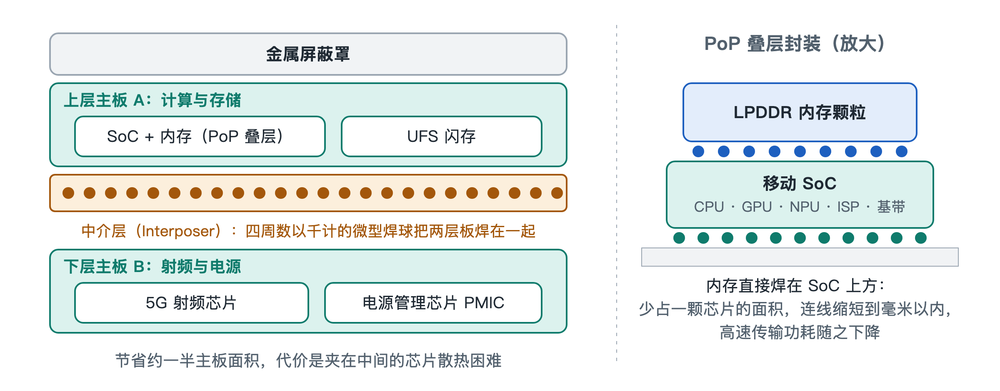

# 2.1 双层堆叠主板（Logic Board）与微型化封装技术

拧下底部螺丝、撬开后盖，再取下覆盖在电路上的几块金属盖板，手机内部最核心的部件就露出来了：一块轮廓弯弯折折、形状很不规则的板子。它就是手机主板，英文常称 Logic Board（逻辑板）。它没有电脑主板那样规整的矩形外形，而是被电池、摄像头模组和扬声器挤成了"见缝插针"的样子。更值得注意的是，这块板子往往不止一层，而是像汉堡一样上下叠在一起。



## 2.1.1 从"摊大饼"到"盖楼房"

我们可以把主板想象成一座城市。早年的功能机，主板面积宽裕，芯片像平房一样平铺在一块电路板上，道路宽敞，彼此也不拥挤。到了智能手机时代，机身越来越薄，电池越来越大，摄像头越来越多，留给主板的地盘被不断压缩，需要安放的芯片却一年比一年多：处理器、内存、闪存、5G 射频、电源管理……平铺已经放不下了。

工程师的办法和城市规划者一样：地不够，就往上盖楼。于是出现了双层堆叠主板（Stacked Logic Board），业内常形象地叫它"汉堡主板"或"三明治主板"。它的基本结构可以用下面的剖面示意来理解：

```
┌──────────────────────────────────────────────┐
│        现代手机双层堆叠主板架构剖面          │
├──────────────────────────────────────────────┤
│ 上层主板 A（计算与存储）                      │
│  [移动 SoC 核心 + 内存堆叠]   [UFS 闪存颗粒]  │
│ ════════════════════════════════════════════ │
│        ▼            ▼            ▼           │
│   ●●● 中间连接框（Interposer）●●●            │
│ 四周数以千计的微型焊球，中间形成封闭空腔      │
│        ▲            ▲            ▲           │
│ ════════════════════════════════════════════ │
│ 下层主板 B（射频与电源）                      │
│  [5G 射频前端芯片群]        [PMIC 供电芯片]   │
└──────────────────────────────────────────────┘
```

这三层各有分工：

- **上层主板（A 板）**：安放计算与存储的核心——移动系统级芯片（SoC, System on Chip）及叠在它上面的内存，还有存放照片、应用的 UFS（通用闪存存储，Universal Flash Storage）闪存颗粒。
- **下层主板（B 板）**：承载 5G 射频前端芯片群和电源管理单元（PMIC, Power Management IC）。这两类芯片工作时发热都不小。
- **中间连接框（Interposer，中介层）**：一圈环形的"框子"夹在上下两板之间，框的上下表面布满数以千计的微小焊球，把两块板直接焊死、熔合成一个整体。电信号就沿着这些焊球在上下层之间穿梭。

这种结构属于球栅阵列（BGA, Ball Grid Array）式连接：不再用细长的引脚，而是用排成阵列的小锡球实现密集互连。焊好之后，环形中介层的中间留出一块封闭空腔，上下两板朝内一侧的芯片就"藏"在这个空腔里。

## 2.1.2 SLP：把电路"画"得像芯片一样细

光会叠层还不够，每一层板子本身也必须更密。普通电路板（PCB, Printed Circuit Board）的走线较粗，放在今天的手机里显得太"占地方"。于是手机主板普遍采用类载板（SLP, Substrate-like PCB）工艺。

所谓"类载板"，意思是它的精细程度接近芯片封装用的载板。在这种工艺下，走线的线宽与线间距被压缩到 30 微米以下。作个对照：一根头发的直径大约几十微米，也就是说，主板上的铜线比头发丝还细，而且一根挨着一根，间隙同样窄。

不仅横向密，纵向也深。一块指甲盖到名片大小的主板，内部可以叠压超过 10 层导电线路，层与层之间靠微小的孔洞相连，形成一张立体的高密度互联网络。如果说普通电路板是一张平面城市地图，SLP 主板更像一座拥有多层地下通道和高架桥的立体城市。

## 2.1.3 省下一半地盘，代价是散热

双层堆叠带来的好处直截了当：与把所有芯片平铺相比，它大约节约了一半的主板面积。省下来的空间可以让给电池，带来更长的续航；也可以让给更大的摄像头模组，或者让机身更薄。

但工程上没有免费的午餐。回看剖面图就会发现，上下两块板夹住的那个空腔几乎是密闭的：藏在里面的芯片被四周的焊环和上下的电路板包围，热量很难直接散到外面。而下层恰好放着本身就发热不小的射频芯片和电源管理芯片。这就像把两间开着暖气的屋子上下摞在一起，中间还封了窗户——楼是省地了，屋里却更闷。

这种"空间换热量"的取舍，是理解手机设计的一条主线。后面讲到散热屏蔽、温度墙与热节流时，读者会一再看到它的影子。下面这张表概括了双层主板的利与弊：

| 维度 | 双层堆叠主板的做法 | 带来的结果 |
|---|---|---|
| 面积 | 上下两板叠合 | 约节省一半主板面积 |
| 布线密度 | SLP 工艺，线宽/间距 30 μm 以下 | 小面积内实现超 10 层高密度互联 |
| 层间连接 | 环形中介层，数以千计的微米级焊球 | 上下板电气相通、结构牢固 |
| 功能分区 | A 板计算存储，B 板射频与电源 | 模块清晰，便于布局 |
| 代价 | 中间形成封闭空腔 | 夹层芯片散热困难，维修难度加大 |

## 2.1.4 谁在制造这块"芯片城市"

这样精密的板子，背后是一条专业化的产业链。高端类载板的制造商主要有中国台湾的欣兴电子、华通电脑、鹏鼎控股，奥地利的奥特斯（AT&S），以及中国大陆的深南电路。它们负责把细如发丝的线路一层层做出来。

板子做好、芯片焊上之后，还要和屏幕、电池、摄像头等部件组装成整机。这一环由富士康、立讯精密、比亚迪电子、和硕等精密代工企业承担。于是，一块手掌里的主板，往往凝结了跨越多个国家和地区的分工协作——这一点，我们会在本章最后一节的供应链总览中展开。

## 2.1.5 小结

手机主板之所以长成"汉堡"的样子，是空间压力逼出来的：SLP 工艺让每一层更密，中介层焊环让两层合为一体，最终在极小面积里塞下整部手机的计算、存储、通信与供电核心，同时也留下了散热这道难题。主板上最核心的那颗芯片——SoC，又用一种类似的"叠罗汉"方式与内存堆在一起，这正是下一节要拆开的对象。
