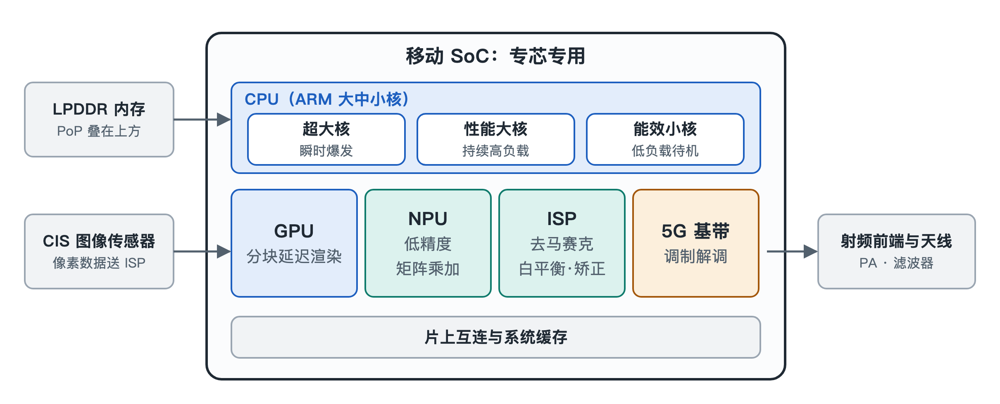

# 3.1 移动 SoC 的异构算力矩阵：专芯专用的能效哲学

打开手机，点开相机，对准窗外按下快门，再顺手刷两下短视频。这几秒钟里，你可能以为手机里有一颗“处理器”在埋头苦干。实际上，在指甲盖大小的系统级芯片（System on Chip，SoC）内部，并不存在一个包揽一切的“全能处理器”。真正干活的是一支分工明确的队伍：有人负责瞬间冲刺，有人负责长跑，有人专门画图，有人专门算矩阵，有人专门处理光信号。操作系统的调度器像一位调度员，根据每一项任务的性质，把它派给最合适的引擎，用尽可能少的电量把事情办完。

这种“不同类型的计算单元协同工作”的做法，称为异构计算（Heterogeneous Computing）。本节就来认识这支队伍的四类主力：CPU、GPU、NPU 和 ISP。

## 3.1.1 为什么不造一颗“超级全能芯”？

先想一个生活中的类比。一家医院不会只雇一位“全科神医”来处理所有病人，而是设急诊、内科、放射科、检验科。急诊医生反应快，检验科的仪器能批量化验，放射科的设备只拍片子却拍得又快又准。各科室各司其职，整家医院的效率反而最高。

手机面对的约束比医院更苛刻：电池容量有限，机身密闭散热困难，用户又要求随时响应。通用处理器什么都能算，但做专门任务时往往“大材小用”，需要执行大量指令、频繁搬运数据，既慢又费电。专用电路则把某类固定运算直接“刻”进硬件，同样的工作耗电少得多。所以移动 SoC 的设计哲学可以概括为四个字：**专芯专用**。

## 3.1.2 CPU：大中小核的接力跑

中央处理器（Central Processing Unit，CPU）是整个系统的“总指挥”，负责运行操作系统和应用程序的主体逻辑。现代手机 CPU 通常把不同能力的核心组合在一起，形成三档梯队：

- **超大核**（如 Arm 的 Cortex-X 系列）：负责瞬时爆发。你点开一个应用、它从零开始加载的那一刻（称为“冷启动”），超大核全力冲刺，力求让界面尽快出现。它性能最强，耗电也最大，只在关键时刻短暂出场。
- **性能大核**（如 A7xx 系列）：负责持续的高负载。玩一局游戏要连续几十分钟稳定输出算力，这类“耐力型”任务交给大核来扛。
- **能效小核**（如 A5xx 系列）：负责全天候的低负载工作。熄屏收消息、后台同步、播放音乐，这些轻活交给小核，功耗仅几十毫瓦。

这就像一场接力赛：短跑选手负责起跑冲刺，中长跑选手维持节奏，后勤人员整天守着营地。调度器会根据任务轻重随时调整人选，让重活不至于拖慢，轻活不至于浪费。手机能“一天一充”而不是“半天一充”，大中小核的分工功不可没。

## 3.1.3 GPU：把屏幕切成瓦片再画

图形处理器（Graphics Processing Unit，GPU）负责把游戏场景、界面动画画到屏幕上。它擅长同时处理成千上万个像素，属于典型的“人多力量大”型计算单元。

但手机 GPU 面临一个棘手问题：画面数据要在芯片和内存之间来回搬运，搬运本身就非常耗电、发热。为此，移动 GPU 普遍采用**分块延迟渲染**（Tile-Based Deferred Rendering，TBDR）机制，做法分两步：

1. **分块**：把整块屏幕切成许多微小的“瓦片”（Tile），每次只处理一小块，这一小块的数据可以放在芯片内部的高速缓存里，不必反复访问外部内存。
2. **延迟着色**：在给像素“上色”之前，先判断哪些物体被前面的物体挡住了，把看不见的像素提前剔除，只给最终可见的像素做着色计算。

打个比方：画一面墙之前，先确认墙前面会摆一个大书柜，那书柜挡住的部分就不必刷漆了。这样一来，显存带宽和发热都节省了一大截。

## 3.1.4 NPU：专攻矩阵的神经网络引擎

神经网络处理器（Neural Processing Unit，NPU）是近年 SoC 中最受关注的成员。人脸识别、语音唤醒、图像分割乃至端侧大模型，本质上都是在做海量的矩阵乘法与累加。

NPU 的特点是专门执行**低精度矩阵乘加运算**，例如 INT8、INT4 精度的通用矩阵乘法（General Matrix Multiply，GEMM）。所谓 INT8、INT4，是用 8 位或 4 位整数来表示数值，比常规的高精度浮点数“粗糙”一些，但神经网络对这种粗糙往往并不敏感，换来的却是电路更小、速度更快、耗电更少。

正因如此，NPU 能以极高的能效比，在本地毫秒级完成人脸解锁时的特征比对，也能支撑端侧大模型推理。数据留在手机里处理，既快速，也减少了上传云端带来的隐私顾虑。

## 3.1.5 ISP：光信号的硬件流水线

图像信号处理器（Image Signal Processor，ISP）是相机背后的“暗房”。图像传感器输出的原始数据还不是我们看到的照片，需要经过一系列加工。ISP 用固定的硬件流水线，以纳秒级的速度依次完成：

- **去马赛克**：传感器每个像素只记录一种颜色，需要推算还原出完整色彩；
- **坏点校正**：修补个别失灵的像素；
- **自动白平衡**：让白色在不同光源下仍然呈现白色；
- **镜头畸变矫正**：把边缘弯曲的线条拉直。

在此基础上，ISP 还会与 NPU 协同，完成计算摄影中的**多帧 HDR 合成**——把多张不同曝光的照片融合成一张亮部不过曝、暗部有细节的成片。按下快门的一瞬间，这条流水线已经跑完了一整套工序。

## 3.1.6 四类引擎一览

| 计算单元 | 英文缩写 | 擅长的任务 | 关键机制 | 能效思路 |
|---|---|---|---|---|
| 中央处理器 | CPU | 系统逻辑、应用运行 | 超大核/大核/小核分级 | 轻重任务分派给不同核心 |
| 图形处理器 | GPU | 游戏画面、界面渲染 | 分块延迟渲染（TBDR） | 减少显存搬运，剔除不可见像素 |
| 神经网络处理器 | NPU | 人脸识别、端侧大模型 | INT8/INT4 矩阵乘加 | 低精度换取高能效 |
| 图像信号处理器 | ISP | 照片与视频处理 | 硬件流水线 | 固定工序硬件化，协同 NPU |

## 3.1.7 小结

移动 SoC 的强大，不在于某一个单元无所不能，而在于“让合适的单元做合适的事”。CPU 分级接力，GPU 精打细算，NPU 专攻矩阵，ISP 流水作业，再由操作系统调度器统一指挥，才在有限电量和狭小空间里实现了流畅体验。理解了这支队伍，再看发布会上“AI 算力”“图形性能”等参数，就能知道它们各自对应的是哪一位“队员”。下一节，我们将跟随光线进入相机模组，看看光子如何一步步变成数字像素。
