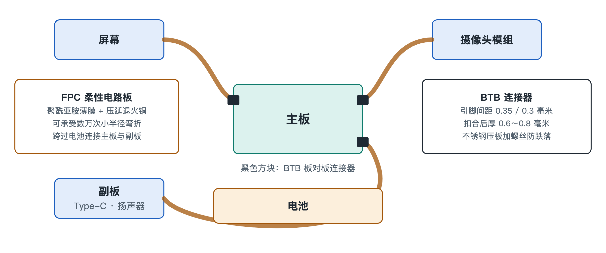

# 4.2 柔性电路板（FPC 软板）：机身夹缝中的立体神经血管

把手机翻过来，隔着后盖想象一下内部：主板是一块坚硬的"城市中心"，而摄像头蹲在机身上角，按键贴在侧边框，扬声器藏在底部，屏幕覆盖整个正面，电池则像一块厚实的砖头横亘在中间。这些部件散落各处，彼此之间隔着高低落差、转角和缝隙。是谁把它们连成一个整体？答案是一条条薄如纸片、金黄或橙褐色的软带，即柔性印制电路板（Flexible Printed Circuit，简称 FPC，俗称"软板"）。

如果说主板是手机的大脑与心脏，FPC 就是遍布全身的神经和血管。它既传递信号，也输送电能，而且必须在狭窄的夹缝里拐弯、折叠、绕行。

## 4.2.1 为什么硬板走不通

普通电路板（硬板）以玻璃纤维加树脂为基材，结实但不能弯。在一部厚度不足一厘米的手机里，各个模块的高度、位置都不在同一平面上：屏幕在最上层，主板在中层，电池在旁侧，摄像头还会凸出机身。如果只用硬板和导线连接，要么占用大量空间，要么在装配和使用中被反复拉扯而断裂。

FPC 的思路是把电路"印"在一层柔软的薄膜上，让线路本身可以像布料一样弯折。这样，一条软板就能从主板出发，翻过电池的边缘，沿着中框内壁爬到摄像头背后，全程贴合结构，几乎不额外占据体积。

## 4.2.2 两种关键材料：聚酰亚胺与压延铜

一条合格的手机软板，核心在于两种材料的配合。

### 4.2.2.1 聚酰亚胺薄膜（Polyimide Film，简称 PI 膜）

PI 膜是 FPC 的"皮肤"和骨架，充当绝缘基材。它有两个突出特点：一是耐高温，能承受约 300℃ 的高温，这意味着在回流焊（把元件焊到电路板上的高温工序）时不会变形、起泡；二是极其坚韧，薄薄一层就能反复弯折而不开裂。日常生活中，很难找到一种塑料能同时做到"不怕烫"和"折不坏"，这正是 PI 被选中的原因。

### 4.2.2.2 压延退火铜（Rolled Annealed Copper，简称 RA 铜）

导线用的铜也有讲究。铜箔常见的制造方式有两种：一种是电解沉积，铜原子像下雪一样一层层堆积，晶粒呈竖直的柱状；另一种是压延，把铜锭反复轧制、再经过退火（加热后缓慢冷却以消除内应力），使晶粒沿横向被拉长、铺展开来。

可以用一个类比来理解两者的差别：电解铜的晶粒像一排排竖着插的筷子，横向一弯，筷子之间的缝隙就容易裂开；压延退火铜的晶粒像顺着方向铺平的面条，弯折时能整体跟着延展。因此，RA 铜更适合需要反复弯折的部位，配合 PI 膜，能承受数万次小半径弯折而不断裂。

| 对比项 | 普通硬板 | FPC 软板 |
|---|---|---|
| 基材 | 玻璃纤维 + 树脂 | 聚酰亚胺薄膜（PI 膜） |
| 导体 | 常规铜箔 | 压延退火铜（RA 铜） |
| 可弯折性 | 基本不可弯 | 可承受数万次小半径弯折 |
| 典型用途 | 承载芯片的主板 | 跨区连接屏幕、摄像头、按键、电池等 |

## 4.2.3 跨越电池：连接主板与副板

许多手机采用"主板 + 副板"的布局：主板位于机身上部，承载 SoC 等核心芯片；副板位于底部，负责充电接口、扬声器、麦克风等。两者之间横着一块厚重的电池包。

连接上下两块电路板的任务，就交给一条长长的 FPC。它从电池一侧贴着边框穿过，或从电池下方压过，把充电电流、音频信号、射频信号等一并送达。这条软板既要足够薄，不挤占电池的空间；又要足够可靠，承受装配时的折弯和日常使用中机身的轻微形变。拆过手机的人常常会注意到，这条"排线"是开机后必须首先断开或最后连接的部件之一，足见它在系统中的枢纽地位。

## 4.2.4 托起悬浮的镜片：潜望长焦里的软板

FPC 最精巧的用法之一出现在潜望式长焦摄像头中。为了实现对焦和防抖，镜片组需要由微型马达驱动，悬浮在磁场中做细微而快速的移动。问题在于：镜片模组本身也要通电、传信号，必须连着线。

如果连线太硬，它就会像一根拽着气球的绳子，拉住镜片，干扰马达的精确定位。FPC 在这里的要求是极低的机械回弹力——弯曲后几乎不产生"往回弹"的反作用力。这样，马达推动镜片时，软板只是柔顺地跟随，不施加多余的拉扯，从而保证镜片能以微秒级的响应保持悬浮和稳定。换句话说，这里的软板不仅是导线，更是机械系统的一部分，它的柔软程度直接影响拍照是否清晰。

## 4.2.5 看不见的设计约束

FPC 的设计并不只是"做软一点"那么简单，工程师需要同时权衡几件事：

- **弯折半径**：弯得越急，铜线承受的应力越大，必须在空间和寿命之间取舍；
- **固定与走向**：软板要用胶贴、卡扣定位，避免在跌落或振动中摩擦磨损；
- **信号完整性**：传输屏幕、摄像头等高速数据时，线路宽度、间距和屏蔽层都要精心设计，防止干扰；
- **装配顺序**：软板往往需要先折叠再扣合，决定了整机的组装流程。

## 4.2.6 小结

FPC 用耐高温、极坚韧的聚酰亚胺薄膜作身体，用晶粒横向延展的压延退火铜作导线，让电路第一次拥有了"可弯折"的形态。它跨越电池连接主副板，绕过边框抵达摄像头与按键，甚至以近乎无阻力的柔顺托起悬浮的镜片，把散落在机身各处的模块缝合成一个整体。不过，软板最终总要"插"到主板上，这个插接点既要极小、又要牢靠，下一节将走近这道物理关卡——微型板对板（BTB）连接器。
