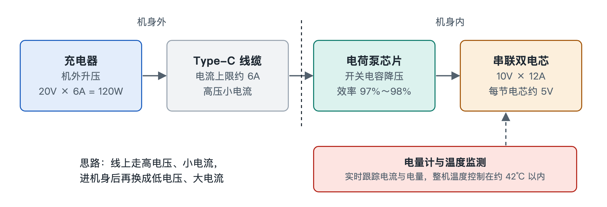

# 5.2 极致的能量阶梯：百瓦超级闪充与电荷泵直充

拿起你的充电器看看，外壳上通常印着一排细小的输出参数，比如“5V⎓3A”“10V⎓…”“20V⎓6A”。再看看手机底部那个小小的 Type-C 接口，它只有指甲盖宽，里面的金属触点细如发丝。百瓦级的能量要在几十分钟内灌进一块电池，必须先挤过这个接口，再穿过一段线缆。本节沿着电能的路径，从插座一直跟到电芯内部，看看这一级一级的“能量阶梯”是怎样设计的。

## 5.2.1 瓶颈在哪里：接口扛不住大电流

电功率等于电压乘以电流（P = U × I）。想得到 120W，可以用 5V 配 24A，也可以用 20V 配 6A。两组数字相乘结果一样，对线缆和接口的考验却差别很大。

原因在于导体发热。电流流过有电阻的导线和触点，产生的热量与电流的平方成正比（Q ∝ I²R）。电流翻一倍，发热就变成四倍。Type-C 接口和常规线缆的触点面积有限，按照规范，它能安全承载的电流上限大约是 **6A**。超过这个值，接口和线材会明显发烫，触点还可能氧化甚至烧蚀。

所以第一条设计原则是：**在机身外部，用高电压、小电流来传输。**

## 5.2.2 第一级台阶：充电器把电压抬到 20V

可以把电能想成水流。电压相当于水压，电流相当于流量。水管口径固定时，要送更多的水，就加大水压，不必加粗水管。

充电器就是负责加压的那台“水泵”。它把市电转换成 **20V/6A** 的直流电，正好是 120W。这时线缆和接口里的电流被压在 6A 的规范红线以内，传输段的发热因此可控。

不过电池不能直接接受 20V。锂电池对充电电压的要求很严格，超出一点就可能引发安全风险。高压送进了手机，还需要在机身内部降下来。

## 5.2.3 第二级台阶：电荷泵把电压“对折”

传统做法是在手机里放一颗电感式降压芯片。这类芯片的转换效率不算低，但损失的那部分能量会全部变成热，留在本来就拥挤的机身里。百瓦级功率下，哪怕只损失几个百分点，也是一个不小的“暖手宝”。

快充方案因此改用 **电荷泵（Charge Pump）** 芯片。它基于 **开关电容（Switched Capacitor）** 原理，可以用一个生活场景来理解：

> 有两只相同的水桶。先把它们像积木一样上下叠起来串联，从高处接满水；再把它们并排摆开并联，一起往外倒。水的“高度”减半，同时倒出来的总流量翻倍。

芯片内部的开关以很高的频率重复这个动作，让电容在“串联充电”和“并联放电”之间来回切换，实现 **2:1** 的电压变换：

| 位置 | 电压 | 电流 | 功率 |
|---|---|---|---|
| 线缆与接口（电荷泵输入） | 20V | 6A | 120W |
| 电荷泵输出（进入电池） | 10V | 12A | 约 120W |

这里的关键是效率。电荷泵主要靠电容和开关搬运电荷，不依赖电感的磁能转换，转换效率可以超过 **97%~98%**。损耗越小，留在机身里的热量就越少。大电流只在电荷泵到电池之间很短的一段路径上流动，这段铜箔走线又短又宽，电阻很小，发热也随之被控制住。

这种电压只做比例变换、几乎直接灌入电池的方式，常被称为 **直充**。

## 5.2.4 第三级台阶：双电芯串联分担电压

10V 仍然高于单个锂电芯能承受的范围。解决办法是把电池拆成两只电芯，**串联** 成一个电池组。

串联电路中，两只电芯流过同样的电流，电池组的电压是两只电芯电压之和。两只电芯串联后，电池组充满时约 8.8～9V，每只电芯仍不超过各自的充电上限（约 4.4～4.5V）；电荷泵的输出电压也会跟着电池组当前的电压调整，而不是固定死在 10V。打个比方，一个人扛不动的担子，两个人一前一后抬着就稳当了。

与单电芯方案相比，双电芯串联还有一个好处：同样的充电功率下，每只电芯承受的负担减轻，内部发热也更均匀。代价是电池管理变得复杂，两只电芯必须保持一致，不能一只充满了另一只还空着。

## 5.2.5 看不见的守门人：库仑计与分流电阻

高速充电的过程中，系统需要一直清楚“灌进去多少电、电池现在多热”。这项工作由两个器件配合完成：

- **库仑计（Coulomb Counter）芯片**：库仑是电荷量的单位。这颗芯片对流入和流出电池的电流做持续累计，好比给电池装了一块精确的“水表”，由此推算剩余电量，也就是屏幕上显示的百分比。
- **双向分流电阻（Shunt Resistor）**：一枚阻值极小的精密电阻，串在电池回路中。电流流过时在它两端形成微小的电压差，芯片测出这个电压差就能换算出电流。“双向”的意思是充电和放电两个方向都能测。

这些数据会实时反馈给充电管理系统。一旦温度逼近设定上限，系统会主动降低充电功率。整套方案的目标是把电池温度控制在约 **45℃** 的上限之内（具体数值各厂商不同）。这也是很多手机电量充到较高时速度明显放缓的原因之一：系统在主动给电池和机身降温。

## 5.2.6 小结：一条四级能量阶梯

把整个过程串起来，就是一条清晰的链路：

1. **充电器升压**：20V/6A，绕开接口的电流瓶颈；
2. **电荷泵对折**：高效率转换为 10V/12A，把热损耗压到最低；
3. **双电芯串联**：每只电芯不超过约 4.4～4.5V 的充电上限，保证电化学安全；
4. **计量与温控**：库仑计和分流电阻实时监测，守住约 45℃ 的电池温度上限。

发布会上的“百瓦闪充”，背后是电压、电流、发热三者之间的一连串权衡。能量在机身里奔流的同时，光子也在另一条路径上高速转化，下一节我们转向按下快门的那一瞬间。
