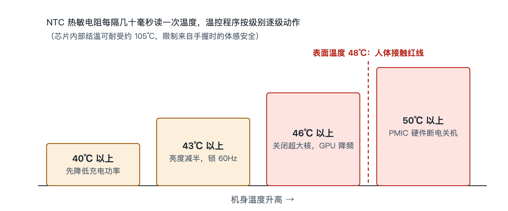

# 6.2 温度墙与热节流（Thermal Throttling）：密闭空间的自保艺术

夏天在阳光下打开导航，同时插着充电线，再开一局大型游戏，过不了多久，你会注意到一连串变化：充电速度明显变慢，屏幕自己暗了下来，画面不再像刚开始那样顺滑，严重时甚至弹出“手机温度过高”的提示。这些变化并不是故障，是手机在按预先写好的规则保护自己。工程上把这套规则称为热节流（Thermal Throttling），触发它的温度门槛叫作“温度墙”。

## 6.2.1 两条红线：芯片能扛多热，手能握多热

理解温控，先要分清两个温度。

第一个是**芯片结温**，也就是芯片内部晶体管所在区域的温度。硅芯片的耐热能力比人们想象的强，内部结温可以耐受到 105℃ 左右。仅从芯片本身看，它还有不少余量。

第二个是**人体触感温度**，也就是机身外壳贴着手掌、脸颊时的温度。智能手机要长时间握在手里、贴在耳边，皮肤长时间接触过热的表面会造成低温烫伤。所以安全标准对可触摸表面的温度有限制，限值按材料和接触时间分档；厂商通常把长时间手持的表面温度控制在 40 多摄氏度。

两条红线中间隔着将近 60℃。真正卡住手机性能的，往往不是芯片的承受极限，而是人手的承受极限。可以打个比方：汽车发动机内部能承受很高的温度，但驾驶舱必须让乘客舒适。手机没有风扇，也没有进风口，它是一个密闭的玻璃金属盒子，热量只能靠导热材料和外壳慢慢散出去。芯片一旦持续满负荷，外壳温度迟早会逼近人体红线，系统只能主动减少发热。

## 6.2.2 遍布主板的“温度哨兵”

要控制温度，先得知道温度。手机主板上分布着一组 **NTC 热敏电阻**。NTC 是 Negative Temperature Coefficient 的缩写，意为“负温度系数”：温度越高，它的电阻值越低。电路测出它的电阻，就能换算出所在位置的温度。

这些热敏电阻不会只放一个，而是组成阵列，分别靠近 SoC、电池、充电芯片、摄像头模组等主要热源。系统**每隔几十毫秒**读取一次各点温度，相当于在机身里布了一圈哨兵，随时上报哪里在升温、升得多快。

负责汇总这些数据并做决策的，是操作系统中的**温控守护进程**。“守护进程”指在后台持续运行、不直接和用户交互的系统程序。它不处理照片，也不加载游戏，只盯着温度表，按规则下达降温指令。

## 6.2.3 四级阶梯：先砍最不影响体验的

温控守护进程不会一发现升温就全面降速，而是按一套**固定的级联梯级**逐级执行，越往上越严厉：

| 温度阈值 | 采取的措施 | 你能感受到的变化 |
|---|---|---|
| 超过 40℃（示意） | 优先降低充电功率 | 充电变慢，电量上涨速度下降 |
| 超过 43℃ | 屏幕亮度强制减半，刷新率锁定 60Hz | 屏幕变暗，滑动不如高刷顺滑 |
| 超过 46℃ | 关闭超大核，GPU 降频 | 游戏掉帧，应用响应变慢 |
| 超过 50℃ | PMIC 触发硬件断电关机 | 手机直接关机 |

这个顺序体现了一种取舍：**先牺牲用户最不容易察觉的，再牺牲用户感受最明显的。**

**第一级，砍充电。**充电时，电池内部的化学反应和充电芯片的能量转换都会发热，快充时更明显。降低充电功率，只是让充满时间变长，不会打断你正在做的事，代价最小。而且电池本身怕热，高温下大电流充电会加速老化，这一步同时保护了电池。

**第二级，压屏幕。**屏幕是手机里面积最大、持续耗电的部件之一，高亮度和高刷新率都意味着更多功耗。把亮度减半、刷新率锁到 60Hz，你会觉得屏幕暗了、没那么丝滑，但内容仍然能看、操作仍然能用。

**第三级，动算力。**到 46℃，前两步已经压不住，系统开始直接限制计算核心：关闭发热最大的超大核，让 GPU（图形处理器）降低频率。这一步对游戏玩家最明显，画面帧率下降，出现卡顿。上一节讲到的 EAS 调度会配合这一步，把任务转移到更省电的核心上。

**第四级，断电。**若温度仍然冲过 50℃，说明软件手段已经失效，可能是环境极端或存在异常。这时由 **PMIC**（Power Management IC，电源管理芯片）在硬件层面直接切断供电，强制关机。这一步不依赖操作系统，即使软件卡死，硬件保护也能动作，是最后一道保险。

## 6.2.4 为什么要“分级”而不是“一刀切”

如果设计者偷懒，只设一个阈值，超过就全面降速，用户会经历“满血”和“残血”之间的突然切换，体验很差。分级阶梯的好处在于：

- **渐进**：温度小幅上升时只做轻微调整，多数时候用户察觉不到；
- **对症**：先处理充电、屏幕这类可以让步的负载，尽量保住核心任务；
- **兜底**：软件层层退让之后，还有硬件断电作为最终保护。

这也解释了一个常见现象：同一款手机，新机评测时跑分很高，长时间游戏后帧率却下滑。发布会上的峰值性能，是温度墙之下的短时表现；能持续多久，取决于散热设计和温控策略。看懂这一点，就能更理性地理解“满帧”“持续性能”这类宣传。

## 6.2.5 小结

热节流不是性能缺陷，而是手机在没有风扇的密闭空间里做出的工程选择：芯片能耐受 105℃，但必须服从人手能长时间触摸的温度上限。NTC 热敏电阻负责感知，温控守护进程负责决策，（以示意的）40℃、43℃、46℃、50℃ 四级阶梯从充电、屏幕、算力一路退到硬件断电。下次手机变暗、变慢时，你可以判断它正处在哪一级。温度只是手机感知的物理量之一，下一节将看到，系统如何把加速度、角速度、磁场等多路传感器信号融合在一起，得到可靠的结果。
