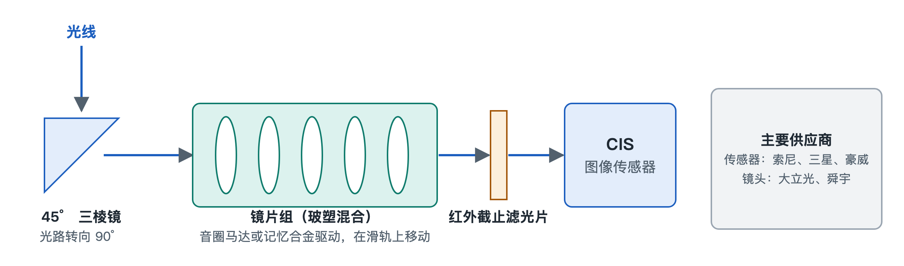

# 7.2 摄像头模组实物解剖与产业图谱

翻过手机，背面那块凸起的摄像头区域，往往是整部机器上最显眼的部位。几颗圆形镜头排在一起，有的旁边还有一个方形的“窗口”。它们看起来只是几块玻璃，拆开后却各自连着一整条精密的光学与半导体链条。本节先按光线走过的路线拆开一个潜望长焦模组，再看感光芯片和镜头背后由哪些企业撑起。

## 7.2.1 方形窗口里的秘密：潜望长焦模组的四段光路

长焦镜头要把远处的景物“拉近”，需要较长的焦距。焦距可以粗略理解为镜片到感光面之间需要的光学距离。手机机身厚度不足一厘米，镜头如果直直地朝里排，根本放不下。工程师的办法是让光线拐弯，这就是潜望式（Periscope）结构的由来。它和潜水艇的潜望镜道理相同，都是用一块反射元件把光路转个方向。

一束光从进入方形窗口到变成电信号，要依次经过四个部件：

1. **45° 转向三棱镜**：光线从机身背面垂直射入，碰到斜放 45° 的棱镜后被折转 90°，改为沿机身长边方向横着走。原本需要“竖着”占用的长度，就这样被放平到机身内部更宽裕的方向上。
2. **悬浮镜片组**：横向传播的光穿过一组镜片完成对焦。这组镜片并不固定，而是安装在微型滑轨上，由马达推动前后移动。常见的驱动方式有两种：一种是**音圈马达**（Voice Coil Motor，VCM），利用线圈通电后在磁场中受力的原理推动镜片，和扬声器振膜的发声原理相近；另一种是**形状记忆合金**（Shape Memory Alloy，SMA），这种金属丝受热后会收缩回预设长度，通过控制电流加热，就能精确地拉动镜片。
3. **红外截止滤光片**（IR-cut Filter）：感光芯片对人眼看不见的红外光也会产生反应。如果不过滤，照片会偏色、发灰。这片薄玻璃的作用是只让可见光通过。
4. **CMOS 图像传感器**（CMOS Image Sensor，CIS）：光路的终点。这块芯片表面排布着数以千万计的像素，负责把光子转换成电荷，再变成数字信号，交给后面的图像信号处理器。

这四段部件的配合可以用“取景—转向—聚焦—过滤—记录”来概括：

| 部件 | 光路中的角色 | 生活类比 |
|---|---|---|
| 45° 转向三棱镜 | 把垂直入射光折转 90° | 楼道拐角处的反光镜 |
| SMA / VCM 悬浮镜片组 | 移动镜片完成对焦与防抖 | 望远镜上调焦的旋钮 |
| 红外截止滤光片 | 滤除红外光，保证色彩准确 | 墨镜挡掉刺眼的成分 |
| CIS 图像传感器 | 把光信号转为电信号 | 胶片相机里的底片 |

## 7.2.2 感光芯片三巨头：各自押注的技术路线

决定画质上限的核心是 CIS。目前这个领域有三家代表性厂商，它们选择了不同的技术方向。

**索尼半导体（LYTIA 品牌）**的代表作是 1 英寸的 LYT-900。它是堆栈式传感器，大尺寸感光面积带来更多进光量。索尼在堆栈式传感器上的一项代表性技术是 2021 年发布的**双层晶体管像素**。传统传感器里，负责收光的光电二极管和负责读出信号的晶体管挤在同一层硅片上，相互争夺面积。索尼把两者分别制作在两片晶圆上，再上下垂直键合在一起。可以把它想成一栋楼：原来商铺和仓库挤在同一层，现在仓库搬到楼下，楼上整层都用来“接光”。光电二极管有了更大的空间，能容纳的电荷更多，按索尼的说法饱和信号量约提高一倍，动态范围随之扩大。动态范围指的是同一画面中同时记录亮部和暗部细节的能力，逆光拍人时脸不发黑、天空不过曝，靠的就是它。

**三星半导体（ISOCELL 品牌）**走的是超高像素路线，代表产品是 2 亿像素的 HP2。像素数量多，单个像素就必然很小，暗光下每个像素收到的光很少。三星的对策是**十六合一像素重排**：光线不足时，把相邻 16 个小像素合并当作一个大像素使用，以牺牲分辨率换取进光量；光线充足时，再拆开输出全像素的高清细节。这套方法类似一支球队，平时 16 个人各守一块位置，遇到强敌时抱成一团集中防守。

**豪威科技（OmniVision）**的代表产品是 OV50H 和 OV50K，首创了 **LOFIC 超高动态技术**。LOFIC 的全称是 Lateral Overflow Integration Capacitor，意为横向溢出积分电容。强光下，光电二极管很快就会被电荷“灌满”，多出来的电荷会丢失，画面亮部变成一片死白。LOFIC 在像素旁边加了一个电容，专门接住溢出的电荷，就像在水杯旁边加了一个溢水盆，满出来的水不会白白流走。这样，亮部细节也能被保留下来。

| 厂商 | 品牌 / 代表产品 | 核心技术 | 主要解决的问题 |
|---|---|---|---|
| 索尼半导体 | LYTIA / 1 英寸 LYT-900 | 1 英寸堆栈式；索尼另有双层晶体管像素技术 | 进光量与动态范围 |
| 三星半导体 | ISOCELL / 2 亿像素 HP2 | 十六合一像素重排 | 高像素与暗光进光量兼顾 |
| 豪威科技 | OmniVision / OV50H、OV50K | LOFIC 横向溢出电容 | 强光下亮部不过曝 |

读发布会参数时，“1 英寸大底”“2 亿像素”“超高动态”这三类说法，往往分别对应上述三条路线。它们之间没有简单的优劣，各自在面积、像素数量和电荷容量上做了不同的取舍。

## 7.2.3 镜头里的“玻璃+塑料”：1G+6P 玻塑混合

传感器前方的镜头由多片微型镜片叠成。手机镜片多数是精密注塑成型的塑料（Plastic，简写 P），轻巧，成本低，可以做成复杂的非球面形状；玻璃（Glass，简写 G）透光性好，受温度影响小，但加工难度大。**1G+6P** 的意思是用 1 片玻璃镜片加 6 片塑料镜片组合成一个镜头，用一片玻璃补足塑料在色散和稳定性上的短板，同时保留塑料轻薄的优势。

这种直径只有几毫米、要求极高精度的玻塑混合镜头，制造被**大立光**与**舜宇光学**牢牢掌握。镜片的面形误差和多片之间的对位精度，直接决定照片是否锐利，这正是少数厂商能长期占据这一环节的原因。

## 7.2.4 小结

一个摄像头模组，从外到内串起了光学设计、精密机械、材料科学和半导体工艺：棱镜解决空间问题，马达解决对焦问题，滤光片解决色彩问题，CIS 解决光电转换问题，玻塑镜头解决成像锐度问题。每一环背后都有专门的厂商。下一节将转向手机正面那块面积最大的部件，看看柔性屏幕与盖板玻璃遵循着怎样的标准。
