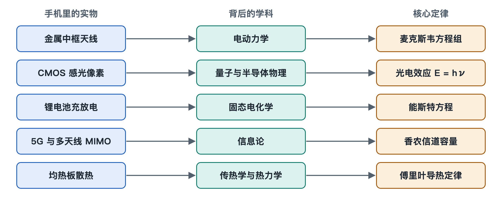

# 8.5 智能手机实物与基础学科理论映射全景

把手机翻过来，背面朝上放在桌上。金属中框上那几道细细的塑料缝，镜头模组里一块指甲盖大小的感光芯片，玻璃后盖下面一块扁平的电池，主板上一枚负责 5G 的基带芯片，还有紧贴处理器的一片薄薄的金属散热板，这些部件都看得见、摸得着。本章前四节分别沿着其中四条线索，一直追到教科书里的方程。这一节把四条线索收拢，再补上散热这一条，画成一张完整的映射图。读者往后再看到手机上的某个现象，就能找到它对应的学科、定理和奠基人。

## 8.5.1 一张表：从零件到定律

下表按“实物或现象—学科—核心定理或模型—代表人物”四列排列。每一行都可以当作一条从手机内部通往基础科学的路径来读。

| 手机内部实体元器件 / 关键现象 | 背后支撑的学科领域 | 核心物理定理 / 数学模型 | 最具代表性的科学奠基人 |
|---|---|---|---|
| 金属中框天线、高频射频发射 | 经典电动力学 / 射频工程 | 麦克斯韦方程组（电磁波辐射）、波动方程 | 詹姆斯·麦克斯韦、赫兹 |
| CMOS 感光二极管、夜景噪点 | 量子力学 / 半导体物理 | 爱因斯坦光电效应（E=hν）、泊松散粒噪声 | 普朗克、爱因斯坦、肖克利 |
| 锂离子电池充放电、快充析锂 | 物理化学 / 固态电化学 | 能斯特方程（平衡电势）、阿伦尼乌斯扩散定律 | 能斯特、阿伦尼乌斯、古迪纳夫 |
| 5G 高速通信、MIMO 多天线 | 信息论 / 矩阵代数与统计学 | 香农信道容量公式、空间信道矩阵奇异值分解 | 克劳德·香农、奈奎斯特 |
| 均热板相变散热、芯片结温 | 传热学 / 经典热力学 | 热传导傅里叶定律、相变潜热热力学平衡方程 | 傅里叶、克劳修斯 |

这张表并非随意拼凑，五行恰好对应手机最基本的五种“流动”：电磁波向外流动，光子向内流动，锂离子在正负极之间流动，信息在空间信道中流动，热量从芯片向外壳流动。第五章讲“系统脉动”时介绍过这些流动在工程上的样子，本章讲的是它们为什么必须这样流。

## 8.5.2 五条路径逐一回顾

**第一条：中框缝隙与电磁波。** 中框上的断缝把整圈金属分成几段，每一段都是一根经过精心计算的天线。麦克斯韦方程组说明，变化的电流会激发变化的磁场，变化的磁场又会激发电场，两者交替推进就形成向外传播的电磁波。波动方程决定了波长和频率的关系，因此天线长度要与工作频段匹配。频率越高，波长越短，越容易被墙体和人手削弱，所以工程师要在机身四周布置多根天线，让它们轮流接力。

**第二条：感光像素与光子。** 一个光子打进 CMOS 感光二极管，能量为 E=hν。只要能量足够，就能把一个电子激发出来，这是爱因斯坦解释过的光电效应。光子的到达本身是随机的，服从泊松分布：平均到达 N 个光子时，起伏大约是 √N。夜里光少，N 小，起伏相对更大，画面就显出噪点。“大底”和“大光圈”的作用是多收集光子，让统计起伏变得相对微小。

**第三条：电池与晶格里的离子。** 锂电池的电压由正负极材料的电化学势差决定，能斯特方程描述了电势如何随浓度和温度变化。锂离子在电极晶格中扩散的速度遵从阿伦尼乌斯规律，温度一低，扩散就呈指数式变慢。冬天电量显示还有余量却突然关机，快充时必须控制电流、防止锂在负极表面析出，都能从这里找到解释。古迪纳夫等人对正极材料的研究，奠定了今天手机电池的基础。

**第四条：多天线与信道容量。** 香农公式规定，一条信道在给定带宽和信噪比下能传输的信息有上限。5G 要提速，一是拓宽带宽，二是使用 MIMO（多输入多输出）技术，用多根天线同时收发。从数学上看，空间信道可以写成一个矩阵，对它做奇异值分解，就能把一条拥挤的通道拆成几条近似并行的“子通道”。奈奎斯特关于采样与码元速率的工作，则为数字通信的节拍定下了规矩。

**第五条：均热板与结温。** 这一条在前面各节没有单列，这里补充说明。芯片工作时，晶体管翻转会产生热量。傅里叶定律指出，热流的大小与温度梯度、材料导热能力成正比，所以要用铜、石墨这类导热好的材料把热迅速摊开。均热板内部封有少量液体：液体在热端吸热汽化，蒸汽流到冷端放热凝结，再沿毛细结构回流。相变潜热让很薄的一层金属板也能搬运大量热量。克劳修斯总结的热力学规律则提醒我们，热量只会从高温流向低温，手机散热的极限最终取决于机身与周围空气之间的温差。

## 8.5.3 为什么要画这张全景图

单看某一个零件，容易把它当成孤立的技术点。放进这张表之后，可以看出三层关系：

1. **限制来自定律，而非厂商。** 信号穿墙变弱、夜景出现噪点、低温掉电、发热降频，都受到上表中某条定律的约束。工程只能在定律允许的范围内腾挪。
2. **同一部手机在调用多个学科。** 一次视频通话，同时用到了电动力学、半导体物理、电化学、信息论和传热学，这正是“高集成”的含义。
3. **参数背后有物理量。** 发布会上的“更大底”“更快充”“更强 5G”“更好散热”，都可以翻译回光子数、离子扩散、信道容量和热流。

## 8.5.4 AI 协同接口：从实物现象逆向溯源

这张表也可以反过来用：先看到现象，再追问它属于哪一行。下面的提示词可以直接交给 AI 助手，方括号内替换成你观察到的现象。

> 我正在阅读《AI时代系统知识基础读物：智能手机》第八章关于原理溯源的内容。我观察到了手机使用中的一个具体物理现象：[输入你的具体现象，例如：为什么冬天在室外，手机电量明明还有 30% 却突然自动关机？／为什么 5G 信号隔了一堵承重墙之后衰减得比 4G 严重得多？／为什么手机镜头光圈做得越大、传感器尺寸越大，夜景噪点就越少？]。
> 请基于本章的学科溯源框架，帮我复盘其底层的科学机理：
> 1. 【核心科学定律】：该现象受制于哪一条物理学、化学或信息论定理（如阿伦尼乌斯方程、麦克斯韦方程、能斯特方程或泊松分布）？
> 2. 【微观物理推演】：请用通俗但严谨的微观物理过程，解释温度／晶格／光子／电磁波在这一瞬间发生了什么变化？
> 3. 【工程妥协方案】：现代手机工程师与算法科学家，在硬件设计或操作系统层面运用了什么手段来对抗这一物理极限？

拿到回答后，可以对照上表核对 AI 给出的学科归属是否准确，再回到本章相应小节检查推演过程。这样，AI 起的是陪练作用，最终判断仍由你自己完成。

## 8.5.5 小结

本章从四个方程出发，最后落到这一张五行的表上。它把手机内部看得见的零件，和几百年来物理、化学、信息论积累的成果连在了一起。下一章将系统介绍如何借助 AI，把这种从实物到原理的追问变成日常习惯。
