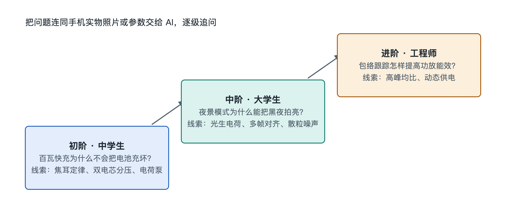

# 9.2 三阶认知进阶探索：从中学生到工程师的问题阶梯

上一节我们让 AI 认出了拆机照片里的每一颗芯片。可是“认出来”只是开始。真正有收获的学习，是带着一个好问题，让 AI 陪你一路追问下去，直到摸到原理的底层。问题提得浅，AI 的回答就停在表面。问题提得准，它就能把你领进一条完整的系统链路。

本节设计了一架三级问题阶梯，分别对应中学生、大学生和工程师三种知识背景。三道题都取自手机日常使用中最常见的现象：充电、夜拍、5G 通话。台阶越往上，涉及的物理和工程概念越深。你可以从自己所在的台阶起步，也可以把三道题连起来看，体会同一部手机在不同深度下呈现的样子。

## 9.2.1 阶梯总览：同一部手机的三种深度

| 台阶 | 读者视角 | 核心问题 | 需调用的知识 | 对应本书章节 |
|---|---|---|---|---|
| 初阶 | 中学生 | 百瓦快充为什么不会把电池充爆炸？ | 初中焦耳定律、串联电路分压 | 5.2、8.3 |
| 中阶 | 大学生 | 夜景拍照为什么能把黑夜拍成白天？ | 光电效应、概率统计、图像对齐 | 5.3、8.2 |
| 进阶 | 工程师 | 5G 包络跟踪如何提升功放能效？ | 调制理论、电源设计、信号带宽 | 5.1、8.4 |

使用时有一个原则：**不要一次性要答案，而要让 AI 按步骤引导你。**比如在提问前加一句：“请不要直接告诉我结论，先问我已经知道什么，再一步步提示我。”这样 AI 就成了陪练，不再只是一本会说话的百科全书。

## 9.2.2 初阶：百瓦快充为什么不会把电池充爆炸？

**起点场景**：你看到发布会写着“百瓦快充”，第一反应可能是担心：功率这么大，电池会不会过热起火？

**推荐的追问路径**：

1. **先回到焦耳定律。**初中物理告诉我们，电流通过导体产生的热量 Q = I²Rt。热量和电流的平方成正比。所以影响发热的主要因素是电流，功率本身倒在其次。你可以问 AI：“如果功率不变，把电压提高一倍、电流降低一半，发热会怎样变化？”答案是：在电阻不变时，发热降为原来的四分之一。
2. **再看串联双电芯分压。**许多快充手机把电池做成两节电芯串联。串联后总电压翻倍，同样的充电功率下，流经电池回路的电流就可以减小。这正是“提电压、降电流”的思路落在电池上的做法。可以追问 AI：“为什么不干脆用一块大电芯？串联两节有什么代价？”这会引出电芯一致性和均衡管理的话题。
3. **最后看电荷泵直充。**充电器送来的电压要经过手机内部转换才能进电池。传统电感式降压电路会有可观的损耗，变成热量留在机身里。电荷泵（Charge Pump）用电容按比例切换来转换电压，转换效率可以做到 98% 左右。也就是说，绝大部分能量进入电池，只有很小一部分变成热。

**本台阶的收获**：快充的安全性来自一整套组合设计，单靠“电池更耐操”是做不到的。降低电流从源头上减少热量，高效转换减少中间损耗，再配合第六章讲过的温度监控，热量始终处在可控范围内。一个初中公式就能解释发布会上最醒目的参数。

## 9.2.3 中阶：夜景拍照为什么能把黑夜拍成白天？

**起点场景**：深夜按下快门，屏幕提示“请保持稳定”，一两秒后，照片亮得像傍晚。光线明明那么少，亮度从哪里来？

**推荐的追问路径**：

1. **从光生电荷出发。**每个像素本质上是一个光电二极管。光子打进硅片，按光电效应激发出电子，这些电子就是光生电荷（Photo-generated Charge）。暗处光子少，每个像素收集到的电荷也少，信号就弱。你可以问 AI：“像素收集的电荷数和最终亮度是什么关系？”
2. **认识泊松散粒噪声。**光子到达像素是随机事件，服从泊松分布。这种由光的粒子性带来的起伏叫散粒噪声（Shot Noise）。它的一个重要性质是：信号越弱，噪声相对越明显。这就是夜景照片满是彩色噪点的根源。请 AI 解释：“为什么把 N 张照片叠加后，信噪比会按 √N 提高？”这一步就是概率统计在相机里的直接应用。
3. **理解 RAW 域光流对齐。**多张叠加有个前提：每张要严丝合缝地对齐。手持拍摄时手会抖，画面里的人和车也在动。手机在 RAW 域，也就是尚未做色彩处理的原始传感器数据里，用光流（Optical Flow）算法估算每一块像素的位移，把多帧逐块对齐后再融合。选择在 RAW 域操作，是因为这里的数据最接近真实的光子统计，噪声特性还没有被后续处理扭曲。

**本台阶的收获**：所谓“把黑夜拍成白天”，并没有凭空增加光，只是把多张照片里分散的光子按统计规律累积起来，再把随机噪声平均掉。整个过程把第五章讲的毫秒级计算摄影接力和第八章的半导体成像物理串在了一起。

## 9.2.4 进阶：5G 包络跟踪如何提升功放能效？

**起点场景**：5G 手机在信号弱时明显发热、掉电快，其中一个大头是射频功率放大器（Power Amplifier，PA）。工程上怎样让它少浪费电？

**推荐的追问路径**：

1. **认识高峰均比的挑战。**5G 使用高阶调制，比如 1024-QAM（正交幅度调制）。它在一个符号里塞进更多比特，信号幅度也随之剧烈起伏，峰值功率远高于平均功率，这就是高峰均比（PAPR）。PA 必须按峰值准备供电电压，但大部分时间信号只在平均水平附近，多余的电压就变成热量。
2. **理解包络跟踪的思路。**包络跟踪（Envelope Tracking，ET）让 PA 的供电电压随信号包络实时变化：信号大时给高压，信号小时给低压。类比一下，固定供电像全程开着大水龙头，ET 则是按需拧阀门。可以请 AI 画出“固定供电”与“ET 供电”下电压曲线和信号包络的对比示意。
3. **深入动态供电的速度要求。**5G 信号带宽可达 100MHz，包络变化极快。ET 电源芯片必须有足够高的压摆率（Slew Rate），在微秒级甚至更短的时间尺度内完成电压调谐，还要和射频信号严格同步。时序一旦错位，就会引入失真，反而恶化通信质量。这里可以追问 AI：“ET 调制器的带宽不足时，会在频谱上产生什么问题？”

**本台阶的收获**：能效问题最终落在调制方式、电源响应速度和信号同步三者的协同上。它把第五章的射频电磁流和第八章香农定理背后“用更复杂的调制换更高速率”的代价联系了起来。

## 9.2.5 小结：阶梯的价值在于连通

三道题看似分属电池、相机和射频三个领域，底层逻辑却很一致：在物理约束下，用系统设计把能量和信息的损耗降到最低。中学生从焦耳定律出发，大学生借助概率统计，工程师掌握信号与电源的动态协同，三人看的都是手里这部手机，只是深浅不同。

把一个现象追问到原理层，再从原理回到实物验证，这个往返过程就是“系统透视眼”的训练方式。下一节，我们会把这种追问能力放进完整的业务场景，从一次真实操作出发，推演整部手机的全链路运行。
