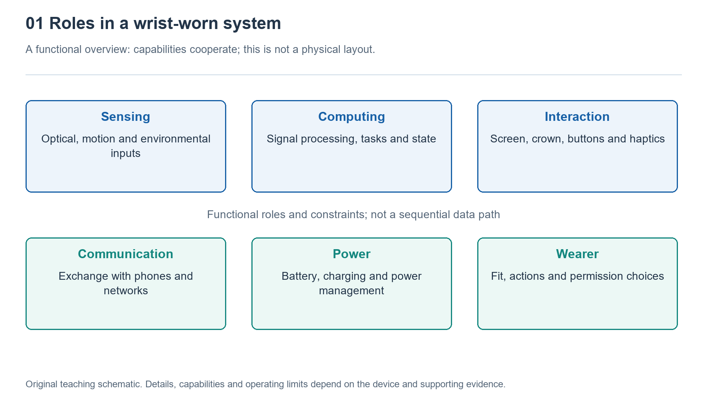

# 1.1 Starting with a Raise of the Wrist: What Is a Smartwatch?

## 1.1.1 Why Raising Your Wrist Is About More Than Checking the Time

As you head out in the morning, you raise your wrist. The screen lights up, showing the time and a message. At an intersection, a gentle vibration reminds you to turn. After your walk, the screen shows your step count and activity duration. These tasks may seem unrelated, yet a single small device performs them all. To understand a smartwatch, we can begin with a question: how does it deliver relevant information to your wrist when you need it?

An ordinary watch can tell time, and a digital watch may also have alarms and step-counting features. So a screen or a step counter alone does not make a watch smart. Here, a smartwatch means an electronic system designed primarily to be worn on the wrist, bringing together sensing, computing, information presentation, and communication. It processes inputs according to software instructions and responds to physical activity, user actions, or external information.

This definition emphasizes cooperation among capabilities, not the number of features. A watch without cellular connectivity may still receive messages through a phone. Another that can make calls independently does not necessarily dispense with a phone in every situation. Understanding the device starts with how it works, not with counting icons on a promotional page.

{width=95%}

Explore sensing, computing, interaction, communication, and power supply through a simple raise of the wrist.


## 1.1.2 Similar to a Phone, but Not Simply a Smaller One

Smartwatches and phones both use chips, software, batteries, and wireless connections. These similarities make it tempting to see a smartwatch as a miniature phone. Yet even for the same message, an approach that works well on a phone may not suit the wrist.

On a phone, you can read lengthy text, find attachments, and reply using a keyboard. A watch has a smaller screen, and holding your wrist up for long periods is uncomfortable, so it generally prioritizes the sender, a summary, and a few actions. Voice input, a crown, buttons, and vibration can complement touch controls. This does not mean a watch can never accept long text. Rather, the movements and attention required to complete the same task differ, and the system must make trade-offs accordingly.

Where the device is worn also changes its operating conditions. A watch moves repeatedly with the arm, its back often touches the skin, and strap tightness affects its stability. A larger battery may extend battery life, but it also takes up space and adds weight. A higher computing workload may enable richer features while increasing power consumption and heat generation. Engineering design must balance these relationships; no single weight or temperature-rise figure can capture the requirements of every product.

A watch, then, is not made by shrinking every phone component in proportion. Its system is reorganized around being comfortable to wear, easy to read, and quick to respond.

## 1.1.3 Breaking a Response Down into Four Capabilities

Consider again how raising your wrist wakes the screen. The wrist changes orientation, motion sensors capture relevant signals, the system applies rules to decide whether to wake the screen, and the display shows the time. The battery supplies energy for these processes. Even a quick glance at the time requires several parts to work together. Different devices may also consider other conditions to reduce screen activations caused by unintended movements.

As an initial framework, we can group the watch’s work into four capabilities—sensing, computing, presentation, and connectivity—with power supply as their shared foundation.

```text
Body activity and surroundings -> Sensing -> Computing and storage -> Screen, sound or
    vibration
                                                    <-> Phone and network services
Battery and power management supply energy to these processes.
```

This diagram shows functional relationships, not the physical arrangement of components inside the case. The arrows indicate possible directions of information flow; they do not mean that every task passes through every stage. Timekeeping, for example, can happen locally on the watch, whereas receiving a message from a phone requires a connection. Some activity records can be stored on the watch first and synchronized later.

“Computing” in the diagram does not necessarily mean sophisticated artificial intelligence. Detecting whether a button has been pressed, scheduling an alarm, and organizing activity samples all count as computing. Whether machine learning is involved depends on the specific feature and its implementation. The word “smart” in a product’s name does not mean AI participates in every step.

## 1.1.4 Connecting Outward to Information, Looking Inward at Activity

From the user’s perspective, a smartwatch works in two complementary directions. One faces outward: it brings messages, navigation, and schedules to the wrist, reducing the need to take out a phone. The other faces the wearer: it takes advantage of its proximity to the body and movement with the wearer to record activity and certain physiological signals.

This positional advantage does not mean it can fully understand the human body. Consider common optical pulse measurement: a light source on the back of the watch shines onto the skin, a detector receives the returning light, and the system extracts pulse-related information from changes in light intensity to estimate heart rate. It does not directly see the heart beating, nor can a single number determine whether someone is healthy.

Continuous wear also does not mean every sensor measures continuously. The device may adjust its operation according to activity, battery level, settings, and signal quality. Some features require the user to activate them or are subject to regional availability and authorization requirements. When a reading appears on the screen, ask what measurement produced it. The absence of an alert does not rule out a health problem.

Likewise, fall detection and emergency calling can only provide assistance under the conditions specified for the product. They cannot guarantee that every incident will be detected or every request for help completed. Connectivity, settings, and battery level can all affect the outcome.

## 1.1.5 Building Understanding Through Your Own Watch

You can now make a few observations without taking anything apart. While stationary in a safe place, check the time first by raising your wrist and then by pressing a button. Notice whether both methods wake the screen. Next, open an existing activity record and check whether it shows a daily total or the results of a single activity. Do not shake your wrist vigorously to test it, and there is no need to deliberately create unusual situations.

Record your observations in three categories: “What I saw,” “What I infer from it,” and “What I do not yet know.” For example, seeing the screen light up after raising your wrist is a direct observation. Suggesting that the system may use motion sensors to determine orientation is an inference grounded in how the technology works. The exact components and decision rules cannot be established from appearance alone.

This distinction is the starting point for understanding smartwatches. A smartwatch is both a personal item worn close to the body and a microsystem that continually receives inputs, processes them, and responds. First understand whom it serves and the conditions in which it operates, then gradually explore its components. The small screen on your wrist can then become a gateway to understanding a system, rather than merely a list of features.
