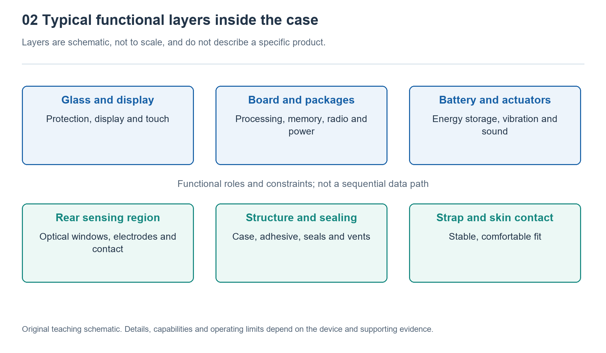

# 2.1 Looking Inward from External Interfaces: Building a System Module Map

Take the watch off your wrist and place it on a soft, dry surface. The screen is on the front; the sides may have a crown, buttons, and small openings; and the back may have a transparent window, metal contact surfaces, or charging contacts. These are more than exterior details: they are entry points for understanding the internal system. Without opening the case, you can gradually build a system module map simply by asking, “What enters here, and what comes out?”

## 2.1.1 Ask Questions About Interfaces Rather Than Guessing at Components

Here, “interface” means more than plugs and sockets. It includes any point where the watch exchanges information or energy with the body, the environment, or other devices. When a finger presses a button, a mechanical action enters the system. When the screen lights up, information leaves as light. A light source on the back shines onto the skin, and light returning from the tissue enters a detector. Invisible wireless connections are interfaces too.

When observing, first describe what happens, then ask what internal capabilities are needed. For example, “The screen lights up after the button is pressed” is something you can confirm directly. “There is circuitry inside that detects the button press and controls the display” is a supported inference. Which chip handles it and which circuit paths are involved require further verification. These three kinds of statement must not be confused.

Small openings on the sides are particularly easy to misidentify. They may be associated with a microphone, speaker, or air-pressure sensing, but their size and shape alone are usually not enough to establish their purpose. Consulting the user manual for the specific model is more reliable than probing an opening with a needle, and avoids damaging internal membranes or seals. The purpose of observing interfaces is to raise verifiable questions, not to force a name onto every feature based on appearance.

{width=95%}

Schematic of functional layers; not to scale and not a teardown of any particular product.


## 2.1.2 Group the Complex Interior into Six Types of Module

For a watch with many functions, begin by grouping its internal workings into six categories by responsibility: sensing, computation and control, storage, interaction, communication, and power supply. Here, a “module” is a functional unit used to understand the system. It does not mean that the case necessarily contains six separate components.

The sensing module detects changes in the body and the environment through optical detection, electrode-based measurement, motion sensing, and other methods. The computation and control module schedules tasks, processes data, and decides when to light the screen or issue an alert. The storage module holds programs, settings, and records, including both temporary working data and information that must remain after power is lost.

The interaction module lets users see, hear, and feel results, while also receiving touch and button input. The communication module establishes connections with phones, wireless networks, or satellite signals as appropriate. The power supply module converts and distributes energy stored in the battery, and also participates in charging and protection management.

An actual component may serve several roles. For example, a highly integrated chip may contain both processing capabilities and wireless communication circuitry, while a display assembly may include the display panel, touch-sensing structures, and associated drivers. A module map therefore answers “What performs each task?” rather than “How many chips are inside?”

## 2.1.3 Use Connections to Show How Modules Work Together

When drawing the map, place computation and control in the center, arrange the other modules around it, and put the body, phone, and charger outside the system boundary. The following introductory functional diagram does not represent the actual layout of any particular model.

```text
Body and environment -> [Sensing] -> [Computing and control] <-> [Storage]
Finger actions -> [Interaction] -> Light, sound and vibration
Phone and other devices <-> [Communication]
Charger -> [Power supply] -> Sensing, computing, storage, interaction and communication
The functional blocks exchange information as the task requires.
```

The upper part of the diagram mainly shows information connections, while the bottom line shows power delivery. The arrows connect functions; they do not represent distances inside the case. Sensing components may sit near the case back or on a circuit board, and communication circuitry and antennas may be located in different places. Two boxes being adjacent in the diagram does not mean their corresponding components sit next to each other in the watch.

The two-way arrows also have specific meanings: the computation module can both read and write records, while the communication module can both send data and receive instructions. For simplicity, the sensing section shows only outgoing data. In operation, it usually also needs control commands to start, stop, or adjust its operating mode. A diagram can be simplified, but you should understand what has been left out.

## 2.1.4 Check the Map with a Single Action

Now press a button lightly and observe the screen’s response. This ordinary action can help test the module map. The button converts the action into an electrical signal, the control logic recognizes the event, the program decides what to display, the display circuitry drives the screen, and the power system supplies energy for these processes. If the interface needs to retrieve the previous workout summary, the storage module also participates.

There is no need to include communication immediately. Many local operations require neither a phone nor the cloud. Communication becomes part of this functional chain only when the interface needs information not already stored on the watch, or must perform a task such as synchronization. The value of a module map lies precisely in distinguishing “the watch has this module” from “this operation requires this module.”

Conversely, a screen that fails to light up does not directly prove that the screen is damaged. Low battery power, a locked state, button settings, or a software fault can all affect the result. A functional chain passes through multiple stages. An abnormal result at its endpoint suggests checking along the chain; it does not, by itself, identify a particular faulty component. A system-level perspective helps prevent such premature conclusions.

## 2.1.5 Leave Room for Evidence and Unknowns

Draw a map of your own watch on paper, using three labels to distinguish the evidence: “Observed,” “Confirmed by documentation,” and “Unknown.” That the screen can display content can be marked as observed. Whether the watch supports standalone satellite positioning should be confirmed using official documentation for the specific model. If there is no reliable information about the component packaging or antenna location, leave those details unknown.

Do not copy another watch’s internal structure merely to make your map look complete. Even versions within the same product series may differ in cellular communication, sensors, or charging methods. Recording the full model designation and the date of the documentation will help with later verification. During observation, do not open the case, touch the battery, insert objects into openings, or immerse the watch to test its construction.

The result is not a precise circuit diagram, but an evidence-based map of your understanding: external interfaces suggest what is exchanged and with what; functional modules explain the division of tasks; connections show how the parts cooperate; and gaps identify questions that still need verification. As you later learn about processors, sensors, or power components, you can place that knowledge back into the system rather than merely memorizing a list of isolated names.
