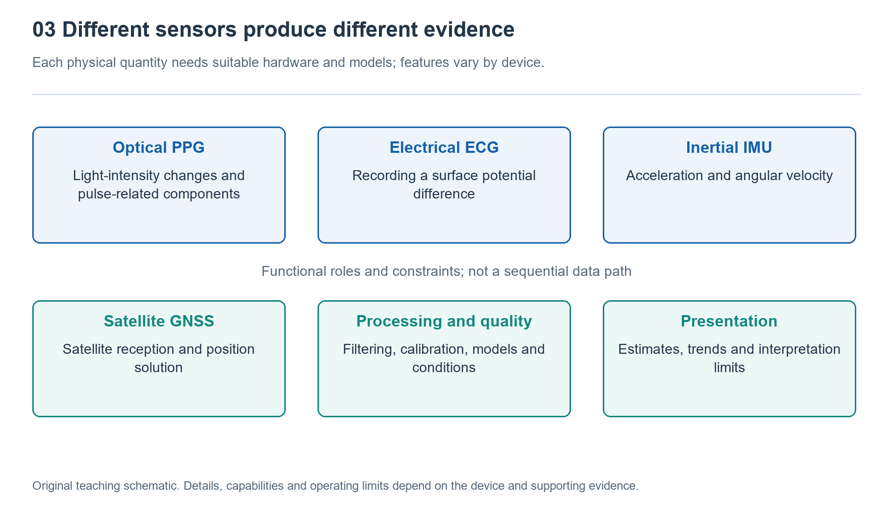

# 3.1 How Light Reads Your Pulse: PPG and Heart Rate and Blood Oxygen Estimation

## 3.1.1 What the Lights on the Back of Your Watch Are Looking For

When you take off your watch at night, you may catch a glimpse of green light flashing on its back. It is neither a lamp nor a camera photographing your blood vessels, but the starting point of an optical measurement. Light enters the skin through a window on the back. Some is absorbed, while some returns after scattering multiple times and is received by a nearby photodetector. What the watch is looking for is a tiny variation in the intensity of the returning light that rises and falls with your pulse.

This method is called photoplethysmography, or PPG. Here, “plethysmography” refers to changes related to blood volume within tissue; it does not mean the watch can directly measure how much blood a particular vessel contains. Each heartbeat pushes blood into peripheral vessels, causing subtle changes in the optical properties of wrist tissue. The returning light carries information about that rhythm.

PPG therefore first produces a signal showing how light intensity changes over time, not a ready-made heart rate number. Getting from light to a reading requires conversion into an electrical signal, interference processing, and algorithmic estimation. A light glowing on the back only indicates that the light source is working; it does not establish that the measurement is reliable.

{width=95%}

Different physical quantities require different components and models, and capabilities vary by device.


## 3.1.2 Separating the Pulse from the Returning Light

Wrist PPG usually uses a reflective configuration: the light source and detector are on the same side of the skin. After entering tissue, light does not turn back along a neat arc. Instead, it travels through complex scattering paths, and only a portion eventually reaches the detector.

The light received by the detector contains a large background component with a smaller pulsatile component superimposed on it. The former is related to factors such as skin, tissue, and nonpulsatile blood; the latter is related to changes in arterial blood volume with each heartbeat. The “background” is not permanently constant either. Moving your wrist or changing contact pressure can cause it to fluctuate considerably.

The diagram below shows how information is converted. It is not an actual cross-section of tissue, nor does it imply that light follows only one path.

```text
Light source -> Absorption and scattering in skin and tissue -> Photodetector
                         ^                                         |
             Pulsatile blood-volume changes              Light becomes electrical signal
                                                                   |
                                                  Sampling, quality assessment and
    estimation
                                                                   |
                                                    Heart-rate / blood-oxygen estimate
```

The upward arrow indicates that changes in blood volume affect light propagation; the processing chain below shows that the number on the screen is the product of several stages. After the detector converts light into an electrical signal, the acquisition circuitry converts that signal into digital samples. The algorithm must find a credible repeating pattern in these samples while identifying interference caused by movement, stray light, or changes in contact.

## 3.1.3 Why Green Light Is Often Used to Estimate Heart Rate

Many watches use green light for heart rate monitoring because hemoglobin absorbs strongly in this wavelength range. With an appropriate light source and detector arrangement, this can produce a pulsatile signal suitable for analysis. But this does not mean that green light is inherently immune to movement, or that every device uses only green light under all conditions. Wavelength, light-source layout, skin conditions, and power budgets all factor into design trade-offs.

When signal quality is good enough, an algorithm can identify the intervals between successive pulses or analyze the dominant repeating frequency in a segment of the waveform, then convert the result into pulses per minute. For example, under ideal conditions, one reliable pulse wave per second corresponds to approximately sixty pulses per minute. This is merely a conversion example, not a standard for judging health.

Everyday interfaces often label this result “heart rate,” but PPG directly observes changes associated with the peripheral pulse, not the heart’s electrical activity. With certain abnormal heart rhythms, inadequate peripheral perfusion, or motion interference, the two cannot simply be treated as equivalent. Screen updates need not coincide with every heartbeat either. A device may combine data collected over a period of time to provide a more stable display.

## 3.1.4 Why Blood Oxygen Estimation Requires Different Colors

Knowing the rhythm of the pulse alone does not tell us how much oxygen hemoglobin is carrying. Blood oxygen estimation uses another clue: oxygenated and deoxygenated hemoglobin absorb different wavelengths of light differently. Common approaches use red and near-infrared light, observing how each changes after traveling through tissue.

Simply comparing which light is “brighter,” however, is not enough. Light-source intensity, skin characteristics, and propagation paths all affect the amount of light received. A common method extracts the pulsatile component at each wavelength and compares it with its respective background component. It then compares these two relative changes and uses a calibrated relationship to estimate oxygen saturation.

This step depends on both optical measurements and a calibration model; it does not directly count oxygen molecules in the blood. Reflective measurements at the wrist also differ in their conditions from transmission measurements made with a finger clip. A consumer watch cannot automatically be equated with a medical pulse oximeter simply because both display a percentage.

Blood oxygen estimation particularly depends on a stable, usable pulse signal. Reduced peripheral blood flow in cold conditions, wrist movement, or an improper fit can all cause inaccurate results or prevent a reading altogether. FDA information on pulse oximeters also cautions that factors such as skin pigmentation and circulation can affect measurements. These limitations should not be obscured by a seemingly precise number.

## 3.1.5 What a Safe Observation Can Tell You

You can make a simple observation in an ordinary indoor setting: first, wear the watch according to the product instructions, sit quietly with your forearm resting naturally on a table, and start a heart rate measurement supported by the device. Note whether a reading appears, how long it takes, and whether any quality alerts appear. There is no need to aim for a particular number, and you should not try to create changes by holding your breath or exercising vigorously.

Later, during normal daily activities, notice whether recordings are interrupted more often while walking than while resting. If you observe a difference, a reasonable initial explanation is that the measurement conditions have changed. This observation alone cannot establish whether arm swing, changes in contact, or the algorithm’s strategy played the main role. Nor should you overtighten the strap to “strengthen the signal.” Fit should follow the instructions while remaining comfortable and safe.

The value of PPG lies in providing ongoing pulse-related clues with relatively little burden; its limitation is that optical signals remain constrained by bodily and environmental conditions. When interpreting readings, consider the measurement conditions, quality alerts, and trends over time together. The absence of an alert does not rule out disease, and if you feel clearly unwell, a number on your wrist must not replace timely professional assessment.
