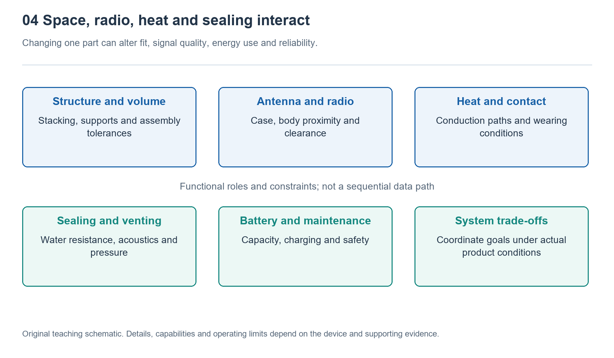

# 4.1 Allocating Space Inside the Watch Case: Understanding Layered Layouts Through Cross-Sections

## 4.1.1 Viewed from the Side, a Watch Is Not an Empty Box

Take off your watch and place it on its side on a table. You will see the crystal, bezel, and slightly raised window on the back. The exterior presents only a few outlines, but inside it must accommodate a screen, battery, circuit board, sensors, speaker, and vibration components. These must not only fit; there must also be room to connect, secure, and protect them.

To understand this arrangement, imagine cutting vertically through the center of the case and looking at the exposed surface. This is the basic idea behind a cross-sectional drawing. It reveals the vertical relationships hidden by the case: what sits closest to your eyes, what lies against your skin, and what is sandwiched in between. However, you should not cut or pry open a real watch to inspect it. Instead, we use structural diagrams and publicly available information with identifiable sources.

A cross-section is not simply a substitute for an interior photograph. It is a selective representation. It emphasizes height, thickness, and contact relationships, but may not show the full shapes of components extending to either side.

{width=95%}

Changing one component may simultaneously affect wearability, signals, and energy.


## 4.1.2 Building a Picture of the Layers, from Screen to Skin

The side facing the user's eyes usually contains the crystal and the display and touch-sensing structures. The crystal withstands everyday contact, the display produces images, and the touch-sensing structures detect input. These may be closely bonded, so their appearance alone cannot tell you whether they are separate components.

The middle region is often reserved for the battery and main circuitry. The battery generally needs a relatively large, continuous volume, while the circuit board can use the remaining space through irregular outlines, localized stacking, or a layout that wraps around other components. The two are not necessarily arranged strictly one above the other. They may sit side by side or overlap in certain areas.

The side closest to the skin needs space for optical windows, electrodes, and related sensor structures. Light emitted by the light source must reach the skin, and returning light must enter the detector, so neither the battery nor an opaque support can block this path. A raised back may reflect sensor structures, contact requirements, and internal space constraints; it cannot simply be attributed to one component being too thick.

The original schematic below illustrates spatial relationships only. It does not represent a particular model and is not drawn to scale.

```text
                        Facing the viewer
                Cover glass, display and touch layers
                              |
         Side parts -- Circuit area -- Connection paths
                              |
                      Battery volume
                              |
             Supports, fixings and sensing structures
                              |
                        Rear window
                        Facing the skin
Functional arrangement only; not a scale drawing.
```

The connection pathway in the diagram reminds us that power and signals must travel between the upper and lower layers. The omission of some parts does not mean they do not exist. Actual products may also reverse the positions of the battery and circuitry.

## 4.1.3 Why Every Gap Cannot Be Filled

When packing luggage, fewer gaps may seem better. Watch design, however, is not simply about filling every available space. Component dimensions vary with manufacturing tolerances, and assembly requires room for positioning and handling. If nominal dimensions leave no clearance, actual production may result in compression, parts that do not fit, or uneven loading.

The battery, in particular, cannot be treated as a filler block that can be squeezed into place. It must be secured reliably and meet the product's design requirements for dimensional changes, mechanical protection, and safety. The necessary allowance depends on the cell, structure, and validation conditions. There is no single clearance value that applies to every watch.

Connectors, bends in flexible cables, and sealing interfaces also occupy space. Brackets, adhesive layers, and gaskets that appear to have no electronic function in a drawing may provide impact resistance, insulation, alignment, or sealing. Removing them will not necessarily produce a thinner watch with the same reliability.

It is also important to distinguish internal clearance from overall thickness. The crystal, case back, and support structures all have thickness of their own, and a raised back affects contact during wear. Comparing thickness figures on promotional pages alone cannot fully establish which watch has more room inside or which will necessarily feel more comfortable.

## 4.1.4 Why the Same Volume Can Have Different Layouts

Imagine two watches with similar external shapes: one emphasizes long battery life, while the other adds standalone connectivity and more interaction features. The first may devote more space to its battery, while the second must make room for additional circuitry, connections, and related components. This merely illustrates the direction of the trade-offs; it does not establish how any particular product is actually designed.

Layouts are also constrained by how components operate. The screen must face outward, optical sensor windows must face the skin, buttons must be accessible from the side, and the speaker needs suitable acoustic space. These components cannot be freely rearranged like building blocks.

Round and square cases impose different constraints as well. Common battery and circuit-board shapes do not necessarily fill a circular outline neatly, potentially leaving edge regions suitable for smaller components. Nor does a square exterior eliminate wasted space, since rounded corners, fastening points, and sidewalls still occupy volume. Similar exterior areas therefore do not imply equal usable internal volumes.

Space allocation is ultimately a set of negotiated trade-offs. Adding a component may require more than its own volume: it may also demand changes to mounting methods, connection routes, and surrounding structures.

## 4.1.5 Read Diagrams Using Evidence, Not Guesses Based on Shape

When reading a publicly available cross-section, first locate three reference points: the display surface, the rear sensor window, and the case boundary. Then identify the battery and circuit regions. Next, examine which components overlap, which sit along the edges, and which pathways must cross between different heights. This makes it easier to build an overall understanding than trying to identify every chip at the outset.

Check what kind of image you are looking at, too. Promotional renderings may omit adhesive layers and fasteners. Patent drawings illustrate technical proposals, not necessarily designs used in a particular product. Teardown photographs are closer to the actual hardware, but their viewing angles may obscure structures underneath. Exploded views separate components to explain assembly relationships; the distances shown are not actual clearances.

You can sketch your own watch's side profile on paper. First label the crystal, buttons, and rear window that you can see directly, then use dashed lines to add inferred internal regions. Mark these respectively as “visible on the watch,” “confirmed by sources,” and “not yet determined.” Do not fill in unknown areas merely to make the drawing look complete.

Understanding a layered layout is not about memorizing a fixed sequence. It is about seeing why each position is occupied and what constraints that imposes. Every layer inside the watch case serves function, assembly, and reliability at the same time.
