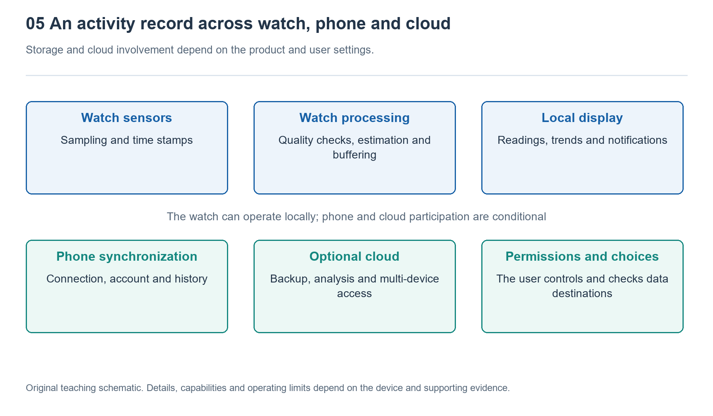

# 5.1 From the Charger to Each Module: How Electrical Energy Flows

## 5.1.1 Placing the Watch on Its Charging Dock: Where Does Power Enter?

You place your watch on its charging dock at night, and a charging icon lights up on the screen. What looks like simply “putting electricity into the battery” actually activates an energy pathway involving reception, conversion, regulation, and protection. Electrical energy does not flow straight into the battery along a single wire, nor does the battery supply every component indiscriminately.

First, consider how the back of the watch connects to the charging dock. Some products conduct electricity through metal contacts; others transfer energy through electromagnetic coupling between coils. Magnets often serve only to position the watch, aligning the contacts or coils. Thus, “magnetic charging” describes how the watch attaches, but does not by itself explain how electrical energy crosses the watch casing.

With contact-based charging, current passes through the contacts into the watch’s input circuitry. With inductive charging, the coil in the charging dock generates a changing magnetic field, inducing a voltage in the watch’s receiving coil. Rectification and regulation then produce direct current that the internal circuits can use. Both pathways involve losses, so not all the energy supplied by the adapter becomes energy stored in the battery.

{width=95%}

The division of responsibilities between layers, data storage, and cloud involvement depend on the specific product and user settings.


## 5.1.2 Charging Management Is More Than a Switch

Electrical energy entering the watch is usually first controlled by charging-management circuitry. This circuitry determines the allowable charging current based on the available input power, battery voltage, temperature, and power the device is currently consuming. These functions may be integrated into a power-management chip or shared among several components; there is no single fixed architecture used by every watch.

Charging a typical lithium-ion battery involves several stages. When the battery is very low, the system may begin with a low-current precharge. Once conditions are suitable, it enters a relatively constant-current stage. As the battery approaches full charge, the voltage is limited and the current gradually decreases. Charging quickly at first and slowing down near full charge is therefore often a normal part of the control process. The battery percentage alone is not enough to diagnose a fault.

While charging, the watch may continue displaying the time, maintaining a phone connection, or performing background tasks. Designs with suitable power-path management can distribute incoming power to both the system and the battery, rather than first storing all the energy in the battery and then drawing it out again. If input power is insufficient, or the temperature reaches a limit set for the product, charging may slow down or pause altogether.

## 5.1.3 Beyond the Battery: Multiple Power-Supply Branches

Once the watch leaves its charging dock, the battery converts stored chemical energy into electrical energy to power the entire device. But its output voltage varies with charge level, load, and temperature, while different modules require different supply conditions. The processor, display, sensors, and radio circuitry cannot simply all be connected directly to the same voltage.

Power-management circuitry acts like a distribution station: some branches need a lower voltage, others may need a higher one, and still others require further reduction of voltage fluctuations. Switching converters generally offer high conversion efficiency, but generate switching noise that must be controlled. Linear regulators differ in their design and noise characteristics, but turn some energy into heat. In practice, designers often combine these approaches according to load requirements.

The following diagram shows functional relationships, not the actual wiring of any particular watch:

```text
Charger / charging dock
          |
Contact input OR coil reception and rectification
          |
Charging and power-path management <-> Battery
          |
Voltage regulation, distribution and branch control
          |--> Processing and storage
          |--> Sensing and acquisition
          |--> Display and interaction
          +--> Wireless communication
```

The branches remind us that a dark screen does not mean the entire watch is powered off. The display branch can reduce its activity while timekeeping, some sensing functions, or connection maintenance continue. Current must also return through a complete circuit. The diagram omits these return paths, so its arrows should not be read as one-way streets where charge enters but never leaves.

## 5.1.4 Handling Brief Peaks in Power Demand

Raising your wrist to wake the screen, receiving a vibration alert, and starting a wireless transmission all change the load. Neither the battery nor the power-supply wiring can maintain a perfectly constant voltage at every instant. Impedance within the battery and along its connections causes voltage to drop when current demand rises. Battery aging and low temperatures can make this effect more pronounced.

Capacitors near the modules temporarily store charge, helping stabilize local voltage when the load changes rapidly; the voltage-regulation circuitry then adjusts its output. A capacitor is more like a short-term buffer than a second battery that extends runtime. It cannot sustain an ongoing call by itself or eliminate every undervoltage risk. When necessary, the system may also limit performance, suspend certain functions, or shut down for protection.

It is important here to distinguish power from energy. Power describes how quickly energy is being consumed at a given moment, whereas energy accumulates that consumption over time. A very brief vibration may draw relatively high power without necessarily consuming more energy than an extended period of location tracking. Current values from branches operating at different voltages cannot be compared directly either. Any discussion of energy consumption must also account for voltage, duration, and conversion losses.

## 5.1.5 Learning the Limits Through a Charging Observation

At normal room temperature, you can observe an everyday charging session using charging equipment approved by the manufacturer or meeting the required specifications. Before starting, record the remaining battery level, connection method, screen state, and whether an update is downloading. Then record the battery level at several points during charging, noting any temperature warnings or charging-paused messages. There is no need to drain the battery until the watch shuts itself down for this exercise.

Keep the watch and charging dock dry and well ventilated during the observation. Do not cover them with clothing, deliberately heat or cool them, or repeatedly charge with the watch misaligned. If you notice abnormal heat, an unusual smell, or a bulging casing, stop using the device and follow the manufacturer’s guidance rather than continuing to test a theory.

These records can show “how the displayed battery level changes under these conditions,” but they cannot directly measure current inside the battery or power in individual branches. The percentage is a system estimate, and judging warmth by touch is not a precise temperature measurement. Understanding electrical energy flow is less about guessing an instantaneous number than recognizing the relationships among input, storage, conversion, distribution, and protection: every screen activation and measurement depends on this energy pathway operating reliably.
