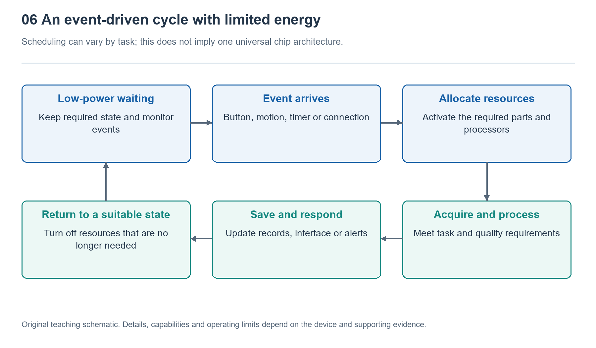

# 6.1 From Sleep to Wake: How the System Switches Operating States

## 6.1.1 When the Screen Goes Dark, the Watch Keeps Working

Lower your wrist, and the screen may turn off or retain a simplified time display. A little later, a message arrives and the watch vibrates; raise your wrist again, and the full watch face reappears. What looks like a simple change in screen brightness actually involves coordination among sensors, processors, memory, and display circuitry.

To understand this process, first distinguish between “no visible activity” and “no activity.” A dark screen is merely a display state; it does not prove that the processor is asleep. Nor does an always-on display mean the entire system is running at full speed. Depending on the current task, the watch places different modules in different operating states: some keep monitoring, some operate less frequently, and others stop temporarily until needed again.

This arrangement does not repeatedly turn the entire watch on and off. Instead, it directs limited battery energy toward the work needed at that moment. The key to understanding it is not memorizing a chip name, but asking: What is still working, what is waiting, and what event will change that division of labor?

{width=95%}

Background sampling, display, and connectivity can be scheduled independently; this does not mean all watches use the same chip architecture.


## 6.1.2 Sleep Varies in Depth and Scope

In everyday language, “sleep” suggests a complete stop, but its meaning in electronic systems is more nuanced. A lighter low-power state may simply pause the processor’s instruction execution while retaining memory contents and keeping some interfaces active. A deeper state may disable clocks to certain circuits or even cut power to some modules. Generally, the less that remains active, the greater the potential energy savings—but more preparation may also be needed to resume operation.

A clock can be understood as a signal that keeps digital circuits working in rhythm. When computation is temporarily unnecessary, stopping the relevant clocks can reduce the energy consumed by repeated circuit switching. But stopping a clock is not the same as cutting power completely; the circuitry may still consume energy through leakage and other mechanisms. Thus, saying that “standby uses no power” is inaccurate.

Before entering deep sleep, the system must also decide which state information to preserve. The current interface, unprocessed data, and connection information, for example, may need to remain in a powered memory region or be written to other storage. The system uses this information to resume work later. Exactly where and how it is saved depends on the hardware and software; this cannot be inferred simply from the screen turning off.

## 6.1.3 What Waits for the Next Event?

If the main processor reduces its activity, how does the watch know that the user has raised their wrist? One common approach is to keep a lower-power detection path running. For example, a motion sensor or low-power processing unit may analyze movement and, upon detecting an event that might warrant turning on the screen, notify other modules to resume operation.

This “notification” often takes the form of an interrupt. It is like a doorbell: rather than continuously asking whether anything has happened, the processor receives a request when an event occurs. But the doorbell itself needs supporting circuitry to remain active. Whether touch can wake the watch depends on whether the corresponding detection circuitry is running; whether wireless messages can arrive depends on the connection state and communication schedule.

Timers are another wake source. The system can arrange in advance to resume some activity at a particular time to handle alarms, maintenance, or data processing. Button presses and connecting a charger may also trigger state changes.

The architecture handling this work varies. Some devices pair a main processor with a separate low-power controller; others integrate different processing units into a single chip. Still others rely on multiple low-power modes within one processor. No single “dual-chip handoff” diagram should be treated as an accurate picture of every watch’s internals.

## 6.1.4 Waking Is an Ordered Recovery Process

After receiving a wake request, the system does not necessarily put every module into a high-performance state immediately. It typically first determines what the event requires, then restores the relevant power supplies, clocks, and interfaces, processes the necessary data, and finally updates the display or provides feedback. Some steps can run in parallel; others must wait until earlier conditions are met.

For example, after the crown is pressed, the system may first need to resume processor operation, read the previously saved interface state, then prepare the image and pass it to the display circuitry. The screen’s perceived wake-up speed results from this entire chain, not just the processor’s computing speed.

The following instructional diagram shows a simplified logic flow and does not represent a specific product:

```text
Low-activity state
  | Button, motion, message or timer event
Confirm request and restore required modules
  |
Process task; display or provide feedback
  |
Check work that must continue
  |-- Work remains -> Keep the required activity
  +-- No work remains -> Save necessary state -> Return to low activity
```

The key phrase in the diagram is “necessary modules”: checking the time usually does not require location tracking and audio recording to start as well. During continuous workout recording, some sensing and computation must continue even when the screen dims. System states are more like combinations of multiple switches than just two settings of “all on” and “all off.”

State transitions themselves also carry a cost. Restoring power, reestablishing communication, and moving data can all consume time and energy. If a module is awakened just after going to sleep, frequent switching may not be worthwhile. Systems therefore often wait briefly or batch nonurgent work before returning to a lower-activity state. This explains why the screen and internal modules do not necessarily enter low-power states at the same time after you lower your wrist.

## 6.1.5 Observe States Through Screen Behavior, Rather Than Guessing the Chips

You can make a simple observation in a normal indoor setting. First check whether raise-to-wake, always-on display, and power-saving mode are enabled. Then separately record what happens when you wake the watch with a button, raise your wrist, and lower it again. There is no need to swing your arm rapidly and repeatedly, and do not trigger an emergency call for testing purposes.

When observing, keep phenomena separate from explanations. “The full watch face appeared after pressing the button” is an observable fact. “The system resumed display-related work” is a reasonable inference. “One separate chip handed display control to another” requires product documentation to confirm. Nor can visual observation alone accurately measure internal wake-up time or determine whether the processor has lost power.

If raising your wrist fails to turn on the screen on one occasion, possible reasons include the movement not meeting recognition criteria, the relevant setting being disabled, or the current mode restricting screen activation. It should not immediately be attributed to a chip failure. Sleep and wake are fundamentally about managing states to balance timely responses with reduced unnecessary activity. The screen is only a window into that arrangement, not an activity indicator for the entire system.
