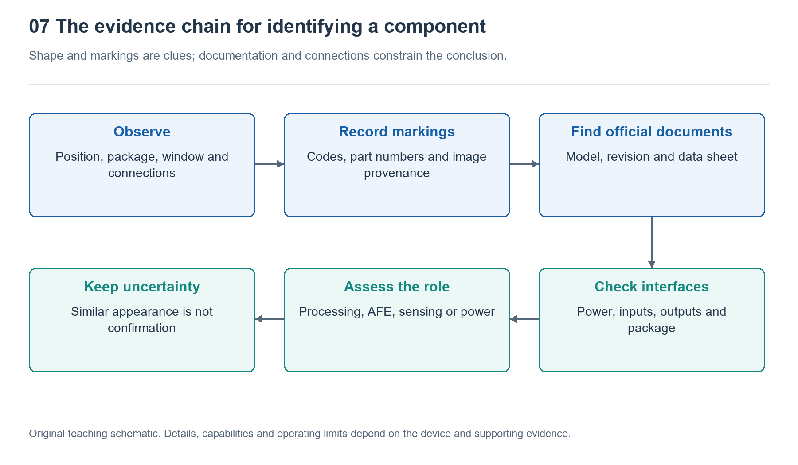

# 7.1 What to Look for First in Teardown Photos: Creating a Component Identification and Evidence Map

## 7.1.1 First, Establish Which Watch the Photo Shows

When you open a smartwatch teardown photo, the battery and several black packages usually stand out first. You might quickly guess that the largest is the processor, the one beside it is memory, and those near the back are sensors. But a photo primarily shows shapes and locations; it does not automatically reveal internal functions. The first step in identifying components is not naming their model numbers, but establishing exactly what the image shows.

Start by checking the device model, size variant, connectivity variant, and image source. Different versions within the same series may use different mainboards, batteries, or antenna layouts; a similar exterior does not guarantee identical internals. Next, determine whether the photo shows the front or back of the mainboard, or a particular layer with its shielding removed. If images have been rotated, cropped, or even combined with close-ups from different devices, subsequent judgments can easily lose their foundation.

Use the crown, buttons, rear window, and strap attachment points as orientation references before examining internal parts. This lets the “upper-left corner” of a photo correspond to a specific area of the physical device, rather than merely a position in the frame. If the source or version is unclear, record it as unknown rather than filling in the name of the closest-looking product.

{width=95%}

Appearance and markings provide clues; documentation and interface relationships constrain the conclusion.


## 7.1.2 Identify Regions Before Individual Components

On a densely populated circuit board, identifying broad regions is more effective than guessing at chips one by one. The battery usually occupies a relatively large, continuous space; the display and rear sensor assembly often connect to the mainboard through flexible cables; metal shields may cover circuits sensitive to electromagnetic interference. These are only common clues, however. The specific structure still requires support from photos or documentation.

Trace connections as you examine the image: where does a flex cable originate, and where does it plug in? Does a metal contact touch the case? Does a board sit directly against an optical window? Location and connections can help establish a component’s role in the system, but may not be enough to identify its model. For example, a small chip near an optical assembly might participate in signal acquisition, or it might handle power, control, or another task.

In particular, do not equate “largest area” with “main processor.” A prominent black block in a photo might be a system-in-package, or it might simply be a shielding or protective structure. SiP stands for system-in-package, which can integrate multiple components, but its exterior generally does not reveal everything inside. Not seeing a separate memory chip does not mean the watch has no memory: it may be inside a package or on a side not shown in the photo.

## 7.1.3 Assign an Evidence Level to Every Judgment

A useful identification map should answer two questions at once: what do you think the object is, and why do you think so? You can use three annotation statuses: “confirmed,” “reasonable inference,” and “unknown.” These do not rank the importance of components; they indicate how far the available evidence supports a conclusion.

“Confirmed” requires supporting evidence. For example, clearly legible component markings match official marking guidance and package documentation, and the photo can be established as showing that device version. “Reasonable inference” means there are clues from location, appearance, or connections, but other explanations remain possible. “Unknown” means there is insufficient information for reliable classification. Unknown is not a failure of identification; it is a necessary category that prevents guesses from becoming facts.

The evidence level should also vary with the specificity of the conclusion. You might confirm that a component is a battery without knowing its internal chemistry, or confirm that an object is a packaged module without knowing which dies it contains. Correctly identifying a broad category does not make details about model, fabrication process, and performance known as well.

The following annotation schematic is for teaching purposes only. It does not represent any actual model, and the sizes and positions of the boxes do not reflect real dimensions:

```text
Example evidence labels for a teardown photograph
A: Battery       -- Confirmed: label and connections agree
B: Black package -- Reasoned inference: possibly an integrated computing module
C: Tiny part     -- Unknown: markings unreadable and connections not visible
For each label, record image source, device version, evidence and open questions.
```

The key is not the three components, but the supporting evidence attached to every conclusion. If later documentation shows that B is merely some kind of protective structure, revise the judgment and retain the reason for the change. There is no need to seek strained explanations just to preserve the initial answer.

## 7.1.4 Markings Are a Starting Point for Research, Not a Complete Answer

The text, numbers, or graphic symbols on a chip’s surface are generally called top markings, and are also commonly referred to as silkscreen markings. They may include a manufacturer’s logo, an abbreviated device identifier, a lot code, or package traceability information, but they do not necessarily spell out the complete ordering part number. The same short character sequence may also mean different things in different manufacturers’ products.

When examining an image, first transcribe the visible content character by character, using question marks for unclear characters rather than filling them in automatically. Then consult manufacturer documentation and compare marking conventions, package shape, dimensions, and pin layout. If the photo has no scale reference, dimensions can only be estimated; a length measured in pixels on a screen cannot be treated directly as a component’s dimensions in millimeters.

An official datasheet describes the capabilities of a particular device model; it cannot, on its own, prove that a particular watch uses it. For example, TI’s AFE4404 product documentation can help explain LED drivers and analog front ends in optical measurement, but it does not establish that a chip near an optical window in a photo is an AFE4404. A chain of evidence linking the device photo to the component’s identity is still needed.

Likewise, an X-ray image may reveal certain package or connection structures without directly establishing circuit function. Multiple images reproduced from the same teardown are not multiple independent sources, either. Checking how sources are related is often more important than collecting more images.

## 7.1.5 Create Your First Identification Map Without Disassembly

Choose a set of publicly available teardown photos with a clear source and an identified device version. On a copy, circle five objects: the battery, mainboard, one connector, one package, and one component you do not yet recognize. Number them in sequence, and record “what is visible,” “what can be inferred from it,” and “what evidence is still missing” for each. Do not put a guessed model number directly into the first field.

For example, “a black rectangular package with a line of blurry characters” is an observation; “may perform computing tasks” is an inference; and “clear markings and matching documentation are needed” is an item for further investigation. Update the annotation if documentation clearly establishes its identity. Recording source links or document names and access dates allows others to check your work and helps you spot version mix-ups.

This task does not require opening your own watch, let alone heating it, prying open the case, or handling the battery. The result should not be an image covered in definitive names, but an evidence map that distinguishes what is known, inferred, and unknown. As you move on to identifying specific components, keep following this sequence: locate the object first, look for clues next, and finally stop your conclusion where the evidence stops.
