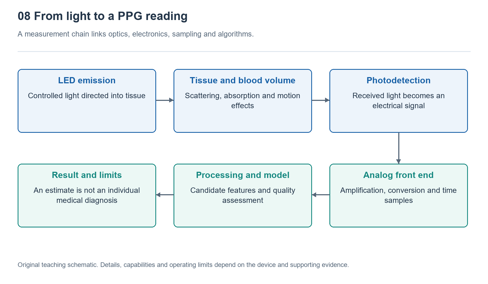

# 8.1 Why Light Carries Information About the Body: Absorption, Scattering, and Photoelectric Conversion

## 8.1.1 Starting with a Green Light on the Back of a Watch

When you take off your watch at night, you may catch a flash of green light from its back. The light source against your skin does not photograph blood vessels, yet it helps the watch estimate your pulse. This is because, after light enters tissue, some is absorbed, some changes direction, and some returns to the back of the watch. Changes in tissue conditions alter the intensity of the returning light, allowing it to carry information that can be analyzed.

Here, “carry” does not mean that every beam of light comes labeled with a heart rate. What the detector receives is the combined result of skin, blood, contact conditions, and ambient light. The watch must find pulse-related changes within this mixed signal. To understand this chain, we first need to distinguish three processes: absorption changes how much light remains, scattering changes where the light goes, and photoelectric conversion turns the received light into an electrical signal.

{width=95%}

A single measurement chain connects optics, electronics, sampling, and algorithms.


## 8.1.2 Absorption: Different Wavelengths Are Treated Differently

Shine light through a glass of colored solution, and some colors pass through easily while others are noticeably weakened. This selectivity arises because substances absorb different wavelengths of light to different degrees. The energy of absorbed light is transferred to the substance, and that light no longer continues along its original path. In human tissue, components such as hemoglobin, melanin, and water all contribute to absorption, but their contributions vary with wavelength.

Hemoglobin absorbs light differently depending on whether it is bound to oxygen. This is an important basis for using multiple wavelengths to estimate blood oxygen saturation. But “different absorption properties” does not mean “a glance at the light’s color reveals blood oxygen levels.” The light received by a watch is also affected by tissue thickness, scattering, blood distribution, and device geometry. Signal processing and calibration are needed to produce an estimate.

For a uniform medium in which scattering is negligible, the Beer–Lambert law describes how light intensity decreases as the concentration of an absorbing substance and the distance traveled increase. Put simply: the longer the path and the more absorbers along it, the less light generally gets through. This principle offers a starting point for understanding, but a wrist cannot be treated as a glass of transparent solution. Real skin is not uniform, nor does light travel through it in a straight line.

## 8.1.3 Scattering: Returning Light Takes Winding Paths

Imagine headlights shining into mist: a concentrated beam becomes dispersed. Cells and their internal structures likewise cause light to change direction repeatedly as it travels through tissue. This is scattering. After multiple changes of direction, some light returns near its entry point and is received by the photodetector on the back of the watch. The reflectance PPG commonly used in wristwatches relies on this returning light to make measurements.

The distance along the surface between the light source and detector therefore does not equal the actual distance light travels through tissue. The received light follows many different paths: some pass through shallower regions, while others reach deeper. Absorption and scattering properties also differ by wavelength. We cannot simply assume that a particular color detects only one layer of blood vessels, much less assign the same penetration depth to every wrist.

The following diagram lays out this invisible journey:

```text
Rear light source                          Photodetector
       |                                        ^
----------------------- Skin surface -----------------------
       -> Scattering -> Further scattering -> Some light returns
              -> Absorption by tissue
                    -> Further scattering through blood-containing regions
```

The arrows show only possible paths; they do not mean that every beam follows the same route. What the detector sees is the combined result of many paths. This also explains why a loose fit can interfere with measurement: changes in gaps and contact position may not only admit ambient light but also alter the conditions under which light enters and leaves the tissue.

## 8.1.4 Photoelectric Conversion: Passing Subtle Changes to the Circuitry

When returning light reaches a photodiode, it can generate a current related to the incident light. Think of this as a conversion interface: before it, light interacts with tissue; after it, circuitry amplifies, processes, and digitizes a weak current. The detector itself does not recognize a “pulse.” It merely responds to the light it receives.

As the heart beats, pulse-related changes in blood volume occur within local tissue, altering absorption conditions and potentially producing periodic fluctuations in the returning light. These fluctuations are usually superimposed on a much larger background. That background includes relatively stable tissue absorption, contributions from nonpulsatile blood, and the average illumination level. Pulse information is only a small varying component within it.

The circuitry must keep the strong background from pushing the signal beyond its measurable range while preserving the small fluctuations. Some systems schedule periods with the light source on and off to estimate and compensate for ambient light. But this does not guarantee that all interference will disappear. Wrist movement changes contact and tissue compression, and the resulting fluctuations may also be periodic. A regular waveform is therefore not automatically reliable evidence of a pulse.

## 8.1.5 From Physical Principles to Readings That Depend on Conditions

When estimating pulse rate, the system mainly looks for timing patterns associated with pulsation. When estimating blood oxygen saturation, it must also compare changes in the pulsatile component relative to the background at different wavelengths. Common methods calculate a ratio of the normalized changes in red and infrared light, then use a calibration relationship to obtain a result. This is not a direct measurement that can be completed simply by inserting two light intensities into an idealized formula.

This distinction matters: physical principles explain “why measurement is possible,” while calibration and validation answer “under what conditions the measurement is trustworthy.” Skin characteristics, local perfusion, movement, and fit can all affect results, with the specific effects also depending on device design. FDA information on pulse oximeters likewise reminds users of measurement limitations; it does not justify treating consumer wristwatches as equivalent to medical pulse oximeters.

While sitting quietly under normal conditions, you can wear your watch according to its instructions and observe when it provides a reading and when it prompts you to adjust contact. There is no need to deliberately tighten the strap, and you should not try to create changes by holding your breath or similar means. Record “what the screen displayed” separately from “what might have caused it.” Following the chain of absorption, scattering, and photoelectric conversion gives us not a window directly into the body, but an indirect method of observation that depends on conditions and requires verification.
