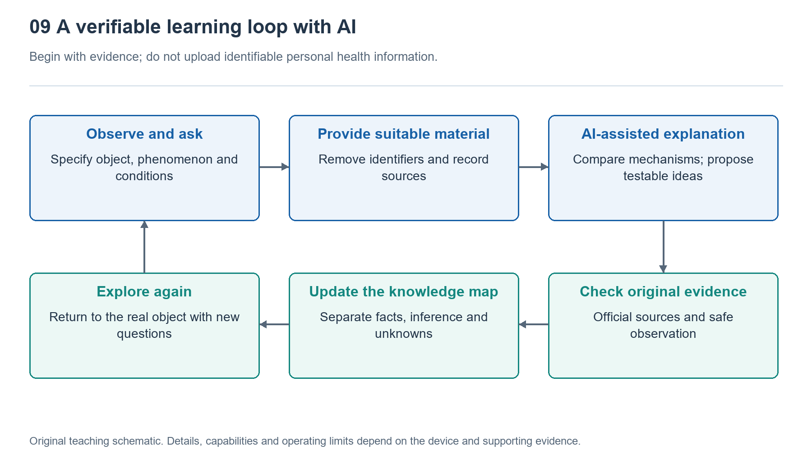

# 9.1 Watch Algorithms and AI Assistants: Distinguishing Their Roles

## 9.1.1 One Question, Two Different Jobs

After returning home from a walk, you notice a short gap in the heart rate graph on your watch. The watch provided no readings for that period, but the AI assistant on your phone quickly lists possible explanations: a loose fit, wrist movement, changes in skin contact, or records that have not yet synced. The answer is well organized, but it is not the same as what the watch actually did.

Watch algorithms work with sensor signals, device status, and predefined tasks; AI assistants typically work with the text, images, or files you provide. The former may determine that “this signal segment is unsuitable for producing a reading,” while the latter organizes possible causes based on your description. Unless it has access to the relevant data and tools, the assistant has not seen the raw signal, let alone measured your body again.

Understanding these two kinds of tools starts with distinguishing three questions: Who accessed the measurement data? Who generated the result? Who is explaining it? They can work together, but fluency alone does not make one a substitute for the other.

{width=95%}

Start with the subject and evidence, then move to explanations and conclusions; do not upload identifiable personal health information.


## 9.1.2 Watch Algorithms: Performing Specific Tasks with Limited Resources

Consider optical heart rate measurement. Not all the changes received by the photodetector come from your pulse; they also include ambient light, changes in contact, and motion interference. The watch must control acquisition timing, process the signal, check its quality, and then estimate pulse rate from usable segments. The number on the screen is the output of this sequence, not a ready-made answer read directly by the sensor.

Here, “algorithm” does not necessarily mean machine learning. Threshold comparisons, filtering, peak detection, statistical models, and trained models may all play a part. Whether a particular feature uses machine learning, and where its model runs, must be checked against specific product documentation. The word “smart” on the packaging is not enough to establish either.

These algorithms usually have clearly defined tasks, such as identifying activity types, estimating heart rate, or detecting a fall. Designers must balance detection performance, response speed, memory, and battery life. Some processing takes place on the wrist, while other processing may be handled by a phone or the cloud. It is therefore inaccurate to say that every judgment is made independently by the watch.

Nor can a watch always provide a reliable answer. Wrist signals may be missing, movement patterns may fall outside a model’s operating conditions, and individual differences may affect performance. A blank output is sometimes the result of quality control—a more honest response than forcing the display of a seemingly precise number.

## 9.1.3 AI Assistants: Organizing Language Is Not Measuring Again

General-purpose AI assistants are good at turning questions into readable explanations. They can help readers understand terms such as “photodetector,” “sampling,” and “motion artifacts,” and organize dependencies between functions based on supplied materials. Their strength lies in overcoming language barriers, giving people unfamiliar with technical terminology a starting point for further learning.

But generating an explanation and verifying a fact are two different things. An assistant may attribute one product’s design to another, present a common approach as the only approach, or even invent chip model numbers or nonexistent references. Asking it to act as a “senior engineer” may change its response style, but it does not add evidence.

If an assistant has web search or file-reading tools, it can access more information, but sources, versions, and applicability still need checking. Reading an optical analog front-end datasheet establishes only what that component can do, not whether your watch uses it. Likewise, a screenshot of a heart rate graph cannot establish which algorithm its internal filter uses.

Some wrist-based assistants may also call device interfaces to read authorized activity records. In that case, they genuinely have more input, but their access still has limits: permission to read summarized heart rate data does not imply access to raw optical waveforms, and the ability to summarize records does not imply medical diagnostic capability.

## 9.1.4 How the Two Tools Work Together

The relationship between the two kinds of tools can be mapped as follows:

```text
Body and environment
          |
Sensors -> Algorithms in watches and related systems -> Readings, graphs, alerts
                                                         | User chooses what to share
Documentation and operating conditions ----------------> AI assistant
                                                         |
                                    Explanations, questions and leads to verify
                                                         |
                                  User consults sources, observes and checks
```

The arrows show how information enters the next stage, not an automatic increase in trustworthiness. After receiving a graph, an AI assistant can help explain its meaning, but it cannot travel backward along the arrows to fill in data the device never recorded. Its proposed causes still need to be checked against documentation or observations.

Take the gap in the walking record. The assistant might suggest first distinguishing between “the watch had no reading at the time” and “the phone is not yet displaying the record.” The former may involve acquisition and quality assessment; the latter may involve syncing or display. This distinction can narrow the investigation, but without evidence, both remain possibilities to explore.

A better way to collaborate is to ask the assistant what evidence each explanation requires and what observations would weaken it, rather than demanding a single cause immediately. As the answer becomes more detailed, its evidence requirements should become clearer—not merely its terminology more elaborate and its conclusions more confident.

## 9.1.5 Try a Role Check That Does Not Involve Diagnosis

Open an ordinary walking record and choose one directly observable feature, such as a missing section of the route or a period without heart rate data. First write down “what the screen actually shows,” rather than immediately writing “the sensor is broken.” The first is an observation; the second already assigns a cause.

You can then ask the assistant: “Please distinguish between device records, general principles, and possible causes, and explain what cannot be known from this image alone.” If you use a screenshot, first obscure your name, precise home address, account details, and unnecessary health information. Alternatively, describe the issue in words without uploading the entire record.

When reviewing the answer, pay particular attention to whether it presents speculation as fact, interprets the absence of an alert as the absence of risk, or claims it can recover actual data that was never collected. If you encounter such statements, stop relying on the conclusion and consult product documentation or an appropriate professional source. Physical symptoms should not be assessed through this observation exercise either.

Watch algorithms produce specific results under constraints; AI assistants help people understand those results and organize questions. Separating measurement, judgment, and explanation is the starting point for collaborative learning: not having one tool vouch for another, but giving every step a clear role and clear limits to its evidence.
