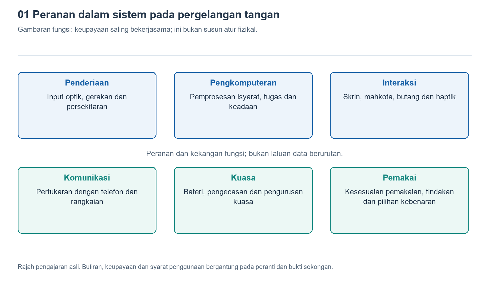

# 1.1 Bermula dengan mengangkat pergelangan tangan untuk melihat waktu: Apakah itu jam tangan pintar

## 1.1.1 Mengapa mengangkat pergelangan tangan bukan sekadar untuk melihat waktu

Ketika keluar pada waktu pagi, anda mengangkat pergelangan tangan, lalu skrin menyala dan memaparkan waktu serta satu mesej. Apabila tiba di persimpangan, pergelangan tangan terasa bergetar perlahan untuk mengingatkan anda supaya membelok; selepas selesai berjalan kaki, skrin pula memaparkan bilangan langkah dan tempoh aktiviti. Semua ini kelihatan seperti perkara yang berasingan, tetapi dilakukan oleh peranti kecil yang sama. Untuk mengenali jam tangan pintar, kita boleh bermula dengan soalan ini: bagaimanakah ia dapat menyampaikan maklumat yang berkaitan ke pergelangan tangan pada saat diperlukan?

Jam tangan biasa juga boleh mengukur masa, manakala jam tangan digital mungkin mempunyai penggera dan fungsi mengira langkah. Oleh itu, kita tidak boleh menentukan sama ada sesebuah jam tangan itu pintar hanya berdasarkan ciri “mempunyai skrin” atau “boleh mengira langkah”. Jam tangan pintar yang dimaksudkan di sini ialah sistem elektronik yang digunakan terutamanya dengan dipakai pada pergelangan tangan, serta menggabungkan keupayaan penderiaan, pengkomputeran, penyampaian maklumat dan komunikasi. Ia boleh memproses input mengikut arahan perisian dan memberikan respons terhadap aktiviti tubuh, tindakan pengguna atau maklumat luaran.

Takrif ini menekankan kerjasama antara bahagian, bukannya jumlah fungsi. Sesuatu model jam tangan yang tidak mempunyai komunikasi selular masih boleh menerima mesej melalui telefon; model lain yang boleh membuat panggilan secara kendiri pula tidak semestinya tidak lagi memerlukan telefon dalam semua keadaan. Untuk memahami peranti ini, kita perlu terlebih dahulu melihat cara ia berfungsi, bukannya mengira jumlah ikon pada halaman promosinya.

{width=95%}

Memahami penderiaan, pengkomputeran, interaksi, komunikasi dan bekalan kuasa melalui tindakan mengangkat pergelangan tangan untuk melihat waktu.


## 1.1.2 Serupa dengan telefon, tetapi bukan sekadar versi yang dikecilkan

Jam tangan pintar dan telefon sama-sama menggunakan cip, perisian, bateri serta sambungan tanpa wayar. Persamaan ini mudah menyebabkan kita menganggap jam tangan pintar sebagai telefon versi kecil. Namun, bagi mesej yang sama, cara pengendalian yang sesuai pada telefon belum tentu sesuai pada pergelangan tangan.

Pada telefon, anda boleh membaca teks yang panjang, mencari lampiran, kemudian membalas menggunakan papan kekunci. Skrin jam tangan lebih kecil, dan posisi pergelangan tangan yang diangkat juga tidak sesuai dikekalkan terlalu lama. Oleh itu, jam tangan biasanya mengutamakan paparan pengirim, ringkasan dan beberapa pilihan tindakan sahaja. Suara, tombol pemutar, butang dan getaran boleh melengkapi operasi sentuhan. Ini bukan bermakna jam tangan langsung tidak boleh digunakan untuk memasukkan teks panjang, tetapi tindakan dan perhatian yang diperlukan untuk menyelesaikan tugas yang sama adalah berbeza. Sistem perlu membuat pilihan berdasarkan perbezaan tersebut.

Kedudukan pemakaian turut mengubah keadaan operasi peranti. Jam tangan bergerak berulang kali mengikut lengan, bahagian belakangnya kerap bersentuhan dengan kulit, manakala keketatan tali mempengaruhi kestabilannya. Membesarkan bateri mungkin memanjangkan tempoh penggunaan, tetapi turut mengambil ruang dan menambah berat; meningkatkan beban pengkomputeran mungkin membolehkan lebih banyak fungsi, tetapi juga meningkatkan penggunaan kuasa dan penghasilan haba. Reka bentuk kejuruteraan perlu mengimbangi hubungan ini. Keperluan semua produk tidak boleh dirumuskan dengan satu angka berat atau kenaikan suhu yang tetap.

Jadi, jam tangan bukanlah telefon yang setiap komponennya dikecilkan mengikut nisbah yang sama. Sebaliknya, sistemnya disusun semula dengan mengutamakan keselesaan pemakaian, kejelasan paparan dan respons tepat pada masanya.

## 1.1.3 Menguraikan satu respons kepada empat keupayaan

Mari kita lihat semula tindakan mengangkat pergelangan tangan untuk menyalakan skrin. Apabila orientasi pergelangan tangan berubah, penderia gerakan memperoleh isyarat yang berkaitan; sistem menentukan sama ada skrin perlu dinyalakan berdasarkan peraturan tertentu; bahagian paparan menunjukkan waktu; manakala bateri membekalkan tenaga untuk semua proses ini. Walaupun sekadar menjeling jam, beberapa bahagian tetap perlu bekerjasama. Peranti yang berbeza juga mungkin mengambil kira keadaan lain untuk mengurangkan pengaktifan skrin akibat gerakan yang tidak disengajakan.

Untuk membina gambaran awal, kita boleh membahagikan operasi jam tangan kepada empat keupayaan buat sementara waktu: penderiaan, pengkomputeran, penyampaian dan sambungan, dengan bekalan kuasa sebagai asas bersama.

```text
Aktiviti badan dan persekitaran -> Penderiaan -> Pengiraan dan penyimpanan
                                                    -> Skrin, bunyi atau getaran
                                                    <-> Telefon dan perkhidmatan rangkaian
Bateri dan pengurusan kuasa membekalkan tenaga untuk proses ini.
```

Ini ialah rajah hubungan fungsi, bukannya rajah kedudukan komponen di dalam badan jam. Anak panah menunjukkan arah maklumat boleh disampaikan, dan tidak bermakna setiap tugas mesti melalui semua peringkat. Sebagai contoh, pengukuran masa boleh dilakukan pada jam tangan itu sendiri, manakala mesej daripada telefon memerlukan sambungan; sesetengah rekod senaman pula boleh disimpan dahulu dalam jam tangan dan disegerakkan kemudian.

“Pengkomputeran” dalam rajah juga tidak semestinya bermaksud kecerdasan buatan yang rumit. Menentukan sama ada butang telah ditekan, menjadualkan penggera dan menyusun sampel data senaman semuanya termasuk dalam pengkomputeran. Sama ada pembelajaran mesin digunakan bergantung pada fungsi dan kaedah pelaksanaannya. Kita tidak boleh menganggap setiap langkah melibatkan AI hanya kerana nama produk mengandungi perkataan “pintar”.

## 1.1.4 Menghubungkan maklumat dari luar, memerhatikan aktiviti pemakai

Dari sudut pengguna, jam tangan pintar mempunyai dua arah yang saling melengkapi. Satu arah menghadap ke luar: ia membawa mesej, panduan navigasi atau jadual ke pergelangan tangan supaya pengguna tidak perlu mengeluarkan telefon setiap kali. Arah yang satu lagi tertumpu kepada pemakai: ia memanfaatkan kedudukannya yang dekat dengan tubuh dan bergerak bersama pemakai untuk merekodkan senaman serta sebahagian isyarat berkaitan fisiologi.

Kelebihan kedudukan ini tidak bermakna ia mampu memahami tubuh manusia secara menyeluruh. Ambil pengukuran nadi secara optik yang lazim digunakan sebagai contoh. Sumber cahaya pada belakang jam menyinari kulit, pengesan menerima cahaya yang dipantulkan kembali, kemudian sistem mengekstrak maklumat berkaitan nadi daripada perubahan keamatan cahaya untuk menganggarkan kadar denyutan jantung. Ia bukan melihat denyutan jantung secara langsung, apatah lagi menentukan sama ada tubuh sihat hanya berdasarkan satu angka.

Pemakaian berterusan juga tidak bermakna semua penderia sentiasa mengukur tanpa henti. Peranti mungkin menyesuaikan cara operasinya mengikut keadaan aktiviti, tahap bateri, tetapan dan kualiti isyarat. Sesetengah fungsi juga perlu diaktifkan sendiri oleh pengguna, atau tertakluk pada syarat wilayah dan kebenaran. Apabila skrin menunjukkan bacaan, kita perlu bertanya pengukuran apakah yang menghasilkan bacaan itu; apabila tiada amaran pula, kita tidak boleh menganggap bahawa masalah kesihatan tidak wujud.

Begitu juga, pengesanan jatuh atau panggilan kecemasan hanya dapat memberikan bantuan dalam keadaan yang ditetapkan oleh produk. Ia tidak dapat menjamin bahawa setiap kejadian akan dikenal pasti atau setiap permintaan bantuan akan berjaya dibuat. Sambungan, tetapan dan tahap bateri semuanya boleh mempengaruhi hasilnya.

## 1.1.5 Membina pemahaman melalui jam tangan sendiri

Sekarang, anda boleh melakukan pemerhatian ringkas tanpa membuka peranti: dalam keadaan tidak bergerak di tempat yang selamat, cuba melihat waktu dengan mengangkat pergelangan tangan dan kemudian dengan menekan butang. Perhatikan sama ada kedua-dua cara boleh mengaktifkan skrin. Seterusnya, buka rekod aktiviti yang sedia ada dan lihat sama ada ia memaparkan jumlah terkumpul bagi hari itu atau hasil satu sesi aktiviti. Jangan menghayunkan pergelangan tangan dengan kuat semata-mata untuk menguji, dan tidak perlu sengaja mewujudkan keadaan luar biasa.

Bahagikan catatan pemerhatian kepada tiga kategori: “Apa yang saya lihat”, “Apa yang saya simpulkan daripadanya” dan “Apa yang belum saya ketahui”. Contohnya, skrin menyala selepas pergelangan tangan diangkat ialah pemerhatian langsung; kemungkinan sistem menggunakan penderia gerakan untuk menentukan orientasi ialah kesimpulan berasaskan prinsip; manakala komponen dan peraturan penentuan yang sebenarnya digunakan tidak dapat dipastikan hanya melalui rupa luaran.

Perbezaan ini ialah titik permulaan untuk memahami jam tangan pintar. Ia bukan sahaja barang yang dipakai dekat pada tubuh, tetapi juga sebuah mikrosistem yang sentiasa menerima input, memprosesnya dan memberikan respons. Fahami dahulu untuk siapa ia berfungsi dan dalam keadaan apa ia beroperasi, kemudian kenali setiap bahagiannya secara beransur-ansur. Dengan itu, skrin kecil pada pergelangan tangan akan menjadi pintu masuk untuk memahami sistem, bukan sekadar senarai fungsi.
