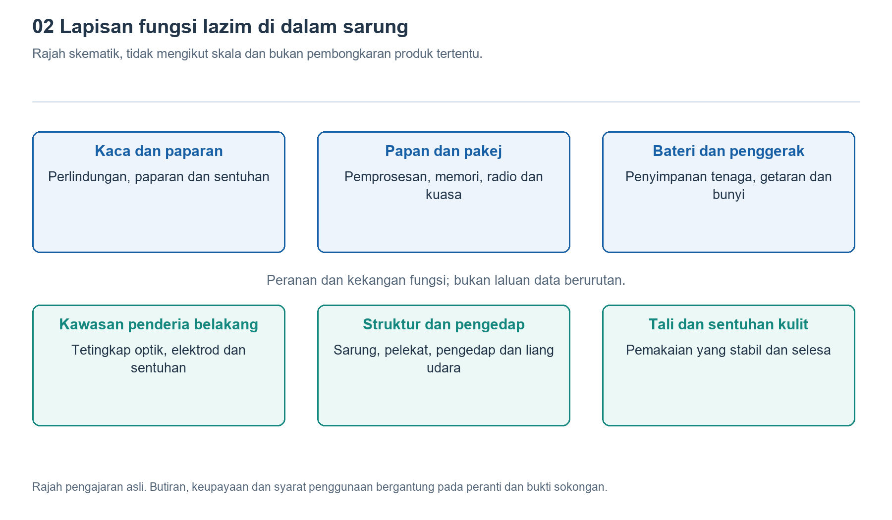

# 2.1 Melihat ke dalam melalui antara muka luaran: membina rajah modul sistem

Tanggalkan jam tangan daripada pergelangan tangan dan letakkannya di atas permukaan meja yang lembut dan kering. Bahagian hadapan ialah skrin, bahagian sisi mungkin mempunyai tombol pemutar, butang dan lubang kecil, manakala bahagian belakang mungkin mempunyai tingkap lutsinar, permukaan sentuhan logam atau titik sentuhan pengecasan. Semua ini bukan sekadar butiran rupa luaran, tetapi juga titik permulaan untuk memahami sistem dalaman. Tanpa membuka sarung jam, anda boleh membina rajah modul sistem secara beransur-ansur dengan bertanya, “Apakah yang masuk melalui bahagian ini, dan apakah yang keluar?”

## 2.1.1 Mengemukakan soalan berdasarkan antara muka, bukan meneka komponen

“Antara muka” di sini bukan sahaja merujuk kepada palam dan soket, tetapi juga bahagian tempat jam tangan bertukar maklumat atau tenaga dengan tubuh manusia, persekitaran dan peranti lain. Apabila jari menekan butang, tindakan mekanikal memasuki sistem; apabila skrin menyala, maklumat dikeluarkan dalam bentuk cahaya; apabila sumber cahaya di bahagian belakang menyinari kulit, cahaya yang dipantulkan oleh tisu pula memasuki pengesan. Sambungan tanpa wayar yang tidak kelihatan juga merupakan sejenis antara muka.

Semasa membuat pemerhatian, huraikan dahulu fenomena yang dilihat, kemudian nyatakan keupayaan dalaman yang diperlukan. Contohnya, “skrin menyala selepas butang ditekan” ialah fenomena yang boleh disahkan secara langsung; “terdapat litar dalaman yang mengenal pasti tekanan butang dan mengawal paparan” ialah inferens yang berasas; manakala cip yang memprosesnya dan laluan litar yang dilaluinya memerlukan pengesahan lanjut. Ketiga-tiga jenis pernyataan ini tidak boleh disamakan.

Lubang kecil di bahagian sisi amat mudah disalah tafsir. Lubang itu mungkin berkaitan dengan mikrofon, pembesar suara atau penderiaan tekanan udara, tetapi kegunaannya biasanya tidak dapat dipastikan hanya berdasarkan saiz dan bentuknya. Merujuk manual penggunaan bagi model yang berkenaan lebih boleh dipercayai daripada mencucuk lubang dengan jarum, dan tidak akan merosakkan membran dalaman atau struktur pengedap. Tujuan pemerhatian antara muka ialah mengemukakan soalan yang boleh disahkan, bukannya memaksa setiap bahagian diberi nama berdasarkan rupanya semata-mata.

{width=95%}

Gambaran skematik lapisan fungsi, tidak mengikut skala dan tidak mewakili hasil pembongkaran mana-mana produk.


## 2.1.2 Mengelompokkan bahagian dalaman yang kompleks kepada enam jenis modul

Bagi sebuah jam tangan yang mempunyai pelbagai fungsi, bahagian dalamannya boleh dikelompokkan terlebih dahulu mengikut tanggungjawab kepada enam jenis: penderiaan, pengkomputeran dan kawalan, storan, interaksi, komunikasi serta bekalan kuasa. “Modul” di sini ialah unit fungsi yang dibentuk untuk memahami sistem, dan tidak bermakna terdapat enam komponen berasingan di dalam sarung jam.

Modul penderiaan menerima perubahan pada tubuh dan persekitaran, termasuk pengesanan optik, pengukuran elektrod dan penderiaan gerakan. Modul pengkomputeran dan kawalan menjadualkan tugas, memproses data serta menentukan masa untuk menyalakan skrin atau mengeluarkan peringatan. Modul storan menyimpan atur cara, tetapan dan rekod, termasuk data yang disimpan sementara semasa operasi serta kandungan yang perlu dikekalkan walaupun bekalan kuasa terputus.

Modul interaksi membolehkan pengguna melihat, mendengar dan merasai hasil, di samping menerima input sentuhan dan tekanan butang. Modul komunikasi menjalin hubungan yang bersesuaian dengan telefon, rangkaian tanpa wayar atau isyarat satelit. Modul bekalan kuasa pula menukar dan mengagihkan tenaga yang disimpan dalam bateri kepada setiap bahagian, serta terlibat dalam pengurusan pengecasan dan perlindungan.

Komponen sebenar mungkin menjalankan beberapa tanggungjawab. Contohnya, satu cip bersepadu tinggi boleh merangkumi keupayaan pemprosesan dan litar komunikasi tanpa wayar serentak; satu pemasangan paparan pula mungkin merangkumi panel paparan, struktur sentuh dan pemacu yang berkaitan. Oleh itu, rajah modul menjawab soalan “bahagian mana menjalankan tugas apa”, bukannya “berapa banyak cip yang ada di dalamnya”.

## 2.1.3 Menggunakan garis penghubung untuk menunjukkan hubungan kerjasama

Semasa melukis rajah, letakkan pengkomputeran dan kawalan di tengah terlebih dahulu, susun modul lain di sekelilingnya, kemudian lukiskan tubuh manusia, telefon dan pengecas di luar sempadan sistem. Berikut ialah rajah skematik fungsi sebagai pengenalan, bukan susun atur sebenar bagi mana-mana model.

```text
Badan dan persekitaran -> [Penderiaan] -> [Pengiraan dan kawalan] <-> [Storan]
Tindakan jari -> [Interaksi] -> Cahaya, bunyi dan getaran
Telefon dan peranti lain <-> [Komunikasi]
Pengecas -> [Bekalan kuasa] -> Penderiaan, pengiraan, storan, interaksi dan komunikasi
Blok fungsi bertukar maklumat mengikut keperluan tugas.
```

Bahagian atas rajah terutamanya menunjukkan hubungan maklumat, manakala baris paling bawah menunjukkan hubungan bekalan tenaga. Anak panah menghubungkan fungsi, bukannya menggambarkan jarak di dalam sarung jam. Modul penderiaan mungkin terletak berhampiran bahagian bawah sarung atau pada papan litar; litar komunikasi dan antena juga mungkin berada di lokasi yang berlainan. Dua kotak yang bersebelahan dalam rajah tidak bermakna komponen yang diwakilinya turut bersebelahan dalam peranti sebenar.

Anak panah dua hala dalam rajah juga mempunyai makna khusus: modul pengkomputeran boleh membaca dan menulis rekod; modul komunikasi boleh menghantar data dan menerima arahan. Demi ringkasan, bahagian penderiaan hanya menunjukkan arah penghantaran data keluar. Namun, semasa beroperasi, modul ini biasanya turut perlu menerima arahan kawalan untuk mula, berhenti atau mengubah cara operasinya. Rajah boleh dipermudah, tetapi anda perlu mengetahui perkara yang telah dipermudah.

## 2.1.4 Menyemak kelengkapan modul melalui satu tindakan

Sekarang, tekan butang sekali dengan lembut dan perhatikan respons skrin. Tindakan biasa ini dapat membantu menyemak rajah modul. Butang menukar tindakan kepada isyarat elektrik, logik kawalan mengenal pasti peristiwa tersebut, atur cara menentukan kandungan yang hendak dipaparkan, litar berkaitan paparan memacu skrin, dan sistem bekalan kuasa menyediakan tenaga untuk semua proses ini. Jika antara muka perlu membaca ringkasan senaman yang terakhir, modul storan juga akan terlibat.

Modul komunikasi tidak perlu dimasukkan serta-merta dalam proses ini. Banyak operasi setempat tidak memerlukan penglibatan telefon atau awan. Komunikasi hanya menjadi sebahagian daripada rantaian fungsi ini apabila antara muka perlu mendapatkan maklumat yang belum disimpan pada peranti, atau melaksanakan tugas seperti penyegerakan. Nilai rajah modul terletak pada keupayaannya membezakan antara “jam tangan mempunyai modul tertentu” dengan “operasi ini mesti menggunakan modul tertentu”.

Sebaliknya, jika skrin tidak menyala, hal itu juga tidak membuktikan secara langsung bahawa skrin rosak. Paras bateri yang rendah, keadaan terkunci, tetapan butang atau gangguan perisian semuanya boleh mengubah hasilnya. Satu rantaian fungsi melalui beberapa peringkat. Keadaan tidak normal pada hujung rantaian hanya menunjukkan bahawa pemeriksaan perlu dilakukan sepanjang rantaian tersebut, bukan membolehkan komponen tertentu dikenal pasti sebagai punca berdasarkan hasil itu sahaja. Perspektif sistem dapat mengurangkan kesilapan membuat kesimpulan terlalu awal seperti ini.

## 2.1.5 Meninggalkan bukti dan ruang kosong dalam rajah modul

Anda boleh melukis rajah untuk jam tangan sendiri di atas kertas dan menggunakan tiga label untuk membezakan bukti: “telah diperhatikan”, “disahkan melalui dokumentasi” dan “belum diketahui”. Keupayaan skrin memaparkan kandungan boleh ditandakan sebagai telah diperhatikan; sokongan penentududukan satelit kendiri perlu disahkan melalui dokumentasi rasmi model berkenaan; jenis pakej komponen yang digunakan dan lokasi antena pula hendaklah dibiarkan sebagai belum diketahui jika tiada bahan rujukan yang boleh dipercayai.

Jangan menyalin struktur dalaman model jam tangan lain semata-mata untuk menjadikan rajah kelihatan lengkap. Versi yang berbeza dalam siri yang sama juga mungkin mempunyai perbezaan dari segi komunikasi selular, penderia atau kaedah pengecasan. Mencatat model penuh dan tarikh bahan rujukan akan membantu semakan pada masa hadapan. Sepanjang pemerhatian, jangan buka sarung, sentuh bateri, masukkan objek ke dalam lubang atau menguji struktur dengan merendam jam di dalam air.

Hasil akhirnya bukan rajah litar yang tepat, tetapi peta pemahaman yang disokong bukti: antara muka luaran menunjukkan pihak yang terlibat dalam pertukaran, modul fungsi menerangkan pembahagian tugas, garis penghubung menjelaskan hubungan kerjasama, manakala ruang kosong menandakan persoalan yang perlu disahkan seterusnya. Apabila anda mempelajari pemproses, penderia atau komponen bekalan kuasa selepas ini, anda dapat mengaitkan pengetahuan baharu itu dengan sistem, bukannya sekadar menghafal deretan nama yang terpisah.
