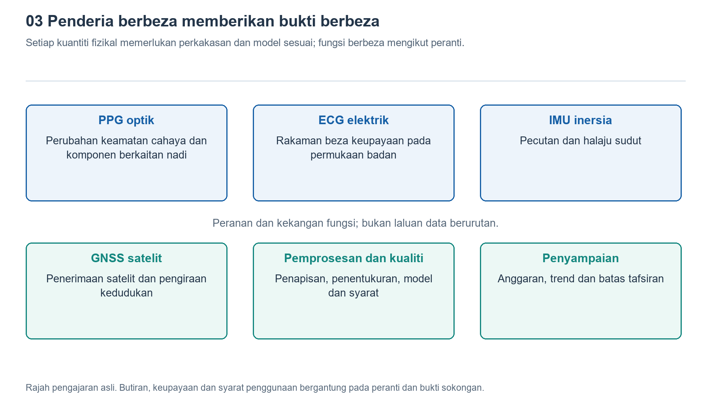

# 3.1 Bagaimana cahaya membaca nadi: PPG serta anggaran kadar denyutan jantung dan oksigen darah

## 3.1.1 Apakah yang dicari oleh cahaya di belakang jam tangan?

Apabila menanggalkan jam tangan pada waktu malam, anda mungkin terpandang cahaya hijau berkelip di bahagian belakangnya. Cahaya itu bukan untuk menerangi kawasan sekeliling, dan bukan juga untuk mengambil gambar salur darah, tetapi merupakan titik permulaan pengukuran optik. Cahaya memasuki kulit melalui tetingkap di bahagian belakang jam. Sebahagiannya diserap, manakala sebahagian lagi kembali selepas mengalami serakan berulang, lalu diterima oleh pengesan fotoelektrik di sebelahnya. Yang dicari oleh jam tangan ialah perubahan kecil pada keamatan cahaya yang kembali, yang turun naik mengikut denyutan nadi.

Kaedah ini dikenali sebagai fotopletismografi, atau ringkasnya PPG. Istilah “isipadu” dalam kaedah ini merujuk kepada perubahan dalam tisu yang berkaitan dengan isipadu darah, bukan bermaksud jam tangan boleh mengukur secara langsung jumlah darah di dalam sesuatu salur darah. Setiap denyutan jantung menolak darah ke dalam salur darah periferi, lalu menyebabkan perubahan halus pada sifat optik tisu pergelangan tangan. Cahaya yang kembali turut membawa maklumat tentang irama tersebut.

Oleh itu, hasil awal PPG ialah isyarat perubahan keamatan cahaya mengikut masa, bukannya angka kadar denyutan jantung yang tersedia terus. Daripada cahaya kepada bacaan, masih terdapat proses penukaran kepada isyarat elektrik, pemprosesan gangguan dan penganggaran melalui algoritma. Lampu di belakang jam yang menyala hanya menunjukkan bahawa sumber cahaya sedang berfungsi, bukan membuktikan bahawa pengukuran itu sudah boleh dipercayai.

{width=95%}

Kuantiti fizikal yang berbeza memerlukan komponen dan model yang berbeza; fungsi juga berbeza mengikut peranti.


## 3.1.2 Mengasingkan nadi daripada cahaya yang kembali

PPG pada pergelangan tangan biasanya menggunakan susunan pantulan: sumber cahaya dan pengesan berada pada sisi kulit yang sama. Selepas memasuki tisu, cahaya tidak berpatah balik mengikut satu lengkungan yang teratur. Sebaliknya, cahaya merambat melalui laluan serakan yang rumit, dan akhirnya hanya sebahagian daripadanya sampai ke pengesan.

Cahaya yang diterima oleh pengesan mengandungi komponen latar yang besar, dengan komponen denyutan yang lebih kecil menindihnya. Komponen pertama berkaitan dengan faktor seperti kulit, tisu dan darah yang tidak berdenyut; komponen kedua pula berkaitan dengan perubahan isipadu darah arteri mengikut denyutan jantung. “Latar” ini juga tidak sentiasa tetap. Pergerakan pergelangan tangan atau perubahan tekanan sentuhan boleh menyebabkan turun naik yang ketara.

Rajah skematik di bawah menunjukkan hubungan penukaran maklumat. Ia bukan keratan rentas tisu sebenar, dan tidak bermaksud cahaya hanya melalui satu laluan.

```text
Sumber cahaya -> Penyerapan dan penyerakan dalam kulit dan tisu -> Fotopengesan
                              ^                                      |
              Perubahan isi padu darah mengikut nadi        Cahaya menjadi isyarat elektrik
                                                                     |
                                            Pensampelan, penilaian kualiti dan penganggaran
                                                                     |
                                           Anggaran kadar denyutan / oksigen darah
```

Anak panah ke atas dalam rajah menunjukkan bahawa perubahan isipadu darah mempengaruhi perambatan cahaya. Rantaian pemprosesan di bahagian bawah pula menunjukkan bahawa angka pada skrin terhasil daripada gabungan beberapa peringkat. Selepas pengesan menukarkan cahaya kepada isyarat elektrik, litar pemerolehan data menukarkannya pula kepada sampel digital. Algoritma perlu mencari kitaran yang boleh dipercayai dalam sampel ini, sambil mengenal pasti gangguan akibat pergerakan, kebocoran cahaya atau perubahan sentuhan.

## 3.1.3 Mengapakah cahaya hijau sering digunakan untuk menganggarkan kadar denyutan jantung?

Banyak jam tangan menggunakan cahaya hijau untuk memantau kadar denyutan jantung kerana hemoglobin menyerap cahaya dalam julat panjang gelombang ini dengan agak kuat. Apabila dipadankan dengan sumber cahaya dan susunan penerimaan yang sesuai, isyarat denyutan yang boleh dianalisis dapat diperoleh. Namun, ini tidak bermaksud “cahaya hijau secara semula jadi tidak terjejas oleh pergerakan”, dan bukan semua peranti hanya menggunakan cahaya hijau dalam semua keadaan. Panjang gelombang, susun atur sumber cahaya, keadaan kulit dan peruntukan penggunaan kuasa semuanya mempengaruhi pertimbangan reka bentuk.

Apabila kualiti isyarat cukup baik, algoritma boleh mengenal pasti sela masa antara denyutan nadi berturutan, atau menganalisis frekuensi pengulangan utama dalam suatu segmen bentuk gelombang, kemudian menukarkannya kepada bilangan denyutan seminit. Contohnya, dalam keadaan ideal, satu gelombang nadi yang boleh dipercayai setiap saat bersamaan dengan kira-kira enam puluh denyutan seminit. Ini hanyalah contoh penukaran, bukan piawaian untuk menilai kesihatan.

Antara muka harian lazimnya melabelkan hasil ini sebagai “kadar denyutan jantung”, tetapi PPG memerhatikan secara langsung perubahan berkaitan nadi periferi, bukannya aktiviti elektrik jantung. Dalam sesetengah keadaan irama jantung tidak normal, perfusi periferi yang tidak mencukupi atau gangguan pergerakan, kedua-duanya tidak boleh dianggap sama begitu sahaja. Kemas kini skrin juga tidak semestinya seiring dengan setiap denyutan. Peranti mungkin menggabungkan data sepanjang suatu tempoh untuk menghasilkan paparan yang lebih stabil.

## 3.1.4 Mengapakah anggaran oksigen darah memerlukan warna yang berbeza?

Mengetahui irama nadi sahaja belum mencukupi untuk mengetahui keadaan hemoglobin membawa oksigen. Anggaran oksigen darah menggunakan petunjuk lain: hemoglobin beroksigen dan hemoglobin terdeoksigen mempunyai ciri penyerapan yang berbeza bagi cahaya dengan panjang gelombang yang berlainan. Kaedah lazim menggunakan cahaya merah dan inframerah dekat, dengan memerhatikan perubahan setiap satunya selepas merambat melalui tisu.

Namun, membandingkan cahaya mana yang “lebih terang” sahaja tidak mencukupi. Kekuatan sumber cahaya, ciri kulit dan laluan perambatan semuanya mengubah jumlah cahaya yang diterima. Kaedah lazim ialah mengekstrak komponen denyutan bagi setiap panjang gelombang dan membandingkannya dengan komponen latar masing-masing. Kedua-dua perubahan relatif ini kemudian dibandingkan, lalu digabungkan dengan hubungan yang telah ditentukur untuk menganggarkan ketepuan oksigen darah.

Langkah ini bergantung pada kedua-dua pengukuran optik dan model penentukuran, bukannya mengira molekul oksigen dalam darah secara langsung. Keadaan pengukuran pantulan pada pergelangan tangan juga berbeza daripada pengukuran transmisi menggunakan alat yang dikepit pada jari. Fungsi jam tangan pengguna tidak boleh dianggap secara automatik setara dengan oksimeter perubatan hanya kerana kedua-duanya memaparkan peratusan.

Anggaran oksigen darah khususnya memerlukan isyarat nadi yang stabil dan boleh digunakan. Pengurangan aliran darah periferi akibat suhu rendah, pergerakan pergelangan tangan atau pemakaian yang tidak sesuai semuanya boleh menyebabkan hasil menyimpang atau bacaan gagal dihasilkan. Panduan FDA mengenai oksimeter nadi turut mengingatkan bahawa faktor seperti pigmentasi kulit dan keadaan peredaran darah boleh mempengaruhi pengukuran. Keterbatasan ini tidak sepatutnya terlindung di sebalik angka yang kelihatan tepat.

## 3.1.5 Sejauh manakah pemerhatian yang selamat dapat memberikan maklumat?

Anda boleh membuat pemerhatian ringkas dalam persekitaran dalaman harian: pakai jam tangan mengikut arahan produk, duduk dengan tenang dan letakkan lengan bawah di atas meja dalam kedudukan yang selesa. Kemudian, mulakan pengukuran kadar denyutan jantung yang disokong oleh peranti. Catat sama ada bacaan dipaparkan, berapa lama masa menunggu, dan sama ada sebarang makluman kualiti muncul. Tidak perlu mengejar angka tertentu, apatah lagi sengaja menahan nafas atau melakukan senaman berat untuk menghasilkan perubahan.

Selepas itu, dalam kehidupan seharian, perhatikan sama ada rekod lebih mudah terputus ketika berjalan berbanding ketika berehat. Jika terdapat perbezaan, penjelasan awal yang munasabah ialah keadaan pengukuran telah berubah. Berdasarkan pemerhatian ini sahaja, belum dapat dipastikan sama ada ayunan lengan, perubahan sentuhan atau strategi algoritma yang memainkan peranan utama. Jangan juga mengetatkan tali jam semata-mata untuk “menguatkan isyarat”. Kesesuaian pemakaian hendaklah berasaskan arahan manual, keselesaan dan keselamatan.

Nilai PPG terletak pada keupayaannya memberikan petunjuk berkaitan nadi secara berterusan dengan beban yang agak rendah kepada pengguna. Batasannya pula ialah isyarat optik sentiasa dipengaruhi oleh keadaan tubuh dan persekitaran. Semasa mentafsir bacaan, pertimbangkan keadaan pengukuran, makluman kualiti dan arah aliran dari semasa ke semasa secara bersama. Ketiadaan amaran tidak bermaksud penyakit telah disingkirkan. Jika terdapat rasa tidak sihat yang ketara, angka pada jam tangan juga tidak boleh menggantikan penilaian profesional yang tepat pada masanya.
