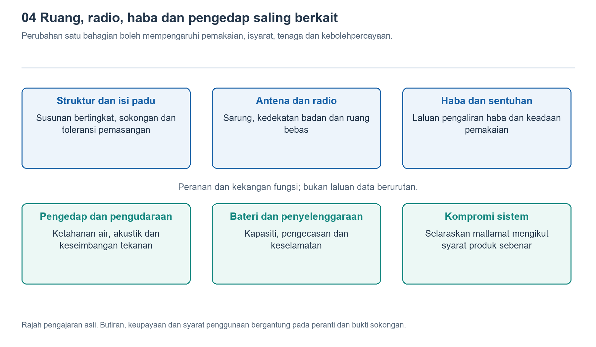

# 4.1 Pembahagian ruang dalam sarung jam: memahami susun atur berlapis melalui rajah keratan rentas

## 4.1.1 Dari sisi, jam tangan bukan sebuah kotak kosong

Tanggalkan jam tangan dan letakkannya secara mengiring di atas meja. Anda akan melihat kaca jam, bingkai dan tingkap belakang yang sedikit menonjol. Dari luar, hanya beberapa garis bentuk yang kelihatan, tetapi di dalamnya perlu dimuatkan skrin, bateri, papan litar, penderia, pembesar suara dan komponen getaran. Semua ini bukan sahaja perlu muat, malah memerlukan ruang untuk sambungan, pengikat dan perlindungan.

Untuk memahami susunan ini, bayangkan sarung jam dipotong secara menegak melalui bahagian tengah, kemudian dilihat dari permukaan potongannya. Inilah konsep asas rajah keratan rentas. Rajah ini memperlihatkan hubungan atas dan bawah yang terlindung oleh sarung: bahagian yang dekat dengan mata, bahagian yang rapat dengan kulit, dan bahagian yang berada di antaranya. Namun, jam sebenar tidak boleh dipotong atau diumpil sendiri semata-mata untuk melihat bahagian dalamnya. Sebaliknya, kita menggunakan rajah skema struktur dan maklumat awam yang mempunyai sumber.

Rajah keratan rentas bukan sekadar pengganti foto bahagian dalaman, tetapi suatu bentuk gambaran terpilih. Ia menonjolkan ketinggian, ketebalan dan hubungan sentuhan, namun tidak semestinya menunjukkan bentuk lengkap komponen yang memanjang ke kiri dan kanan.

{width=95%}

Perubahan pada satu komponen boleh mengubah keadaan pemakaian, isyarat dan tenaga secara serentak.


## 4.1.2 Membentuk gambaran berlapis dari skrin hingga ke kulit

Pada sisi yang menghadap pandangan pengguna, biasanya terdapat kaca jam serta struktur paparan dan sentuhan. Kaca jam menahan sentuhan harian, struktur paparan menghasilkan imej, manakala struktur sentuhan mengesan input pengguna. Struktur-struktur ini mungkin dilekatkan rapat antara satu sama lain, jadi rupa luar sahaja tidak cukup untuk menentukan sama ada ia terdiri daripada beberapa komponen berasingan.

Bahagian tengah lazimnya diperuntukkan kepada bateri dan litar utama. Bateri biasanya memerlukan ruang yang agak besar dan bersambung, manakala papan litar boleh memanfaatkan ruang selebihnya melalui bentuk tidak sekata, tindanan setempat atau susunan mengelilingi komponen lain. Kedua-duanya tidak semestinya disusun tepat di atas dan di bawah satu sama lain; ia juga boleh diletakkan bersebelahan atau bertindih pada bahagian tertentu.

Pada sisi yang dekat dengan kulit, ruang perlu disediakan untuk tingkap optik, elektrod dan struktur penderiaan yang berkaitan. Cahaya daripada sumber cahaya perlu sampai ke kulit, dan cahaya yang kembali pula perlu memasuki pengesan. Oleh itu, laluan ini tidak boleh dihalang oleh bateri atau penyokong legap. Bonjolan di belakang kadangkala berkaitan dengan struktur penderiaan, keadaan sentuhan dan ruang dalaman, bukan semata-mata kerana satu komponen terlalu tebal.

Rajah skema asli di bawah hanya menunjukkan hubungan ruang, tidak mewakili model tertentu dan tidak dilukis mengikut skala.

```text
                         Menghadap pandangan
               Kaca pelindung, paparan dan lapisan sentuhan
                                  |
        Bahagian sisi -- Kawasan litar -- Laluan sambungan
                                  |
                         Ruang untuk bateri
                                  |
             Struktur sokongan, pemasangan dan penderiaan
                                  |
                          Tetingkap belakang
                           Menghadap kulit
Susunan fungsi sahaja; bukan lukisan berskala.
```

Laluan sambungan dalam rajah mengingatkan kita bahawa tenaga elektrik dan isyarat mesti dapat dihantar antara lapisan atas dengan lapisan bawah. Ketiadaan sesetengah komponen dalam rajah tidak bermakna komponen itu tidak wujud; produk sebenar juga mungkin menukar kedudukan bateri dengan litar.

## 4.1.3 Mengapa setiap ruang kosong tidak boleh diisi sepenuhnya

Ketika mengemas bagasi, semakin sedikit ruang kosong seolah-olah semakin baik. Namun, reka bentuk jam tangan tidak boleh hanya bertujuan memadatkan segala-galanya. Dimensi komponen mempunyai toleransi pembuatan, dan proses pemasangan juga memerlukan ruang untuk penjajaran dan kerja pemasangan. Jika ukuran reka bentuk bersentuhan tepat tanpa kelonggaran, pengeluaran sebenar mungkin menghadapi masalah himpitan, komponen tidak dapat dipasang atau taburan daya yang tidak sekata.

Bateri khususnya tidak boleh dianggap sebagai blok pengisi yang boleh ditekan sesuka hati. Ia perlu dipasang dengan kukuh dan memenuhi keperluan reka bentuk produk berkaitan perubahan dimensi, perlindungan mekanikal dan keselamatan. Kelonggaran yang diperlukan ditentukan bersama oleh sel bateri, struktur dan syarat pengesahan; tiada satu ukuran sela yang sesuai untuk semua jam tangan.

Penyambung, bahagian lenturan kabel reben dan permukaan sambungan kedap juga mengambil ruang. Penyokong, lapisan pelekat dan pelapik yang kelihatan tidak mempunyai fungsi elektronik dalam lukisan mungkin berperanan menyerap hentakan, menebat, menetapkan kedudukan atau memberikan kekedapan. Membuangnya tidak semestinya menghasilkan jam nipis yang sama andalnya.

Ruang lega dalaman juga perlu dibezakan daripada ketebalan luaran. Kaca jam, dasar sarung dan struktur sokongan mempunyai ketebalannya sendiri, manakala bonjolan belakang turut mempengaruhi sentuhan ketika dipakai. Membandingkan angka ketebalan pada bahan promosi sahaja tidak cukup untuk menentukan jam yang mempunyai ruang dalaman lebih lapang atau yang semestinya lebih selesa dipakai.

## 4.1.4 Mengapa isipadu yang sama boleh mempunyai susun atur berbeza

Bayangkan dua jam tangan dengan bentuk luaran yang hampir sama: satu mengutamakan tempoh penggunaan bateri yang lebih panjang, manakala satu lagi menambah komunikasi kendiri dan lebih banyak fungsi interaksi. Jam pertama mungkin memperuntukkan lebih banyak ruang kepada bateri, sementara jam kedua perlu menyediakan ruang untuk litar tambahan, struktur sambungan dan komponen berkaitan. Contoh ini hanya menjelaskan arah pertimbangan reka bentuk, bukan asas untuk menyimpulkan reka bentuk sebenar sesuatu produk.

Susun atur turut dibatasi oleh cara komponen berfungsi. Skrin perlu menghadap ke luar, tingkap penderia optik perlu menghadap kulit, butang mesti boleh dikendalikan dari sisi, dan pembesar suara memerlukan ruang akustik yang sesuai. Kedudukan komponen-komponen ini tidak boleh ditukar sesuka hati seperti blok mainan.

Sarung jam bulat dan segi empat juga mewujudkan kekangan yang berbeza. Bateri dan kawasan litar yang lazim digunakan tidak semestinya memenuhi bentuk bulatan dengan tepat, lalu meninggalkan kawasan di tepi yang sesuai untuk komponen kecil. Bentuk segi empat pula tidak bermakna tiada ruang yang terbuang, kerana bucu bulat, tempat pengikat dan dinding sisi tetap mengambil ruang. Oleh itu, keluasan luaran yang hampir sama tidak bermakna isipadu dalaman yang boleh digunakan juga sama.

Pembahagian ruang akhirnya merupakan hasil pelbagai pertimbangan: penambahan satu komponen mungkin bukan sahaja mengambil ruang sebesar komponen itu sendiri, tetapi turut memerlukan pelarasan pada kaedah pengikatan, laluan sambungan dan struktur di sekelilingnya.

## 4.1.5 Membaca rajah berasaskan bukti, bukan meneka melalui bentuk

Ketika membaca rajah keratan rentas yang tersedia kepada umum, mulakan dengan mencari tiga titik rujukan: permukaan paparan, tingkap penderia belakang dan sempadan sarung jam. Kemudian, kenal pasti kawasan bateri dan litar. Seterusnya, perhatikan komponen yang bertindih, komponen yang berada di tepi, dan laluan yang perlu merentasi aras ketinggian berbeza. Cara ini lebih mudah untuk membentuk pemahaman menyeluruh berbanding meneka nama setiap cip sejak awal.

Jenis imej juga perlu disemak. Imej janaan promosi mungkin tidak menunjukkan lapisan pelekat dan pengikat; lukisan paten menunjukkan penyelesaian teknikal, tetapi tidak menjamin bahawa penyelesaian itu telah digunakan dalam sesuatu produk; foto pembongkaran lebih hampir kepada keadaan sebenar, namun sudut rakaman mungkin menyembunyikan struktur di bawah. Rajah cerai memisahkan komponen untuk menerangkan hubungan pemasangan, jadi jarak dalam rajah tidak boleh dianggap sebagai sela sebenar.

Anda boleh melukis bentuk sisi jam tangan sendiri di atas kertas. Tandakan dahulu kaca jam, butang dan tingkap belakang yang dapat dilihat secara langsung, kemudian gunakan garisan putus-putus untuk melengkapkan kawasan dalaman yang dianggarkan. Di sebelahnya, tuliskan label “kelihatan pada objek sebenar”, “disahkan melalui sumber” dan “belum dipastikan”. Jangan mengisi bahagian yang tidak diketahui semata-mata untuk melengkapkan lukisan.

Kunci untuk memahami susun atur berlapis bukanlah menghafal satu urutan tetap, tetapi memahami sebab setiap kedudukan digunakan dan batasan yang terhasil daripada penggunaannya. Setiap lapisan dalam sarung jam menyokong fungsi, pemasangan dan keandalan secara serentak.
