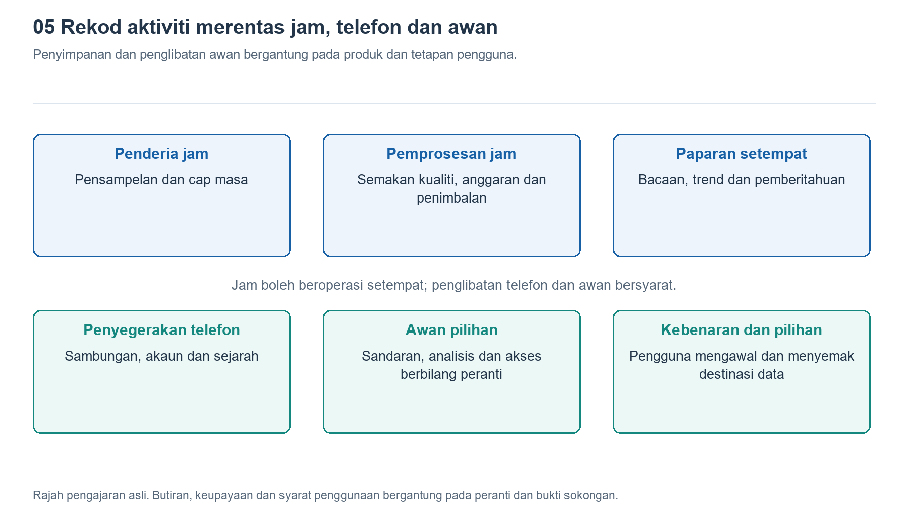

# 5.1 Daripada pengecas ke setiap modul: bagaimana tenaga elektrik mengalir

## 5.1.1 Apabila diletakkan pada tapak pengecas, dari manakah elektrik masuk

Pada waktu malam, anda meletakkan jam tangan pada tapak pengecas, lalu simbol pengecasan muncul pada skrin. Tindakan ini kelihatan sekadar “mengisi bateri dengan elektrik”, tetapi sebenarnya mengaktifkan laluan tenaga yang melalui proses penerimaan, penukaran, pengawalan dan perlindungan. Tenaga elektrik tidak disalurkan terus ke bateri melalui seutas wayar, dan bateri juga tidak mengagihkannya kepada semua komponen tanpa mengambil kira keperluan masing-masing.

Lihat dahulu cara bahagian belakang jam tangan bersambung dengan tapak pengecas. Sesetengah produk mengalirkan elektrik melalui sesentuh logam, manakala yang lain memindahkan tenaga melalui gandingan elektromagnet antara gegelung. Magnet biasanya hanya berfungsi menetapkan kedudukan supaya sesentuh atau gegelung sejajar. Oleh itu, “pengecasan magnetik” menerangkan cara peranti melekat pada pengecas, tetapi istilah itu sahaja tidak menjelaskan bagaimana tenaga elektrik menembusi sarung jam tangan.

Apabila sesentuh digunakan, arus mengalir melaluinya ke litar input jam tangan. Dalam pengecasan aruhan, gegelung pada tapak pengecas menghasilkan medan magnet yang berubah-ubah, lalu mengaruh voltan dalam gegelung penerima jam tangan. Selepas melalui proses penerusan dan pengawalan, voltan ini menghasilkan bekalan arus terus yang boleh digunakan oleh litar dalaman. Kedua-dua laluan mengalami kehilangan tenaga, maka tidak semua tenaga keluaran penyesuai menjadi tenaga yang tersimpan dalam bateri.

{width=95%}

Pembahagian tugas antara lapisan, penyimpanan data dan penglibatan awan bergantung pada produk serta tetapan pengguna.


## 5.1.2 Pengurusan pengecasan bukan sekadar suis

Tenaga elektrik yang memasuki jam tangan biasanya dikawal terlebih dahulu oleh litar pengurusan pengecasan. Litar ini perlu mengambil kira keupayaan input, voltan bateri, suhu serta kuasa yang sedang digunakan oleh peranti untuk menentukan arus pengecasan yang dibenarkan. Fungsi berkenaan mungkin disepadukan dalam cip pengurusan kuasa atau dilaksanakan bersama oleh beberapa komponen. Tiada satu struktur tetap yang digunakan oleh semua jam tangan.

Proses pengecasan bateri litium-ion yang lazim merangkumi beberapa peringkat. Apabila aras cas bateri sangat rendah, sistem mungkin memulakan prapengecasan dengan arus kecil. Setelah keadaan sesuai, pengecasan memasuki peringkat arus yang lebih stabil. Apabila bateri hampir penuh, voltan dihadkan dan arus beransur-ansur berkurang. Oleh itu, pengecasan yang pantas pada peringkat awal tetapi semakin perlahan apabila hampir penuh biasanya merupakan sebahagian daripada proses kawalan biasa. Kerosakan tidak wajar disimpulkan berdasarkan peratusan bateri semata-mata.

Semasa dicas, jam tangan juga mungkin terus memaparkan waktu, bersambung dengan telefon atau menjalankan tugas latar belakang. Reka bentuk dengan pengurusan laluan kuasa yang sesuai boleh membahagikan kuasa input kepada sistem dan bateri secara serentak. Tidak semua tenaga perlu disimpan dahulu dalam bateri sebelum digunakan semula. Jika kuasa input tidak mencukupi, atau suhu mencapai had yang ditetapkan untuk produk, kelajuan pengecasan mungkin berkurang, malah pengecasan boleh dihentikan sementara.

## 5.1.3 Selepas bateri, terdapat pelbagai cabang bekalan kuasa

Selepas dialihkan daripada tapak pengecas, bateri menukarkan tenaga kimia yang tersimpan kepada tenaga elektrik untuk menyokong operasi keseluruhan jam tangan. Namun, voltan keluaran bateri berubah mengikut aras cas, beban dan suhu, manakala setiap modul memerlukan keadaan bekalan kuasa yang berbeza. Pemproses, skrin, penderia dan litar radio tidak boleh semuanya disambungkan terus kepada voltan yang sama begitu sahaja.

Litar pengurusan kuasa ibarat sebuah stesen pengagihan: sesetengah cabang memerlukan voltan diturunkan, sesetengahnya mungkin memerlukan voltan dinaikkan, manakala yang lain memerlukan turun naik voltan dikurangkan lagi. Litar penukar pensuisan biasanya mempunyai kecekapan penukaran yang lebih tinggi, tetapi menghasilkan hingar pensuisan yang perlu dikawal. Litar pengawal voltan linear pula berbeza dari segi struktur dan ciri hingar, namun menukarkan sebahagian tenaga kepada haba. Dalam reka bentuk sebenar, kedua-duanya sering digabungkan mengikut keperluan beban.

Rajah skematik berikut menunjukkan hubungan fungsi, bukan pendawaian sebenar mana-mana model jam tangan:

```text
Pengecas / dok pengecasan
          |
Input sentuhan ATAU penerimaan gegelung dan penerusan
          |
Pengurusan pengecasan dan laluan kuasa <-> Bateri
          |
Pengawalan voltan, pengagihan dan kawalan cabang
          |--> Pengiraan dan penyimpanan
          |--> Penderiaan dan pemerolehan
          |--> Paparan dan interaksi
          +--> Komunikasi tanpa wayar
```

Cabang dalam rajah mengingatkan kita bahawa skrin yang padam tidak bermakna seluruh peranti terputus bekalan kuasa. Aktiviti cabang paparan boleh dikurangkan, sementara pengiraan waktu, sesetengah fungsi penderiaan atau pengekalan sambungan masih diteruskan. Arus juga mesti kembali melalui suatu litar lengkap. Laluan balik tidak ditunjukkan dalam rajah, jadi anak panah itu tidak boleh dianggap sebagai laluan sehala yang hanya membenarkan cas masuk tanpa keluar.

## 5.1.4 Bagaimana lonjakan penggunaan kuasa yang singkat ditampung

Mengangkat pergelangan tangan untuk menyalakan skrin, menerima pemberitahuan getaran dan memulakan penghantaran tanpa wayar semuanya mengubah beban. Bateri dan talian bekalan kuasa tidak dapat mengekalkan voltan yang benar-benar malar pada setiap saat. Impedans di dalam bateri serta sepanjang laluan sambungan menyebabkan permintaan arus yang lebih besar menghasilkan penurunan voltan. Keadaan seperti bateri yang semakin uzur atau suhu rendah juga boleh menjadikan kesan ini lebih ketara.

Kapasitor berhampiran modul boleh menyimpan cas buat sementara waktu untuk membantu menstabilkan voltan setempat apabila beban berubah dengan pantas. Litar pengawal voltan kemudian melaraskan keluarannya. Kapasitor lebih menyerupai takungan penimbal jangka pendek, bukannya bateri kedua yang memanjangkan tempoh penggunaan. Kapasitor tidak mampu menyokong panggilan berterusan secara bersendirian atau menghapuskan semua risiko voltan rendah. Apabila perlu, sistem juga akan mengehadkan prestasi, menjeda sesetengah fungsi atau mematikan peranti sebagai langkah perlindungan.

Di sini, kuasa perlu dibezakan daripada tenaga. Kuasa menerangkan kadar penggunaan tenaga pada sesuatu ketika, manakala tenaga ialah jumlah penggunaan yang terkumpul sepanjang suatu tempoh. Getaran yang sangat singkat mungkin menggunakan kuasa tinggi, tetapi tidak semestinya menggunakan lebih banyak tenaga berbanding penentuan lokasi yang berpanjangan. Nilai arus bagi cabang dengan voltan berbeza juga tidak boleh dibandingkan secara langsung. Perbincangan tentang penggunaan tenaga perlu mengambil kira voltan, tempoh penggunaan dan kehilangan semasa penukaran.

## 5.1.5 Mengenali batas pemahaman melalui pemerhatian satu sesi pengecasan

Anda boleh memerhatikan satu sesi pengecasan harian pada suhu bilik biasa dengan menggunakan peralatan pengecasan yang diluluskan pengeluar atau memenuhi keperluan yang ditetapkan. Sebelum bermula, catat baki bateri, kaedah sambungan, keadaan skrin dan sama ada peranti sedang memuat turun kemas kini. Kemudian, catat perubahan aras cas pada beberapa waktu dan perhatikan sama ada sistem memaparkan amaran suhu atau pemberitahuan pengecasan dijeda. Anda tidak perlu menghabiskan bateri sehingga peranti mati secara automatik semata-mata untuk eksperimen ini.

Semasa pemerhatian, pastikan jam tangan dan tapak pengecas kekal kering serta mempunyai pengudaraan yang baik. Jangan tutupnya dengan pakaian, sengaja memanaskan atau menyejukkannya, atau berulang kali mengecas dengan kedudukan yang tidak sejajar. Jika berlaku kepanasan luar biasa, bau pelik atau sarung mengembung, hentikan penggunaan dan ikuti panduan pengeluar, bukannya meneruskan ujian untuk membuktikan sesuatu andaian.

Catatan seperti ini boleh menunjukkan “bagaimana paparan aras cas berubah dalam keadaan ini”, tetapi tidak dapat mengukur secara langsung arus di dalam bateri atau kuasa setiap cabang. Peratusan bateri ialah anggaran sistem, dan rasa panas pada permukaan bukan ukuran suhu yang tepat. Kunci memahami aliran tenaga elektrik bukanlah meneka suatu nilai seketika, tetapi mengenali hubungan antara input, penyimpanan, penukaran, pengagihan dan perlindungan: setiap kali skrin menyala atau pengukuran dilakukan, semuanya bergantung pada laluan tenaga ini yang berfungsi dengan stabil.
