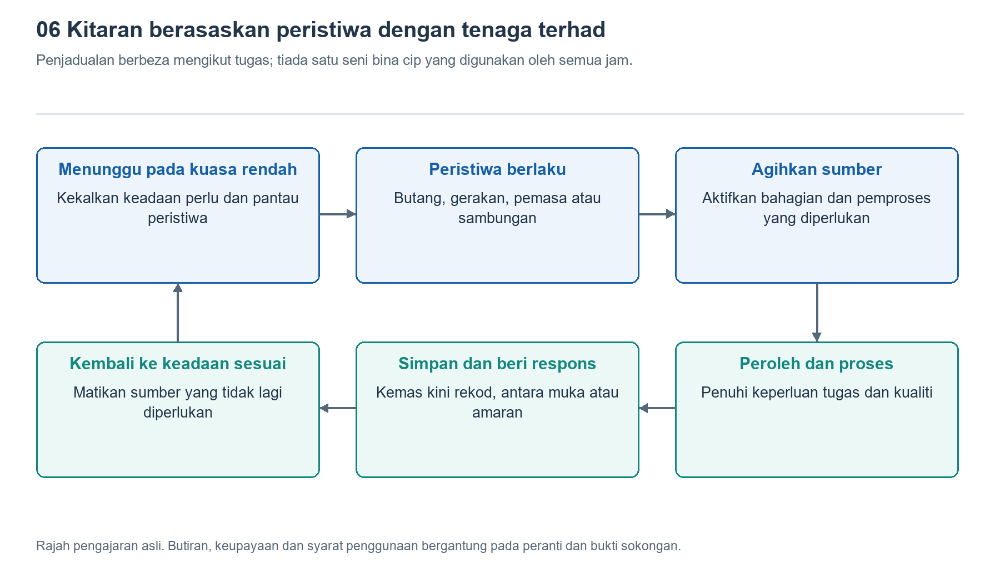

# 6.1 Daripada Tidur kepada Pengaktifan Semula: Cara Sistem Bertukar Keadaan Operasi

## 6.1.1 Apabila Skrin Padam, Jam Tangan Tidak Berhenti Berfungsi

Apabila pergelangan tangan diturunkan, skrin mungkin padam atau hanya memaparkan waktu dalam bentuk ringkas. Tidak lama kemudian, mesej tiba dan jam tangan bergetar lagi; apabila pergelangan tangan diangkat semula, muka jam penuh muncul kembali. Pada zahirnya, hanya kecerahan skrin yang berubah, tetapi di dalamnya terdapat penyelarasan antara penderia, pemproses, memori dan litar paparan.

Untuk memahami proses ini, kita perlu terlebih dahulu membezakan antara “aktiviti tidak kelihatan” dengan “tiada aktiviti”. Skrin padam hanyalah keadaan paparan; kita tidak boleh terus menyimpulkan bahawa pemproses sudah tidur. Paparan sentiasa hidup juga tidak bermakna seluruh sistem sentiasa beroperasi pada kelajuan penuh. Mengikut tugas semasa, jam tangan meletakkan modul yang berbeza dalam keadaan operasi yang berbeza: ada yang terus memantau, ada yang mengurangkan kekerapan aktiviti, dan ada yang berhenti sementara sehingga diperlukan semula.

Susunan ini bukanlah menghidupkan dan mematikan seluruh jam tangan berulang kali, tetapi menggunakan tenaga bateri yang terhad untuk kerja yang diperlukan pada ketika itu. Kunci untuk memahaminya bukan menghafal nama cip tertentu, tetapi bertanya: apakah yang masih berfungsi, apakah yang sedang menunggu, dan peristiwa apakah yang akan mengubah pembahagian tugas ini?

{width=95%}

Pensampelan latar belakang, paparan dan sambungan boleh dijadualkan secara berasingan; ini tidak bermakna semua jam tangan menggunakan reka bentuk cip yang sama.


## 6.1.2 Keadaan Tidur Mempunyai Tahap dan Skop yang Berbeza

Dalam bahasa harian, “tidur” mudah dibayangkan sebagai berhenti bekerja sepenuhnya, tetapi maknanya dalam sistem elektronik lebih terperinci. Keadaan kuasa rendah yang lebih cetek mungkin sekadar menghentikan sementara pelaksanaan arahan oleh pemproses sambil mengekalkan memori dan sebahagian antara muka. Keadaan yang lebih mendalam pula mungkin menghentikan isyarat jam bagi sesetengah litar, malah memutuskan bekalan kuasa kepada sebahagian modul. Semakin sedikit yang dikekalkan, biasanya semakin besar potensi penjimatan tenaga, tetapi persediaan yang diperlukan untuk kembali beroperasi juga mungkin lebih banyak.

Isyarat jam boleh difahami sebagai isyarat yang menggerakkan litar digital supaya bekerja mengikut rentak tertentu. Apabila pengiraan tidak diperlukan buat sementara waktu, menghentikan isyarat jam yang berkaitan dapat mengurangkan penggunaan tenaga akibat pensuisan litar yang berulang. Namun, menghentikan isyarat jam tidak bermakna bekalan kuasa terputus sepenuhnya; litar mungkin masih menggunakan tenaga akibat kebocoran arus dan faktor lain. Oleh itu, kenyataan bahawa “mod siap sedia tidak menggunakan tenaga” adalah tidak tepat.

Sebelum memasuki tidur mendalam, sistem juga perlu menentukan keadaan mana yang wajar disimpan. Contohnya, antara muka semasa, data yang belum diproses dan maklumat sambungan mungkin perlu dikekalkan dalam kawasan memori yang terus dibekalkan kuasa, atau ditulis ke storan lain. Maklumat ini kemudian digunakan untuk menyambung kerja apabila sistem diaktifkan semula. Lokasi dan kaedah penyimpanan yang khusus bergantung pada perkakasan dan perisian, dan tidak boleh disimpulkan hanya daripada keadaan skrin yang padam.

## 6.1.3 Siapa yang Menunggu Peristiwa Seterusnya

Jika pemproses utama mengurangkan aktivitinya, bagaimanakah jam tangan mengetahui bahawa pengguna telah mengangkat pergelangan tangan? Satu pendekatan lazim ialah membiarkan laluan pengesanan yang menggunakan tenaga lebih rendah terus beroperasi. Contohnya, penderia gerakan atau unit pemprosesan kuasa rendah menganalisis pergerakan. Apabila mengesan peristiwa yang mungkin memerlukan skrin dihidupkan, unit itu memberitahu modul lain supaya kembali beroperasi.

“Pemberitahuan” ini lazimnya dilaksanakan melalui sampukan. Ia seperti loceng pintu: pemproses tidak perlu sentiasa bertanya “ada apa-apa yang baharu?”, sebaliknya menerima permintaan apabila sesuatu peristiwa berlaku. Namun, loceng itu sendiri juga memerlukan mekanisme yang sentiasa bersedia. Sama ada sentuhan boleh mengaktifkan sistem bergantung pada sama ada litar pengesanan yang berkaitan masih beroperasi; sama ada mesej tanpa wayar boleh diterima pula berkait dengan keadaan sambungan dan aturan komunikasi.

Pemasa juga merupakan sumber pengaktifan semula. Sistem boleh menetapkan lebih awal untuk memulihkan sebahagian aktiviti pada waktu tertentu bagi melaksanakan penggera, penyelenggaraan atau pemprosesan data. Tekanan butang oleh pengguna, penyambungan pengecas dan peristiwa lain juga boleh mencetuskan perubahan keadaan.

Struktur yang menjalankan tugas ini tidak seragam. Sesetengah peranti menggunakan kerjasama antara pemproses utama dengan pengawal kuasa rendah yang berasingan, manakala yang lain menyepadukan unit pemprosesan berbeza dalam cip yang sama. Ada juga peranti yang bergantung pada pelbagai mod kuasa rendah dalam satu pemproses. Rajah “dua cip bergilir tugas” tidak boleh dianggap menggambarkan keadaan dalaman semua jam tangan.

## 6.1.4 Pengaktifan Semula Ialah Proses Pemulihan yang Berurutan

Selepas menerima permintaan pengaktifan semula, sistem tidak semestinya terus meletakkan semua modul dalam keadaan berprestasi tinggi. Biasanya, sistem terlebih dahulu mengenal pasti keperluan peristiwa itu, kemudian memulihkan bekalan kuasa, isyarat jam dan antara muka yang berkaitan, memproses data yang diperlukan, dan akhirnya mengemas kini paparan atau memberikan maklum balas. Sesetengah langkah boleh berjalan serentak, manakala yang lain perlu menunggu syarat sebelumnya dipenuhi.

Contohnya, selepas tombol jam ditekan, sistem mungkin perlu memulihkan operasi pemproses terlebih dahulu, membaca keadaan antara muka yang disimpan sebelum ini, kemudian menyediakan imej dan menyerahkannya kepada litar paparan. Kelajuan skrin menyala yang dirasakan pengguna ialah hasil gabungan seluruh rantaian ini, bukan sekadar seberapa pantas pemproses membuat pengiraan.

Rajah penerangan berikut menunjukkan logik yang dipermudah dan tidak merujuk kepada produk tertentu:

```text
Keadaan aktiviti rendah
 | Peristiwa butang, gerakan, mesej atau pemasa
Sahkan permintaan dan pulihkan modul yang diperlukan
 |
Laksanakan tugas; paparkan atau berikan maklum balas
 |
Semak kerja yang perlu diteruskan
 |-- Masih ada tugas -> Kekalkan aktiviti yang diperlukan
 +-- Tiada tugas -> Simpan keadaan perlu -> Kembali kepada aktiviti rendah
```

“Modul yang diperlukan” ialah perkara utama dalam rajah ini: melihat waktu biasanya tidak memerlukan penentududukan dan rakaman audio diaktifkan serentak. Semasa merekod aktiviti senaman secara berterusan, sebahagian penderiaan dan pengiraan masih perlu diteruskan walaupun skrin menjadi malap. Keadaan sistem lebih menyerupai gabungan beberapa suis, bukannya hanya dua pilihan, iaitu “semua hidup” dan “semua mati”.

Pertukaran keadaan itu sendiri turut melibatkan kos. Memulihkan bekalan kuasa, mewujudkan semula komunikasi atau memindahkan data boleh mengambil masa dan menggunakan tenaga. Jika sesuatu modul diaktifkan semula sejurus selepas memasuki tidur, pertukaran yang kerap mungkin tidak berbaloi. Oleh itu, sistem lazimnya menunggu seketika atau menghimpunkan kerja yang tidak mendesak untuk diproses sekali gus, sebelum kembali ke keadaan aktiviti yang lebih rendah. Inilah sebabnya skrin dan modul dalaman tidak semestinya memasuki keadaan kuasa rendah pada masa yang sama selepas pergelangan tangan diturunkan.

## 6.1.5 Perhatikan Keadaan Melalui Tingkah Laku Skrin, Bukan Meneka Cip

Anda boleh melakukan pemerhatian ringkas dalam persekitaran dalaman yang biasa: semak dahulu sama ada fungsi angkat pergelangan tangan untuk menghidupkan skrin, paparan sentiasa hidup dan mod penjimatan tenaga telah diaktifkan. Kemudian, catat secara berasingan perubahan paparan apabila jam diaktifkan dengan butang, apabila pergelangan tangan diangkat, dan selepas pergelangan tangan diturunkan. Anda tidak perlu menghayun lengan dengan pantas berulang kali, dan jangan mencetuskan panggilan kecemasan semata-mata untuk menguji.

Semasa membuat pemerhatian, catat fenomena dan penjelasan secara berasingan. “Muka jam penuh muncul selepas butang ditekan” ialah fakta yang dapat dilihat; “sistem memulihkan operasi yang berkaitan dengan paparan” ialah kesimpulan yang munasabah; manakala “satu cip berasingan menyerahkan kawalan paparan kepada cip lain” memerlukan maklumat produk untuk disahkan. Pemerhatian mata kasar sahaja juga tidak dapat mengukur dengan tepat tempoh pengaktifan semula dalaman atau menentukan sama ada bekalan kuasa pemproses telah diputuskan.

Jika skrin tidak menyala apabila pergelangan tangan diangkat, antara kemungkinan sebabnya ialah gerakan itu tidak memenuhi syarat pengecaman, tetapan berkaitan dimatikan, atau mod semasa mengehadkan penghidupan skrin. Keadaan ini tidak boleh terus dianggap sebagai kerosakan cip. Inti pengurusan tidur dan pengaktifan semula ialah menyusun keadaan operasi agar seimbang antara respons yang tepat pada masanya dengan pengurangan aktiviti yang tidak perlu. Skrin hanyalah satu jendela untuk memerhatikan susunan ini, bukannya lampu penunjuk operasi bagi seluruh sistem.
