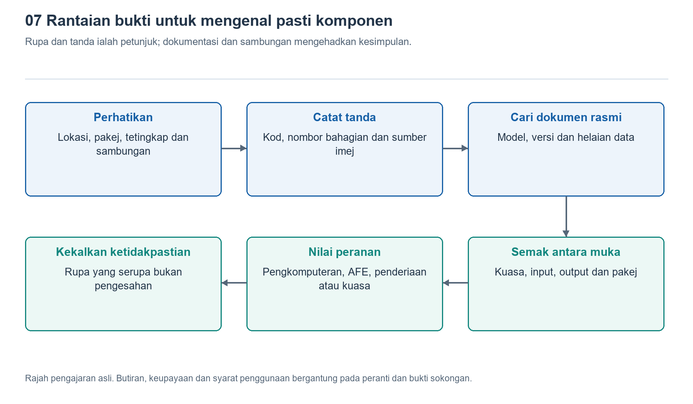

# 7.1 Apa yang perlu dilihat dahulu dalam gambar pembongkaran: membina peta pengenalpastian komponen dan anotasi bukti

## 7.1.1 Kenali dahulu jam tangan dalam foto

Apabila membuka gambar pembongkaran jam tangan pintar, perkara yang paling menonjol biasanya ialah bateri dan beberapa pakej hitam. Anda mungkin segera meneka: yang terbesar ialah pemproses, yang di sebelahnya ialah memori, dan yang berhampiran bahagian bawah jam ialah penderia. Namun, foto pada asasnya hanya menunjukkan rupa dan kedudukan, bukan secara automatik memberitahu kita fungsi dalamannya. Langkah pertama dalam mengenal pasti komponen bukanlah menyebut nombor model, tetapi memastikan apa sebenarnya yang dipaparkan dalam gambar itu.

Semak dahulu model peranti, varian saiz, varian komunikasi dan sumber gambar. Varian berbeza dalam siri yang sama mungkin menggunakan papan utama, bateri atau susun atur antena yang berbeza; rupa luaran yang serupa juga tidak menjamin bahagian dalamnya sama. Kemudian, lihat sama ada foto menunjukkan bahagian hadapan papan utama, bahagian belakangnya, atau suatu lapisan selepas penutup perisai ditanggalkan. Jika gambar telah diputar, dipangkas, atau bahkan mencampurkan gambar bahagian daripada peranti berbeza, pertimbangan seterusnya mudah kehilangan asasnya.

Gunakan dahulu tombol jam, butang, tingkap belakang dan sambungan tali jam sebagai rujukan orientasi, kemudian perhatikan bahagian dalamnya. Dengan cara ini, “penjuru kiri atas” dalam foto bukan sekadar kedudukan pada gambar, tetapi dapat dipadankan dengan kawasan tertentu pada objek sebenar. Apabila sumber dan variannya tidak jelas, catatkan sebagai tidak diketahui, bukannya mengisi kekosongan itu dengan nama produk yang paling menyerupainya.

{width=95%}

Rupa dan tanda cetakan memberikan petunjuk, manakala dokumentasi serta hubungan antara muka menentukan sejauh mana kesimpulan boleh dibuat.


## 7.1.2 Bahagikan mengikut kawasan dahulu, kemudian kenal pasti komponen satu demi satu

Apabila berhadapan dengan papan litar yang padat, mencari kawasan utama dahulu lebih berkesan daripada meneka setiap cip satu demi satu. Bateri biasanya memenuhi ruang bersambung yang agak besar; skrin dan pemasangan penderia belakang lazimnya disambungkan ke papan utama melalui kabel fleksibel; penutup logam mungkin melindungi litar yang sensitif terhadap gangguan elektromagnet. Namun, semua ini hanyalah petunjuk lazim; struktur sebenar masih perlu disokong oleh foto atau dokumentasi.

Semasa memerhati, jejak hubungan sambungannya: dari mana sesuatu kabel fleksibel datang dan ke mana ia disambungkan; sama ada sesuatu sesentuh logam menyentuh sarung jam; sama ada sesuatu papan terletak rapat pada tingkap optik. Kedudukan dan hubungan sambungan boleh membantu menentukan peranannya dalam sistem, tetapi belum tentu mencukupi untuk menentukan modelnya. Contohnya, cip kecil berhampiran pemasangan optik mungkin terlibat dalam pemerolehan isyarat, tetapi mungkin juga menjalankan tugas bekalan kuasa, kawalan atau tugas lain.

Khususnya, jangan terus menyamakan “luas paling besar” dengan “pemproses utama”. Blok hitam yang menonjol dalam foto mungkin merupakan pakej sistem, atau sekadar struktur perisai atau pelindung. SiP ialah istilah bagi sistem dalam pakej yang boleh menggabungkan beberapa komponen, tetapi rupa luarannya biasanya tidak menunjukkan keseluruhan kandungan dalaman. Ketiadaan cip memori berasingan yang kelihatan juga tidak bermakna jam itu tiada memori; memori tersebut mungkin berada di dalam pakej atau pada sisi yang tidak ditunjukkan dalam foto.

## 7.1.3 Nyatakan tahap bukti bagi setiap penilaian

Peta pengenalpastian yang berguna perlu menjawab dua soalan serentak: apakah komponen itu pada pandangan anda, dan apakah asas penilaian tersebut. Anotasi boleh menggunakan tiga status: “disahkan”, “inferens munasabah” dan “tidak diketahui”. Status ini bukan susunan kepentingan komponen, tetapi menunjukkan sejauh mana bukti semasa menyokong sesuatu kesimpulan.

“Disahkan” memerlukan asas yang bersesuaian. Contohnya, tanda komponen yang jelas dan boleh dibaca sepadan dengan penerangan tanda rasmi serta dokumentasi pakej, dan foto itu dapat dipastikan milik varian peranti berkenaan. “Inferens munasabah” pula bermakna terdapat petunjuk daripada kedudukan, rupa atau sambungan, tetapi penjelasan lain masih mungkin. “Tidak diketahui” bermakna maklumat tidak mencukupi untuk pengelasan yang boleh dipercayai. Status tidak diketahui bukan kegagalan mengenal pasti, tetapi ruang yang perlu disediakan agar tekaan tidak ditulis sebagai fakta.

Tahap bukti juga perlu berubah mengikut tahap perincian kesimpulan. Anda mungkin telah mengesahkan bahawa sesuatu bahagian ialah bateri, tetapi belum dapat mengesahkan sistem bahan di dalamnya; anda juga mungkin mengesahkan bahawa sesuatu bahagian ialah modul berpakej, tetapi tidak mengetahui cip tanpa pakej yang terkandung di dalamnya. Jangan menganggap butiran model, proses pembuatan dan prestasi turut diketahui hanya kerana pengelasan umumnya betul.

Berikut ialah contoh anotasi untuk tujuan pengajaran. Ia tidak merujuk kepada mana-mana model sebenar, dan saiz serta kedudukan kotak tidak mewakili dimensi sebenar:

```text
Contoh label bukti pada foto pembongkaran
A: Bateri          -- Disahkan: label dan hubungan sambungan sepadan
B: Pakej hitam     -- Inferens berasas: mungkin modul pengiraan bersepadu
C: Komponen kecil -- Tidak diketahui: tanda tidak terbaca dan sambungan tidak terlihat
Bagi setiap label, catat sumber imej, versi peranti, bukti dan soalan terbuka.
```

Perkara utama dalam rajah ini bukanlah ketiga-tiga komponen tersebut, tetapi asas yang disertakan bagi setiap kesimpulan. Jika maklumat kemudian menunjukkan bahawa B hanyalah sejenis struktur pelindung, ubah penilaian dan simpan sebab perubahan itu, bukannya mencari penjelasan yang dipaksakan demi mempertahankan jawapan awal.

## 7.1.4 Tanda cetakan ialah titik mula carian, bukan jawapan lengkap

Tulisan, nombor atau simbol pada permukaan cip biasanya disebut tanda permukaan atas, dan dalam penggunaan harian sering dirangkumkan sebagai tanda cetakan. Tanda ini mungkin mengandungi pengenalan pengeluar, singkatan komponen, kelompok pengeluaran atau maklumat penjejakan pakej, tetapi tidak semestinya menyatakan nombor model pesanan yang lengkap. Rentetan aksara pendek yang sama juga mungkin membawa makna berbeza bagi produk pengeluar yang berlainan.

Semasa membaca gambar, catatkan dahulu kandungan yang kelihatan aksara demi aksara, dan gantikan aksara yang kabur dengan tanda soal; jangan melengkapkannya secara automatik. Kemudian, cari dokumentasi pengeluar dan bandingkan peraturan penandaan, bentuk pakej, dimensi serta susun atur pin. Jika foto tidak mempunyai skala, dimensi juga hanya boleh dianggarkan; panjang dalam piksel pada skrin tidak boleh terus dianggap sebagai ukuran komponen dalam milimeter.

Helaian data rasmi menerangkan keupayaan sesuatu model komponen, tetapi tidak boleh dengan sendirinya membuktikan bahawa sesuatu jam tangan menggunakannya. Contohnya, dokumentasi produk AFE4404 daripada TI boleh membantu memahami pemacu LED dan bahagian hadapan analog dalam pengukuran optik, tetapi tidak membolehkan kita terus menentukan bahawa cip berhampiran tingkap optik dalam foto ialah AFE4404. Rantaian bukti yang menghubungkan foto peranti dengan identiti komponen masih diperlukan.

Begitu juga, imej sinar-X boleh mendedahkan struktur pakej atau sambungan tertentu, tetapi belum tentu dapat menerangkan fungsi litar secara langsung. Beberapa gambar yang semuanya disiarkan semula daripada pembongkaran yang sama juga bukan beberapa sumber bebas. Menyemak hubungan antara sumber selalunya lebih penting daripada terus menambah bilangan gambar.

## 7.1.5 Siapkan peta pengenalpastian pertama tanpa membongkar peranti

Pilih satu set foto pembongkaran yang tersedia kepada umum, mempunyai sumber yang jelas dan menyatakan varian peranti. Pada salinannya, bulatkan lima objek: bateri, papan utama, satu penyambung, satu pakej dan satu bahagian yang belum anda kenali. Nomborkan objek tersebut mengikut turutan, kemudian catatkan bagi setiap satu “apa yang dilihat”, “apa yang diinferenskan daripadanya” dan “bukti apa yang masih diperlukan”. Jangan terus mengisi ruangan pertama dengan model yang diteka.

Contohnya, “kelihatan pakej segi empat tepat berwarna hitam dengan sebaris aksara kabur” ialah pemerhatian; “mungkin menjalankan tugas pengkomputeran” ialah inferens; “memerlukan tanda yang jelas dan dokumentasi sepadan” ialah perkara yang perlu disemak. Jika dokumentasi membuktikan identitinya dengan jelas, barulah kemas kini anotasi. Merekodkan pautan sumber atau nama dokumen berserta tarikh akses membolehkan orang lain menyemaknya semula, dan memudahkan anda sendiri mengesan kekeliruan antara varian.

Tugas ini tidak memerlukan anda membuka jam tangan sendiri, apatah lagi memanaskan, mengumpil sarung atau mengendalikan bateri. Hasil akhirnya bukan sepatutnya gambar yang penuh dengan nama yang dinyatakan sebagai pasti, tetapi peta bukti yang membezakan perkara yang diketahui, inferens dan perkara yang tidak diketahui. Apabila mengenal pasti komponen tertentu seterusnya, sentiasa ikuti urutan ini: tentukan lokasi objek dahulu, kemudian cari petunjuk, dan akhirnya hadkan kesimpulan setakat yang dibenarkan oleh bukti.
