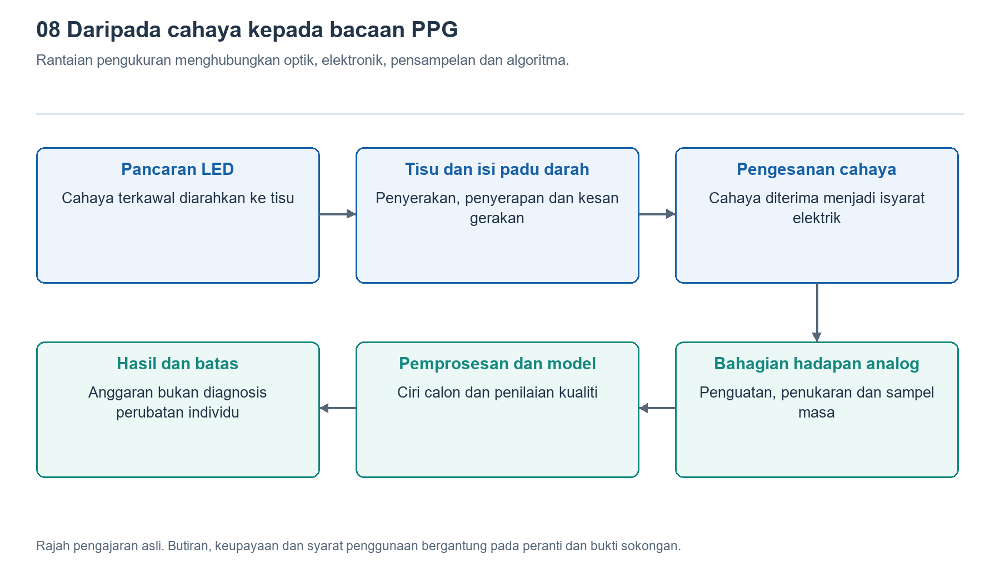

# 8.1 Mengapa cahaya membawa maklumat tubuh: penyerapan, penyerakan dan penukaran fotoelektrik

## 8.1.1 Bermula dengan cahaya hijau di belakang jam tangan

Apabila menanggalkan jam tangan pada waktu malam, anda mungkin terlihat cahaya hijau berkelip di bahagian belakangnya. Sumber cahaya yang bersentuhan dengan kulit itu tidak merakam imej salur darah, tetapi dapat membantu jam tangan menganggarkan kadar nadi. Ini kerana selepas cahaya memasuki tisu, sebahagiannya diserap, sebahagiannya berubah arah, dan sebahagian lagi kembali ke belakang jam tangan. Keamatan cahaya yang kembali berubah mengikut keadaan tisu, lalu membawa maklumat yang boleh dianalisis.

“ Membawa” di sini tidak bermakna setiap berkas cahaya sudah dilabel dengan kadar denyutan jantung. Apa yang diterima oleh pengesan ialah hasil gabungan kesan kulit, darah, keadaan sentuhan dan cahaya persekitaran. Jam tangan perlu mencari perubahan yang berkaitan dengan nadi dalam isyarat bercampur itu. Untuk memahami rantaian ini, kita perlu terlebih dahulu membezakan tiga proses: penyerapan mengubah jumlah cahaya yang masih tinggal, penyerakan mengubah arah pergerakan cahaya, manakala penukaran fotoelektrik menukarkan cahaya yang diterima menjadi isyarat elektrik.

{width=95%}

Satu rantaian pengukuran menghubungkan optik, elektronik, pensampelan dan algoritma.


## 8.1.2 Penyerapan: panjang gelombang yang berbeza menerima kesan yang berbeza

Apabila cahaya disuluhkan ke arah segelas larutan berwarna, sesetengah warna mudah menembusinya, manakala warna lain menjadi jauh lebih lemah. Sifat terpilih ini berpunca daripada perbezaan penyerapan cahaya pada panjang gelombang yang berlainan oleh sesuatu bahan. Tenaga cahaya yang diserap dipindahkan kepada bahan tersebut dan tidak lagi merambat sebagai cahaya asal. Dalam tisu manusia, komponen seperti hemoglobin, melanin dan air semuanya menyerap cahaya, tetapi kesan masing-masing berbeza mengikut panjang gelombang.

Sifat penyerapan cahaya oleh hemoglobin berubah apabila ia mengikat oksigen. Inilah asas penting penggunaan pelbagai panjang gelombang untuk menganggarkan ketepuan oksigen darah. Namun, “sifat penyerapan yang berbeza” tidak bermakna “paras oksigen darah boleh diketahui hanya dengan melihat warna cahaya”. Cahaya yang diterima oleh jam tangan turut dipengaruhi oleh ketebalan tisu, penyerakan, taburan darah dan struktur komponen peranti. Pemprosesan isyarat dan penentukuran diperlukan sebelum nilai anggaran dapat dihasilkan.

Bagi medium seragam yang penyerakannya boleh diabaikan, hukum Lambert–Beer menerangkan bagaimana keamatan cahaya berkurang apabila kepekatan bahan penyerap dan jarak perambatan meningkat. Secara mudah: semakin panjang laluannya dan semakin banyak bahan penyerap di sepanjang laluan itu, lazimnya semakin sedikit cahaya yang akhirnya dapat menembusinya. Hukum ini memberikan asas pemahaman, tetapi pergelangan tangan tidak boleh dianggap begitu sahaja sebagai segelas larutan lutsinar. Kulit sebenar tidak seragam, dan cahaya di dalamnya juga tidak bergerak dalam satu garis lurus.

## 8.1.3 Penyerakan: cahaya yang kembali telah melalui laluan berliku

Bayangkan lampu kereta menyinari kabus nipis; berkas cahaya yang asalnya tertumpu menjadi tersebar. Sel dan struktur dalaman sel dalam tisu juga menyebabkan cahaya terus berubah arah perambatan. Inilah penyerakan. Selepas berubah arah beberapa kali, sebahagian cahaya keluar semula berhampiran tempat ia masuk, lalu diterima oleh pengesan fotoelektrik di belakang jam tangan. PPG jenis pantulan yang lazim digunakan pada jam tangan memanfaatkan cahaya yang kembali ini untuk membuat pengukuran.

Oleh itu, jarak di permukaan antara sumber cahaya dengan pengesan tidak sama dengan jarak sebenar yang dilalui cahaya di dalam tisu. Cahaya yang diterima datang melalui pelbagai laluan: ada yang melalui kawasan lebih cetek, dan ada yang menembusi lebih dalam. Sifat penyerapan dan penyerakan juga berbeza mengikut panjang gelombang. Maka, kita tidak boleh menganggap bahawa sesuatu warna hanya mengesan salur darah pada satu lapisan tertentu, apatah lagi menetapkan kedalaman penembusan yang sama bagi semua pergelangan tangan.

Rajah skema berikut memperlihatkan perjalanan yang tidak kelihatan ini:

```text
Sumber cahaya belakang jam                    Fotopengesan
        |                                         ^
---------------------- Permukaan kulit ----------------------
        -> Penyerakan -> Penyerakan lanjut -> Sebahagian cahaya kembali
                 -> Penyerapan oleh tisu
                       -> Penyerakan lanjut melalui kawasan yang mengandungi darah
```

Anak panah dalam rajah hanyalah laluan yang mungkin dilalui, bukan bermakna setiap berkas cahaya bergerak melalui laluan yang sama. Apa yang dilihat oleh pengesan ialah hasil gabungan sejumlah besar laluan. Ini juga menjelaskan mengapa pemakaian yang longgar boleh mengganggu pengukuran: perubahan pada celah dan kedudukan sentuhan bukan sahaja boleh membenarkan cahaya persekitaran masuk, malah mengubah keadaan cahaya ketika memasuki dan keluar daripada tisu.

## 8.1.4 Penukaran fotoelektrik: menyerahkan perubahan kecil kepada litar

Apabila cahaya yang kembali sampai ke fotodiod, ia boleh menghasilkan arus yang berkaitan dengan cahaya tuju. Proses ini boleh dianggap sebagai antara muka penukaran: bahagian pertama melibatkan interaksi cahaya dengan tisu, manakala bahagian seterusnya melibatkan litar yang menguatkan, memproses dan mendigitalkan arus lemah. Pengesan itu sendiri tidak mengenali “nadi”; ia hanya bertindak balas terhadap cahaya yang diterimanya.

Semasa jantung berdenyut, isi padu darah dalam tisu setempat berubah mengikut denyutan, lalu mengubah keadaan penyerapan. Oleh itu, turun naik berkala mungkin muncul pada cahaya yang kembali. Turun naik ini biasanya bertindih dengan komponen latar yang jauh lebih besar. Komponen latar merangkumi penyerapan tisu yang agak stabil, sumbangan darah yang tidak berdenyut dan aras pencahayaan purata; maklumat nadi hanyalah komponen perubahan yang lebih kecil di dalamnya.

Litar perlu mengelakkan komponen latar yang kuat daripada menyebabkan isyarat melampaui julat yang boleh diukur, sambil mengekalkan turun naik kecil tersebut. Sesetengah sistem menetapkan tempoh sumber cahaya dihidupkan dan dipadamkan untuk menganggarkan sumbangan cahaya persekitaran serta membuat pampasan. Namun, ini tidak menjamin semua gangguan dapat dihapuskan. Ayunan pergelangan tangan mengubah sentuhan dan keadaan tekanan pada tisu, dan turun naik yang terhasil juga mungkin bersifat berkala. Oleh itu, bentuk gelombang yang teratur tidak semestinya merupakan bukti nadi yang boleh dipercayai.

## 8.1.5 Daripada asas fizik kepada bacaan yang bergantung pada keadaan

Ketika menganggarkan kadar nadi, sistem terutamanya mencari pola masa yang berkaitan dengan denyutan. Ketika menganggarkan oksigen darah, sistem juga perlu membandingkan perubahan komponen berdenyut berbanding komponen latar pada panjang gelombang yang berbeza. Kaedah lazim membentuk nisbah perubahan ternormal bagi cahaya merah dan inframerah, kemudian menggunakan hubungan penentukuran untuk mendapatkan hasil. Ini bukan pengukuran langsung yang boleh diselesaikan hanya dengan memasukkan dua nilai keamatan cahaya ke dalam satu formula ideal.

Perbezaan ini penting: hukum fizik menjelaskan “mengapa pengukuran mungkin dilakukan”, manakala penentukuran dan pengesahan menjawab “dalam keadaan apakah pengukuran boleh dipercayai”. Ciri kulit, perfusi setempat, pergerakan dan keadaan pemakaian semuanya boleh mempengaruhi hasil, dengan kesan khusus turut bergantung pada reka bentuk peranti. Maklumat FDA tentang oksimeter nadi juga mengingatkan pengguna agar mengambil perhatian terhadap batasan pengukuran. Oleh itu, jam tangan pengguna tidak boleh disamakan dengan oksimeter perubatan.

Ketika duduk diam seperti biasa, anda boleh memakai jam tangan mengikut manual dan memerhatikan bila ia memberikan bacaan serta bila ia meminta anda melaraskan sentuhan. Tidak perlu sengaja mengetatkan tali jam, dan jangan mencetuskan perubahan dengan menahan nafas atau cara seumpamanya. Catatkan “apa yang dipaparkan pada skrin” secara berasingan daripada “apa yang mungkin menyebabkannya”. Melalui rantaian penyerapan, penyerakan dan penukaran fotoelektrik ini, apa yang kita peroleh bukanlah tingkap untuk melihat terus ke dalam tubuh, tetapi kaedah pemerhatian tidak langsung yang bergantung pada keadaan dan perlu disahkan.
