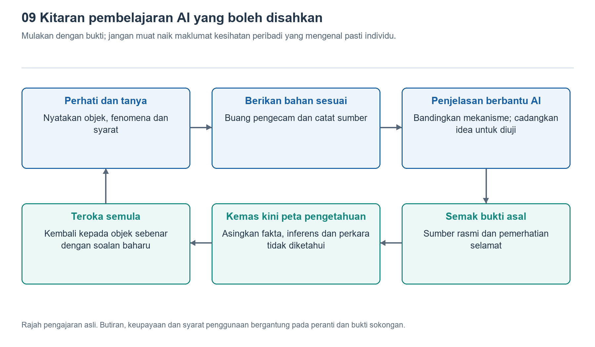

# 9.1 Algoritma jam tangan dan pembantu AI: Membezakan peranan dua jenis alat

## 9.1.1 Soalan yang sama, dua tugas yang berbeza

Selepas pulang daripada berjalan kaki, anda mendapati terdapat sedikit ruang kosong pada graf kadar denyutan jantung dalam jam tangan anda. Jam tangan itu tidak memberikan bacaan bagi tempoh tersebut, tetapi pembantu AI dalam telefon dapat menyenaraikan penjelasan dengan pantas: tali jam longgar, pergerakan pergelangan tangan, perubahan sentuhan dengan kulit, atau rekod yang belum disegerakkan. Jawapannya tersusun, tetapi tugasnya tidak sama dengan apa yang sebenarnya dilakukan oleh jam tangan.

Algoritma jam tangan berurusan dengan isyarat penderia, keadaan peranti dan tugas yang telah ditetapkan; pembantu AI pula lazimnya berurusan dengan teks, imej atau fail yang anda masukkan. Yang pertama mungkin menentukan bahawa “segmen isyarat ini tidak sesuai untuk menghasilkan bacaan”, manakala yang kedua menyusun kemungkinan punca berdasarkan penerangan. Melainkan diberikan data dan kebenaran penggunaan alat yang berkaitan, pembantu itu tidak melihat isyarat mentah tersebut, apatah lagi mengukur semula keadaan tubuh anda.

Untuk memahami kedua-dua jenis alat ini, bezakan dahulu tiga perkara: siapa yang mengakses data pengukuran, siapa yang menghasilkan keputusan, dan siapa yang menerangkan keputusan. Kedua-duanya boleh bekerjasama, tetapi kelancaran jawapan semata-mata tidak membolehkan satu menggantikan yang lain.

{width=95%}

Mulakan dengan perkara yang dikaji dan bukti, kemudian barulah penjelasan dan kesimpulan; jangan muat naik maklumat kesihatan peribadi yang boleh mengenal pasti individu.


## 9.1.2 Algoritma jam tangan: Melaksanakan tugas khusus dengan sumber terhad

Ambil pengukuran kadar denyutan jantung secara optik sebagai contoh. Perubahan yang diterima oleh pengesan foto bukan semuanya berpunca daripada denyutan nadi; ia turut merangkumi cahaya persekitaran, perubahan sentuhan dan gangguan pergerakan. Jam tangan perlu mengawal pemasaan pemerolehan data, memproses isyarat, memeriksa kualitinya, kemudian menganggarkan frekuensi denyutan nadi daripada segmen yang boleh digunakan. Angka pada skrin ialah hasil rangkaian langkah ini, bukannya jawapan siap yang dibaca terus oleh penderia.

“Algoritma” di sini tidak semestinya bermaksud pembelajaran mesin. Perbandingan nilai ambang, penapisan, pengesanan puncak, model statistik dan model yang diperoleh melalui latihan semuanya mungkin terlibat. Sama ada sesuatu fungsi menggunakan pembelajaran mesin dan di mana model itu dijalankan perlu disemak dalam dokumentasi produk berkenaan. Perkataan “pintar” pada pembungkusan sahaja tidak cukup untuk membuat kesimpulan.

Tugas algoritma ini biasanya agak khusus, seperti mengenal pasti jenis aktiviti, menganggarkan kadar denyutan jantung atau menentukan sama ada seseorang telah terjatuh. Pereka perlu mengimbangi prestasi pengecaman, kelajuan tindak balas, memori dan penggunaan bateri. Sebahagian pemprosesan dilakukan pada pergelangan tangan, manakala sebahagian lagi mungkin diserahkan kepada telefon atau awan. Oleh itu, tidak tepat untuk mengatakan bahawa semua penentuan dibuat oleh jam tangan secara kendiri.

Jam tangan juga tidak sentiasa dapat memberikan jawapan yang boleh dipercayai. Isyarat pada pergelangan tangan mungkin hilang, corak pergerakan mungkin berada di luar keadaan yang sesuai untuk model, dan perbezaan individu juga boleh mempengaruhi prestasi. Paparan kosong kadangkala merupakan hasil kawalan kualiti, dan lebih jujur daripada memaksa paparan angka yang kelihatan tepat.

## 9.1.3 Pembantu AI: Menyusun bahasa tidak sama dengan mengukur semula

Pembantu AI serba guna mahir menukarkan soalan menjadi penjelasan yang mudah dibaca. Ia membantu pembaca memahami istilah seperti “pengesan foto”, “pensampelan” dan “artifak pergerakan”, serta boleh menyusun hubungan kebergantungan antara fungsi berdasarkan bahan yang diberikan. Kelebihannya ialah mengatasi halangan bahasa dan penyampaian, supaya orang yang tidak biasa dengan istilah teknikal dapat menemukan titik permulaan untuk belajar lebih lanjut.

Namun, menghasilkan penjelasan dan mengesahkan fakta ialah dua perkara yang berbeza. Pembantu mungkin menerapkan struktur satu produk pada produk lain, menyatakan kaedah lazim sebagai satu-satunya kaedah, malah mereka-reka model cip atau bahan rujukan yang tidak wujud. Memintanya berperanan sebagai “jurutera kanan” boleh mengubah gaya jawapan, tetapi tidak menambah bukti sebenar.

Jika pembantu diberikan alat carian dalam talian atau pembacaan fail, bahan yang boleh digunakannya akan bertambah. Namun, sumber, versi dan kesesuaiannya masih perlu diperiksa. Membaca helaian spesifikasi bahagian hadapan analog optik hanya menjelaskan kemampuan komponen jenis itu, bukan membuktikan bahawa jam tangan anda menggunakannya. Melihat tangkap layar graf kadar denyutan jantung juga tidak membolehkan pembantu menentukan algoritma penapis dalaman yang digunakan.

Selain itu, sesetengah pembantu pada jam tangan mungkin boleh menggunakan antara muka peranti untuk membaca rekod aktiviti yang telah dibenarkan. Dalam keadaan ini, pembantu sememangnya menerima lebih banyak input, tetapi skop kebenarannya tetap terbatas: boleh membaca ringkasan kadar denyutan jantung tidak bermakna boleh membaca bentuk gelombang optik mentah; boleh merumuskan rekod juga tidak bermakna mempunyai keupayaan diagnosis perubatan.

## 9.1.4 Bagaimana kedua-dua jenis alat saling menyambung tugas

Hubungan antara kedua-dua jenis alat boleh digambarkan melalui rajah peranan berikut:

```text
Badan dan persekitaran
          |
Penderia -> Algoritma jam dan sistem berkaitan -> Bacaan, graf, pemberitahuan
                                                   | Pengguna memilih bahan untuk dikongsi
Dokumentasi dan syarat penggunaan ----------------> Pembantu AI
                                                   |
                                    Penjelasan, soalan dan petunjuk untuk disahkan
                                                   |
                                    Pengguna merujuk sumber, memerhati dan menyemak
```

Anak panah dalam rajah menunjukkan bagaimana maklumat memasuki peringkat seterusnya, bukan bahawa kebolehpercayaannya meningkat secara automatik. Selepas menerima graf, pembantu AI boleh membantu menerangkan maknanya, tetapi tidak boleh bergerak mengundur sepanjang anak panah untuk mengisi data yang tidak pernah direkodkan oleh peranti. Punca yang dicadangkannya masih perlu disahkan melalui bahan rujukan atau pemerhatian.

Bagi ruang kosong dalam rekod berjalan kaki tadi, pembantu boleh mencadangkan supaya anda terlebih dahulu membezakan antara “jam tangan tidak mempunyai bacaan pada waktu itu” dengan “telefon belum memaparkan rekod buat sementara waktu”. Keadaan pertama mungkin melibatkan pemerolehan data dan penilaian kualiti, manakala keadaan kedua mungkin melibatkan penyegerakan atau paparan. Perbezaan ini dapat mengecilkan skop masalah, tetapi tanpa bukti, kedua-duanya hanyalah kemungkinan untuk disiasat.

Cara bekerjasama yang lebih baik ialah meminta pembantu menerangkan bukti yang diperlukan bagi setiap penjelasan, serta pemerhatian yang boleh melemahkan penjelasan tersebut, bukannya memaksanya memilih satu-satunya punca dengan segera. Dengan cara ini, semakin mendalam jawapannya, semakin jelas keperluan buktinya—bukannya sekadar semakin banyak istilah dan semakin tegas kesimpulan.

## 9.1.5 Semak peranan tanpa melibatkan diagnosis

Buka satu rekod berjalan kaki biasa dan pilih satu perkara yang dapat anda sahkan secara langsung, contohnya sebahagian laluan hilang atau tiada data kadar denyutan jantung bagi suatu tempoh. Catat dahulu “apa yang sebenarnya dipaparkan pada skrin”, dan jangan terus menulis “penderia rosak”. Ayat pertama ialah pemerhatian, manakala ayat kedua sudah pun menetapkan punca.

Kemudian, anda boleh bertanya kepada pembantu: “Sila bezakan rekod peranti, prinsip umum dan andaian tentang punca, serta terangkan perkara yang masih tidak dapat diketahui daripada gambar ini sahaja.” Jika menggunakan tangkap layar, tutup dahulu nama, alamat kediaman yang tepat, akaun dan maklumat kesihatan yang tidak diperlukan. Anda juga boleh memberikan penerangan dalam bentuk teks sahaja tanpa memuat naik keseluruhan rekod.

Semasa menyemak jawapan, perhatikan khususnya sama ada pembantu menyatakan andaian sebagai fakta, mentafsirkan ketiadaan amaran sebagai ketiadaan risiko, atau mendakwa boleh memulihkan data sebenar yang tidak pernah dikumpulkan. Jika menemui pernyataan seperti ini, jangan terus menggunakan kesimpulannya; sebaliknya, semak panduan produk atau dapatkan pengesahan melalui saluran profesional yang sesuai. Ketidakselesaan tubuh juga tidak patut dinilai melalui tugasan pemerhatian ini.

Algoritma jam tangan bertanggungjawab menghasilkan keputusan khusus dalam batasan tertentu, manakala pembantu AI membantu orang memahami keputusan dan menyusun persoalan. Memisahkan pengukuran, penentuan dan penjelasan ialah titik permulaan pembelajaran bersama: bukan meminta satu alat menjamin alat yang lain, tetapi memastikan setiap langkah mempunyai peranan dan batas bukti yang jelas.
