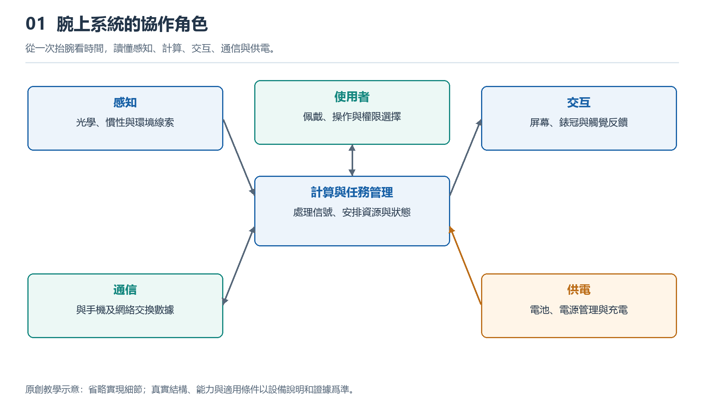

# 1.1 從抬腕看時間開始：智能手錶是什麼

## 1.1.1 一次抬腕，爲什麼不只是看時間

早晨出門，你抬起手腕，屏幕亮起，顯示時間和一條消息。走到路口，手腕輕輕振動，提醒你轉彎；散步結束後，屏幕又出現步數和活動時長。這些事情看似各自獨立，卻由同一只小設備完成。認識智能手錶，可以從這個問題開始：它爲什麼能在需要的時候，把有關的信息送到手腕上？

普通手錶也能計時，電子錶也可能有鬧鐘和計步功能。因此，不能僅憑“有屏幕”或“能計步”判斷一隻手錶是否智能。這裏所說的智能手錶，是以腕上佩戴爲主要使用方式，把感知、計算、信息呈現和通信等能力組織起來的電子系統。它能夠按照軟件安排處理輸入，並對身體活動、操作或外部信息作出回應。

這個定義強調的是協作，而不是功能數量。某款手錶沒有蜂窩通信，仍可能通過手機獲得消息；另一款能夠獨立通話，也不意味着它在所有場景下都不再需要手機。理解對象，首先要看它怎樣工作，而不是數宣傳頁上有多少個圖標。

{width=95%}

從一次抬腕看時間，讀懂感知、計算、交互、通信與供電。


## 1.1.2 它與手機相似，卻不是簡單縮小

智能手錶和手機都使用芯片、軟件、電池與無線連接，這種相似容易讓人把前者當成縮小版手機。但同樣一條消息，適合手機的處理方式，未必適合手腕。

在手機上，你可以閱讀長段文字、查找附件，再用鍵盤迴復。手錶屏幕較小，抬腕姿勢也不適合長時間保持，因此通常優先顯示發送者、摘要和少量操作。語音、錶冠、按鍵與振動，能夠補充觸摸操作。這不是說手錶絕對不能輸入長文本，而是說，完成同一任務所需的動作和注意力不同，系統必須據此作出取捨。

佩戴位置還改變了設備的工作條件。手錶會隨手臂反覆運動，背部經常接觸皮膚，錶帶鬆緊又影響穩定性。增加電池可能延長續航，卻也佔用空間、增加重量；提高計算負荷可能帶來更豐富的功能，同時增加耗電和發熱。工程設計要協調這些關係，不能用一個固定重量或溫升數字概括所有產品的要求。

所以，手錶不是把手機的各個零件按比例縮小，而是圍繞“戴得住、看得清、及時回應”重新安排系統。

## 1.1.3 把一次回應拆成四種能力

再看抬腕亮屏這個動作。手腕姿態發生變化，運動傳感器獲得相關信號；系統根據一定規則判斷是否需要亮屏；顯示部分呈現時間；電池則爲這些過程提供能量。即使只是看一眼表，也需要多個部分共同參與。不同設備還可能結合其他條件，減少無意動作造成的亮屏。

爲了建立第一張認識地圖，可以暫時把手錶的工作歸納爲感知、計算、呈現和連接四種能力，並把供電視爲共同基礎。

```text
身體活動與周圍環境 → 感知 → 計算與保存 → 屏幕、聲音或振動
                                  ↕
                             手機及網絡服務

              電池與電源管理爲上述工作提供能量
```

這是一幅功能關係示意圖，不是錶殼內部的零件位置圖。箭頭表示信息可以沿着哪些方向傳遞，也不意味着每次任務都要經過所有環節。比如，計時可以在手錶本地完成，手機發來的消息則需要連接參與；有些運動記錄可以先保存在手錶中，稍後再同步。

圖中的“計算”也不一定意味着複雜人工智能。判斷按鍵是否按下、安排鬧鐘、整理運動樣本，都屬於計算。是否使用機器學習，要看具體功能與實現方式，不能因爲產品名稱裏有“智能”，就認定每一步都有AI參與。

## 1.1.4 向外連接信息，向內觀察活動

從使用者的角度看，智能手錶有兩個相互補充的方向。一個方向朝外：它把消息、導航或日程帶到手腕，讓人不必每次都拿出手機。另一個方向朝向佩戴者：利用貼近身體、隨人活動的條件，記錄運動和部分生理相關信號。

這種位置優勢並不等於能夠完整了解人體。以常見的光學脈搏測量爲例，表背光源照向皮膚，探測器接收返回的光，系統從光強變化中提取與脈搏有關的信息，再估計心率。它不是直接看見心臟跳動，更不是僅憑一個數字判斷身體是否健康。

持續佩戴也不等於所有傳感器始終連續測量。設備可能根據運動狀態、電量、設置和信號質量調整工作方式。某些功能還需要使用者主動開啓，或者滿足地區與授權條件。屏幕上有讀數時，應當追問它來自什麼測量；沒有提示時，也不能據此排除健康問題。

同樣，跌倒檢測或緊急呼叫只能在產品規定的條件下發揮輔助作用，不能保證識別每一次事件或完成每一次求助。連接、設置和電量，都可能影響結果。

## 1.1.5 從自己的手錶建立認識

現在可以做一個不拆機的小觀察：在安全靜止的位置，分別通過抬腕和按鍵查看時間，留意兩種方式是否都能喚醒屏幕；再打開一個已有的活動記錄，看看它顯示的是當日累計值，還是一次活動的結果。不要爲了測試而劇烈甩腕，也不必刻意製造異常情境。

把觀察分成三類記錄：“我看見的”“我據此推測的”和“目前不知道的”。例如，抬腕後屏幕亮起是直接觀察；系統可能利用運動傳感器判斷姿態，是有原理依據的推測；具體用了哪些器件和判斷規則，僅憑外觀還不能確定。

這一區分是理解智能手錶的起點。它既是一件貼身用品，也是一個不斷接收輸入、作出處理並給出回應的微系統。先看清它爲誰工作、在什麼條件下工作，再逐步認識各個組成部分，腕上的小屏幕纔會成爲理解系統的入口，而不只是功能清單。
