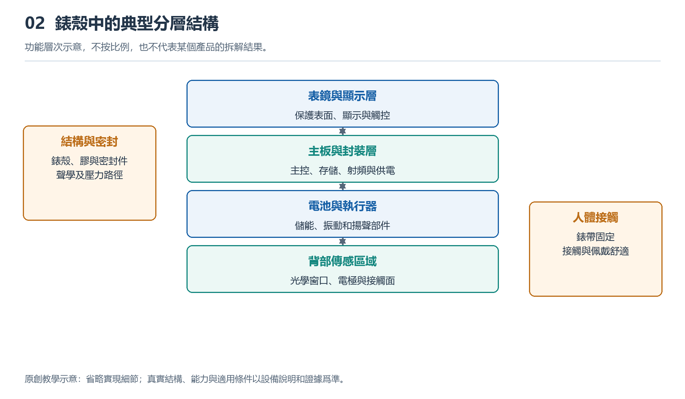

# 2.1 從外部接口向內看：建立系統模塊圖

把手錶從腕上取下，放在柔軟、乾燥的桌面上。正面是屏幕，側面可能有錶冠、按鍵和小孔，背面則有透明窗口、金屬接觸面或充電觸點。這些位置不僅是外觀細節，也是理解內部系統的入口。無需打開錶殼，只要追問“這裏讓什麼進入，又讓什麼出來”，就能逐步建立一張系統模塊圖。

## 2.1.1 從接口提出問題，而不是猜測零件

這裏所說的“接口”，不只指插頭和插座，還包括手錶與人體、環境及其他設備交換信息或能量的位置。手指按下按鍵，機械動作進入系統；屏幕亮起，信息以光的形式輸出；背部光源照向皮膚，組織返回的光又進入探測器。看不見的無線連接，同樣是一種接口。

觀察時，先描述現象，再提出內部需要具備的能力。例如，“按下按鍵後屏幕亮起”是可以直接確認的現象；“內部存在識別按鍵並控制顯示的電路”是有依據的推斷；至於由哪顆芯片處理、經過哪條線路，則需要進一步查證。三種表述不能混爲一談。

側面的小孔尤其容易引起誤判。它可能與麥克風、揚聲器或氣壓感知有關，但僅憑孔的大小和形狀，通常不能確定用途。查閱對應型號的使用說明，比拿針探孔更可靠，也不會損傷內部薄膜或密封結構。接口觀察的目的，是提出可驗證的問題，而不是憑外形給每個位置強行命名。

{width=95%}

功能層次示意，不按比例，也不代表某個產品的拆解結果。


## 2.1.2 把複雜內部歸成六類模塊

面對一隻功能繁多的手錶，可以先按職責把內部歸成六類：感知、計算與控制、存儲、交互、通信、供電。這裏的“模塊”是爲理解系統建立的功能單元，不意味着錶殼裏必然有六塊獨立零件。

感知模塊接收身體與環境的變化，包括光學檢測、電極測量以及運動感知等。計算與控制模塊安排任務、處理數據，並決定何時點亮屏幕或發出提醒。存儲模塊保存程序、設置和記錄，其中既有運行時暫存的數據，也有斷電後仍需保留的內容。

交互模塊負責讓人看見、聽見、感受到結果，也接收觸摸和按鍵操作。通信模塊負責與手機、無線網絡或衛星信號建立相應聯繫。供電模塊則把電池儲存的能量轉換、分配給各部分，並參與充電和保護管理。

實際器件可能承擔多項職責。例如，一顆高度集成的芯片可以同時包含處理能力和無線通信電路；一個顯示總成則可能包含顯示面板、觸控結構及相關驅動。因此，模塊圖回答的是“誰承擔什麼任務”，不是“裏面有多少顆芯片”。

## 2.1.3 用連線表示協作關係

畫圖時，先把計算與控制放在中央，將其他模塊安排在周圍，再把人體、手機和充電器畫在系統邊界之外。下面是一張用於入門的功能示意圖，不代表某一型號的真實佈局。

```text
人體與環境 → [感知] → [計算與控制] ↔ [存儲]
                           ↕
手指操作   →           [交互] → 光、聲音、振動
                           ↕
手機等設備 ↔           [通信]

充電器 → [供電] → 感知、計算與控制、存儲、交互、通信
```

圖中上半部分主要表示信息聯繫，最下面一行表示供能關係。箭頭連接的是功能，不是錶殼中的距離。感知模塊可能貼近底殼，也可能位於電路板上；通信電路與天線還可能分佈在不同位置。不能因爲圖上兩個方框相鄰，就認爲對應器件在實物中挨在一起。

圖中的雙向箭頭也有具體含義：計算模塊可以讀取記錄，也可以寫入記錄；通信模塊既能發送數據，也能接收指令。感知部分爲簡潔只畫出了數據送出的方向，實際工作時，它通常還需要接收啓動、停止或調整工作方式的控制命令。圖可以簡化，但應當知道簡化了什麼。

## 2.1.4 用一個動作檢查模塊是否齊全

現在輕按一次按鍵，觀察屏幕響應。這個普通動作可以幫助檢驗模塊圖。按鍵把動作轉換爲電信號，控制邏輯識別事件，程序決定顯示什麼，顯示相關電路驅動屏幕，電源系統爲這些過程提供能量。如果界面需要讀取上次運動摘要，存儲模塊也會參與。

這裏不必立即加入通信模塊。許多本地操作無需手機或雲端介入。只有當界面需要獲取尚未保存在本機的信息，或執行同步等任務時，通信才成爲這條功能鏈的一部分。模塊圖的價值，正在於區分“手錶具備某模塊”與“本次操作必須使用某模塊”。

反過來，屏幕沒有亮起，也不能直接證明屏幕損壞。電量不足、鎖定狀態、按鍵設置或軟件異常，都可能改變結果。一條功能鏈經過多個環節，末端表現異常只能提示沿鏈檢查，不能單憑結果鎖定某顆器件。系統視角能減少這種過早下結論的錯誤。

## 2.1.5 給模塊圖留下證據和空白

可以在紙上爲自己的手錶畫一張圖，並用三種標記區分證據：“已觀察”“資料確認”“尚未知”。屏幕能夠顯示內容，可以標爲已觀察；是否支持獨立衛星定位，應根據對應型號的官方資料確認；具體採用何種封裝、天線藏在哪裏，如果沒有可靠材料，就保留未知。

不要爲了讓圖顯得完整，照搬另一款手錶的內部結構。同一系列的不同版本，也可能在蜂窩通信、傳感器或充電方式上存在差異。記錄完整型號和資料日期，有助於以後覈對。觀察過程中，不拆殼、不觸碰電池、不向孔洞插入物品，也不以浸水方式驗證結構。

最終得到的並非一張精確電路圖，而是一張有證據支撐的理解地圖：外部接口提示交換對象，功能模塊解釋任務分工，連線說明協作關係，空白則標出下一步需要查證的問題。此後認識處理器、傳感器或電源器件時，就能把新知識放回系統，而不是隻記住一串孤立的名稱。
