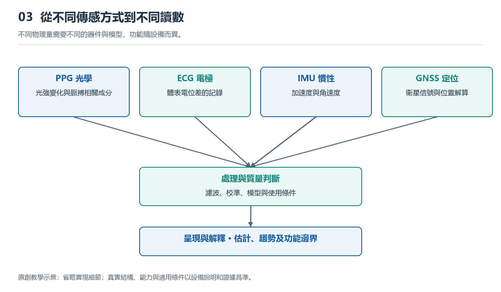

# 3.1 光怎樣讀出脈搏：PPG與心率、血氧估計

## 3.1.1 腕背的燈光在尋找什麼

夜裏摘下手錶時，你可能瞥見背面閃過的綠光。它不是照明燈，也不是在給血管拍照，而是一次光學測量的起點。光從背部窗口進入皮膚，一部分被吸收，一部分經過多次散射後返回，由旁邊的光電探測器接收。手錶要尋找的，是返回光強中隨脈搏起伏的微小變化。

這種方法稱爲光電容積脈搏波描記，簡稱PPG。這裏的“容積”指組織中與血液容量有關的變化，不意味着手錶能直接量出某根血管裝了多少血。每次心臟搏動推動血液進入外周血管，腕部組織的光學性質隨之發生細微變化，返回的光也帶上了節律信息。

因此，PPG首先得到的是光強隨時間變化的信號，而不是現成的心率數字。由光到讀數，中間還要經過電信號轉換、干擾處理和算法估計。背部燈亮，只說明光源正在工作，不能證明此次測量已經可靠。

{width=95%}

不同物理量需要不同的器件與模型，功能隨設備而異。


## 3.1.2 從返回的光裏分出脈搏

腕部PPG通常採用反射式結構：光源與探測器位於皮膚同一側。光進入組織後，並不是沿一條整齊的弧線折返，而是在複雜的散射路徑中傳播，最終只有一部分到達探測器。

探測器接收的光包含較大的背景成分，其中疊加着較小的搏動成分。前者與皮膚、組織和非搏動血液等因素有關；後者與動脈血容量隨心搏發生的變化有關。“背景”也不是永遠不變，手腕一動、接觸壓力一變，它就可能明顯起伏。

下面的示意圖表示信息轉換關係，並非真實組織剖面，也不表示光只走一條路徑。

```text
光源發光 → 皮膚與組織中的吸收、散射 → 光電探測器
                    ↑                       ↓
             血容量隨脈搏變化          光強變成電信號
                                            ↓
                                  採樣、質量判斷與估計
                                            ↓
                                    心率／血氧估計值
```

圖中向上的箭頭說明，血容量變化會影響光的傳播；下方的處理鏈則說明，屏幕數字是多個環節共同產生的結果。探測器把光轉成電信號後，採集電路再把它轉成數字樣本。算法需要從這些樣本中尋找可信的週期，同時識別運動、漏光或接觸變化造成的干擾。

## 3.1.3 心率爲何常用綠光估計

不少手錶在心率監測時使用綠光，因爲血紅蛋白對這一波段有較強吸收，配合合適的光源與接收結構，能夠獲得可用於分析的搏動信號。但這不是“綠光天然不會受運動影響”，也不是所有設備在所有狀態下都只用綠光。波長、光源佈局、皮膚條件和功耗預算都參與設計取捨。

當信號質量足夠好時，算法可以識別連續脈搏之間的時間間隔，或分析一段波形中的主要重複頻率，再換算成每分鐘的脈搏次數。例如，理想情況下每秒出現一次可信的脈搏波，對應每分鐘約六十次。這只是換算示例，不是判斷健康的標準。

日常界面常把這個結果標爲“心率”，但PPG直接觀察的是外周脈搏相關變化，不是心臟的電活動。在部分心律異常、外周灌注不足或運動干擾條件下，兩者不能簡單等同。屏幕更新也不必與每次搏動同步，設備可能綜合一段時間的數據，換取更穩定的顯示。

## 3.1.4 血氧估計爲什麼需要不同顏色

只知道脈搏的節奏，還不能知道血紅蛋白攜氧的情況。血氧估計利用的是另一條線索：氧合血紅蛋白與還原血紅蛋白，對不同波長光的吸收特性不同。常見方案採用紅光和近紅外光，分別觀察它們在組織中傳播後的變化。

不過，比較兩種光“誰更亮”並不足夠。光源強弱、皮膚特性和傳播路徑都會改變接收光量。常見方法是分別提取每種波長中的搏動成分，並與各自的背景成分作比較，再比較這兩個相對變化，結合經過標定的關係估計血氧飽和度。

這一步同時依賴光學測量和標定模型，不是直接數出血液裏的氧分子。腕部反射測量的條件也不同於夾在手指上的透射測量。消費級手錶的功能，不能因爲同樣顯示百分比就自動等同於醫療血氧儀。

血氧估計尤其需要穩定、可用的脈搏信號。低溫導致末梢血流減少、手腕運動、佩戴不合適等，都可能使結果偏離或無法生成。FDA關於脈搏血氧儀的說明也提醒，皮膚色素、循環狀況等因素會影響測量；這類侷限不應被一個看似精確的數字遮住。

## 3.1.5 一次安全觀察能說明多少

可以在日常室內環境中做一次簡單觀察：先按產品說明佩戴手錶，安靜坐下，讓前臂自然支撐在桌面，再啓動設備支持的心率測量。記錄是否出數、等待多久，以及是否出現質量提示。不必追求某個數字，更不要通過憋氣或劇烈運動製造變化。

隨後可在正常生活中留意，走動時的記錄是否比安靜時更容易中斷。若出現差異，合理的初步解釋是測量條件改變了；僅憑這一現象，還不能確定是擺臂、接觸變化還是算法策略起主要作用。也不要爲了“增強信號”把錶帶勒得更緊，貼合應以說明書和舒適、安全爲前提。

PPG的價值，是以較低負擔持續提供脈搏相關線索；它的邊界，是光學信號始終受到身體與環境條件約束。理解讀數時，應同時看測量條件、質量提示和持續趨勢。無提示不等於排除疾病，有明顯不適時，也不能讓腕錶數字替代及時的專業評估。
