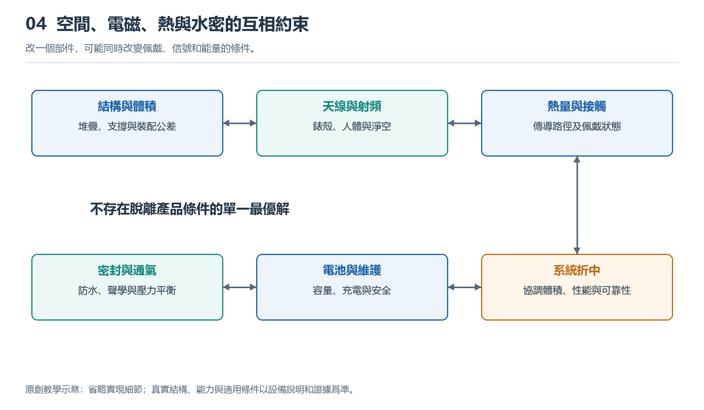

# 4.1 錶殼裏的空間分配：從剖面圖理解層疊佈局

## 4.1.1 從側面看，手錶並不是一個空盒子

把手錶摘下，側放在桌面上，你會看到表鏡、邊框和略微凸起的背部窗口。外觀只是幾條輪廓，內部卻要容納屏幕、電池、電路板、傳感器、揚聲器和振動部件。它們不僅需要放得進去，還要留下連接、固定和保護所需的空間。

理解這種安排，可以先想象沿錶殼中央豎直切開，再從切面觀察。這就是剖面圖的基本思路。它讓被外殼遮住的上下關係顯露出來：什麼靠近眼睛，什麼貼近皮膚，什麼夾在中間。但真實手錶不能爲了觀察而自行切割或撬開，我們藉助的是結構示意圖和有來源的公開資料。

剖面圖不是內部照片的簡單替代，而是一種有選擇的表達。它突出高度、厚度和接觸關係，卻未必能顯示部件向左右延伸的完整形狀。

{width=95%}

改一個部件，可能同時改變佩戴、信號和能量的條件。


## 4.1.2 沿着屏幕到皮膚，建立層疊印象

靠近使用者視線的一側，通常是表鏡與顯示、觸控相關結構。表鏡負責承受日常接觸，顯示結構產生圖像，觸控結構感知操作。它們可能緊密貼合，不能僅憑外觀就判斷是幾片獨立組件。

中間區域往往留給電池和主要電路。電池通常需要較大且連續的體積，電路板則可以通過異形輪廓、局部堆疊或環繞佈局利用剩餘區域。兩者不一定嚴格上下排列，也可能並排，或在部分區域相互重疊。

靠近皮膚的一側，需要爲光學窗口、電極以及相關傳感結構安排位置。光源發出的光要到達皮膚，返回的光也要進入探測器，因此這條路徑不能被電池或不透明支架擋住。背部凸起有時與傳感結構、接觸條件和內部空間有關，不能簡單歸結爲某一個器件太厚。

下面的原創示意圖只表達空間關係，不對應具體型號，也不按比例繪製。

```text
                  朝向視線
          ┌──────────────────┐
          │ 表鏡及顯示、觸控結構 │
      ┌───┴──────────────────┴───┐
      │ 側邊部件 │ 電路區域          │
      │          ├───────────────┤
      │ 連接通路 │ 電池佔用區域      │
      │          └───────────────┤
      │ 支撐、固定與傳感相關結構      │
      └────────┬─────────┬───────┘
               │ 背部窗口 │
               └─────────┘
                  朝向皮膚
```

圖中的連接通路提示我們：上層與下層之間必須能傳遞電能和信號。圖中沒有畫出全部零件，並不意味着那些零件不存在；實際產品也可能交換電池與電路的位置。

## 4.1.3 爲什麼不能把每一處空隙都填滿

收納行李時，空隙似乎越少越好；設計手錶卻不能只追求塞滿。部件尺寸存在製造偏差，裝配時也需要定位和操作空間。如果設計尺寸剛好相抵，實際生產中就可能出現擠壓、裝不上或受力不均。

電池尤其不能被當作可以隨意壓緊的填充塊。它需要可靠固定，並滿足產品針對尺寸變化、機械保護和安全的設計要求。具體餘量由電芯、結構與驗證條件共同決定，沒有適用於所有手錶的統一間隙數字。

連接器、排線轉彎處和密封結合面同樣佔據空間。圖紙上看似沒有電子功能的支架、膠層和墊片，可能承擔抗衝擊、絕緣、定位或密封任務。刪掉它們，未必能得到一隻同樣可靠的薄表。

還要區分內部淨空與外部厚度。表鏡、殼底和支撐結構本身都有厚度，背部凸起也會影響佩戴時的接觸。只比較宣傳頁上的厚度數值，不能完整判斷哪隻表內部更寬裕，或戴起來一定更舒適。

## 4.1.4 同一體積，爲什麼會有不同佈局

設想兩隻外形相近的手錶：一隻強調較長續航，另一隻增加了獨立通信和更多交互功能。前者可能把較多空間交給電池，後者則需要爲新增電路、連接結構及相關部件騰出位置。這只是說明取捨方向，不能據此推斷某款產品的真實設計。

佈局還受到部件工作方式的限制。屏幕要朝外，光學傳感窗口要朝向皮膚，按鍵要能從側面操作，揚聲器需要合適的聲學空間。這些部件不像積木一樣可以任意調換位置。

圓形與方形錶殼也會形成不同約束。常見電池和電路區域不一定恰好填滿圓形輪廓，邊緣可能形成適合小部件利用的區域；方形外形也不意味着沒有空間損失，因爲圓角、緊固位置和側壁仍會佔用體積。因此，外觀面積相近，不代表可用內部體積相同。

空間分配最終是一組協商結果：增加一個部件，可能不僅佔去自身大小，還需要連帶調整固定方式、連接路線與周圍結構。

## 4.1.5 帶着證據讀圖，而不是憑形狀猜測

閱讀公開剖面圖時，可以先找三個錨點：顯示面、背部傳感窗口和錶殼邊界，再辨認電池與電路區域。隨後觀察誰與誰重疊，哪些部件位於邊緣，哪些通路需要跨越不同高度。這樣比一開始逐個猜芯片名稱更容易建立整體認識。

還要覈對圖片的性質。宣傳渲染圖可能省略膠層與緊固件；專利圖展示的是技術方案，不保證已經用於某款產品；拆解照片更接近實物，卻可能因拍攝角度遮住下方結構。爆炸圖把部件拉開，是爲了說明裝配關係，不能把圖上的距離當作真實間隙。

你可以在紙上畫出自己手錶的側面輪廓，先標註能直接看到的表鏡、按鍵和背部窗口，再用虛線補畫推測的內部區域。旁邊分別寫上“實物可見”“資料確認”和“尚未確定”，不要爲了圖面完整而填滿未知。

讀懂層疊佈局，關鍵不是記住一套固定順序，而是看清每個位置爲何被佔用，以及這種佔用限制了什麼。錶殼裏的每一層，都同時服務於功能、裝配和可靠性。
