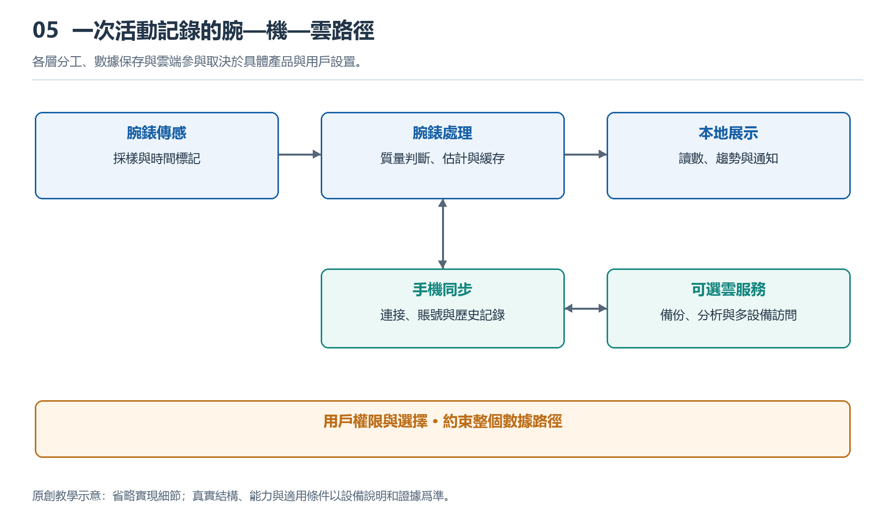

# 5.1 從充電器到各模塊：電能怎樣流動

## 5.1.1 貼上充電座，電從哪裏進入

晚上把手錶放上充電座，屏幕亮起充電符號。這個動作看似只是“給電池裝電”，實際卻啓動了一條經過接收、轉換、調節和保護的能量通路。電能並不是沿一根導線直接灌進電池，也不是由電池不加區分地分給所有器件。

先看錶背與充電座的接觸方式。有些產品通過金屬觸點導電，有些依靠線圈之間的電磁耦合傳遞能量。磁鐵往往只負責定位，讓觸點或線圈對準；因此，“磁吸充電”描述的是吸附體驗，並不能單獨說明電能怎樣跨過錶殼。

使用觸點時，電流經過接點進入手錶的輸入電路。使用感應式充電時，充電座線圈產生變化的磁場，手錶接收線圈中出現感應電壓，再經過整流和調節，形成內部可利用的直流電。兩種路徑都有損耗，所以適配器輸出的能量不會全部成爲電池儲存的能量。

{width=95%}

各層分工、數據保存與雲端參與取決於具體產品與用戶設置。


## 5.1.2 充電管理不是一隻開關

進入手錶的電能，通常先受到充電管理電路的約束。它需要結合輸入能力、電池電壓、溫度以及設備正在消耗的功率，決定允許多大的充電電流。具體功能可能集成在電源管理芯片中，也可能由幾顆器件共同承擔，並不存在所有手錶通用的固定結構。

常見鋰離子電池的充電過程包含不同階段。電池電量很低時，系統可能先以較小電流進行預充；條件合適後進入較穩定的電流階段；接近充滿時，電壓受到限制，電流逐漸減小。因此，前半段充得快、接近滿電時變慢，往往是正常控制過程，不宜只憑電量百分比判斷故障。

充電時手錶也可能繼續顯示時間、連接手機或執行後臺任務。具備相應電源路徑管理的設計，可以把輸入功率同時分配給系統和電池，而不是必須先把所有能量存進電池，再取出來使用。如果輸入功率不足，或溫度達到產品設定的限制，充電速度就可能降低，甚至暫時停止。

## 5.1.3 電池之後，是多條供電支路

離開充電座後，電池把儲存的化學能轉變爲電能，支撐整隻手錶運行。但電池輸出電壓會隨電量、負載和溫度變化，各模塊所需的供電條件也不同。處理器、顯示屏、傳感器和無線電路，不能簡單地全部直接接到同一電壓上。

電源管理電路就像一座分配站：某些支路需要降壓，某些可能需要升壓，還有些需要進一步減小電壓波動。開關式轉換電路通常具有較高的轉換效率，但會產生需要控制的開關噪聲；線性穩壓電路結構和噪聲特性有所不同，卻會把一部分能量轉化爲熱。實際設計常按負載需求組合使用。

下面的示意圖表達功能關係，不代表某款手錶的具體接線：

```text
充電器／充電座
      ↓
觸點輸入，或線圈接收與整流
      ↓
充電與電源路徑管理 ←→ 電池
      ↓
穩壓、分配與支路控制
      ├→ 處理與存儲
      ├→ 傳感與採集
      ├→ 顯示與交互
      └→ 無線通信
```

圖中的分支提醒我們：屏幕熄滅不等於整機斷電。顯示支路可以減少工作，計時、部分傳感或連接維護仍可能繼續。電流還必須通過迴路返回；圖中省略了返回路徑，不能把箭頭理解成電荷只進不出的單行道。

## 5.1.4 短時用電高峯怎樣被接住

抬腕亮屏、收到振動提醒、開始無線發送，都會改變負載。電池和供電線路無法在任何瞬間都維持完全不變的電壓，電池內部與連接路徑上的阻抗，會使較大的電流需求帶來電壓下降。電池老化、溫度偏低等條件，也可能使這種影響更加明顯。

模塊附近的電容可以暫時儲存電荷，在負載快速變化時幫助穩定局部電壓；穩壓電路隨後調整輸出。電容更像短時緩衝池，而不是第二塊續航電池。它無法獨自支撐持續通話，也不能消除所有欠壓風險。必要時，系統還會限制性能、暫停部分功能或關機保護。

這裏需要區分功率與能量。功率描述某一時刻消耗能量的快慢，能量則要把一段時間內的消耗累積起來。一次很短的振動可能功率較高，卻未必比長時間定位更耗電。不同電壓支路的電流值也不能直接橫向比較；討論耗電，還應同時考慮電壓、持續時間與轉換損耗。

## 5.1.5 用一次充電觀察認識邊界

可以在正常室溫下，用廠商認可或符合要求的充電設備，觀察一次日常充電。開始前記錄剩餘電量、連接方式、屏幕狀態，以及是否正在下載更新。隨後在幾個時間點記錄電量變化，並留意系統是否顯示溫度或充電暫停提示，不必爲了實驗把電池耗到自動關機。

觀察時讓手錶與充電座保持乾燥、通風，不用衣物覆蓋，也不要故意加熱、冷卻或反覆錯位充電。如果出現異常發熱、異味或外殼鼓起，應停止使用並按廠商指引處理，而不是繼續驗證某種猜想。

這樣的記錄能說明“這些條件下電量顯示怎樣變化”，卻不能直接測出電池內部電流或各支路功率。百分比是系統估計，表面溫感也不是精密溫度測量。理解電能流動，關鍵不在猜出一個瞬時數字，而在認清輸入、儲存、轉換、分配與保護之間的關係：每一次亮屏和測量，都以這條能量通路能夠穩定工作爲前提。
