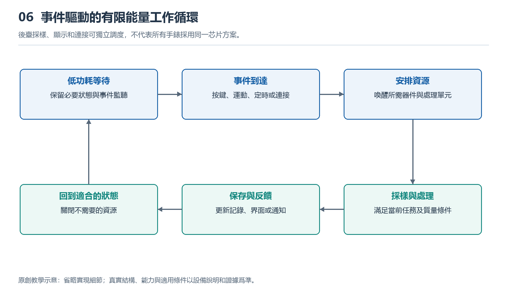

# 6.1 從休眠到喚醒：系統如何切換工作狀態

## 6.1.1 屏幕暗下去，手錶並沒有停止工作

把手腕放下，屏幕可能熄滅，也可能留下簡化的時間顯示。過一會兒，消息到來，手錶又會振動；再次抬腕，完整錶盤重新出現。看起來只是屏幕亮暗變化，內部卻涉及傳感器、處理器、存儲器和顯示電路的配合。

理解這一過程，首先要分清“看不見活動”與“沒有活動”。息屏只是顯示狀態，不能據此斷定處理器已經休眠；常亮也不意味着整套系統一直全速運轉。手錶會根據當前任務，讓不同模塊處於不同工作狀態：有的繼續監測，有的降低活動頻率，有的暫時停止，等待需要時再恢復。

這種安排不是把整隻手錶反覆開關，而是把有限的電量花在當下需要的工作上。讀懂它，關鍵不在於記住某個芯片名稱，而在於追問：誰還在工作，誰在等待，什麼事件會改變這種分工？

{width=95%}

後臺採樣、顯示和連接可獨立調度，不代表所有手錶採用同一芯片方案。


## 6.1.2 休眠有深淺，也有不同的範圍

日常語言中的“休眠”容易讓人想到完全停工，電子系統中的含義卻更細。較淺的低功耗狀態可能只是暫停處理器執行指令，仍保留內存和部分接口；更深的狀態可能關閉某些電路的時鐘，甚至切斷部分模塊的供電。保留得越少，通常越有節能空間，但恢復時需要完成的準備也可能越多。

時鐘可以理解爲推動數字電路按節拍工作的信號。暫時不需要計算時，停止相關時鐘，能夠減少電路反覆切換產生的耗能。但停止時鐘並不等於完全斷電，電路仍可能存在漏電等消耗。因此，“待機不耗電”並不準確。

深度休眠前，系統還要決定哪些狀態值得保存。例如當前界面、尚未處理的數據和連接信息，可能需要留在保持供電的存儲區域，或寫入其他存儲器。恢復時再利用這些信息繼續工作。具體保存位置與方式取決於硬件和軟件，不能從屏幕熄滅這一現象直接推斷。

## 6.1.3 誰負責等候下一次事件

如果主處理器減少活動，手錶怎樣知道用戶抬起了手腕？一種常見思路是讓耗能較低的檢測路徑繼續運行。例如，運動傳感器或低功耗處理單元分析動作，發現可能需要亮屏的事件後，再通知其他模塊恢復工作。

這裏的“通知”常通過中斷實現。它類似門鈴：處理器不必持續追問“有沒有新情況”，而是在事件到來時收到請求。但門鈴本身也需要值守條件。觸控能否喚醒，取決於相應檢測電路是否保持工作；無線消息能否到達，則與連接狀態和通信安排有關。

定時器也是喚醒來源。系統可以提前約定，在某個時刻恢復部分活動，完成鬧鐘、維護或數據處理。用戶按鍵、充電器接入等，也可能觸發狀態變化。

承擔這些工作的結構並不統一。有的設備採用主處理器與獨立低功耗控制器協作，有的把不同處理單元集成在同一芯片內，也有設備依靠單個處理器的多種低功耗模式。不能把某一種“雙芯接力”圖當作所有手錶的內部實況。

## 6.1.4 喚醒是一段有順序的恢復過程

收到喚醒請求後，系統未必立刻讓所有模塊進入高性能狀態。它通常先確認事件需要什麼，再恢復相應電源、時鐘和接口，處理必要的數據，最後更新顯示或發出反饋。部分步驟可以並行，另一些必須等待前面的條件滿足。

例如，按下表冠後，系統可能需要先恢復處理器運行，讀取此前保存的界面狀態，再準備畫面並交給顯示電路。用戶感受到的亮屏速度，是這條鏈路共同作用的結果，不只是處理器算得快不快。

下面的教學圖表示一種簡化邏輯，不對應特定產品：

```text
低活動狀態
  ├─ 按鍵、動作、消息或定時事件
  ↓
確認請求，恢復必要模塊
  ↓
處理任務，顯示或反饋
  ↓
檢查仍需持續的工作
  ├─ 有任務 → 保持相應活動
  └─ 無任務 → 保存必要狀態 → 返回低活動狀態
```

圖中的“必要模塊”是重點：查看時間通常不需要同時啓動定位和錄音；持續運動記錄時，即使屏幕變暗，部分感知與計算仍需繼續。系統狀態更像多個開關的組合，而不是隻有“全開”和“全關”兩個擋位。

狀態切換本身也有代價。恢復電源、重新建立通信或搬運數據，都可能消耗時間和能量。如果一個模塊剛睡下就被叫醒，頻繁切換未必划算。因此，系統往往會短暫等待，或把不緊急的工作集中處理，再回到較低活動狀態。這解釋了爲什麼放下手腕後，屏幕與內部模塊不一定同時進入低功耗狀態。

## 6.1.5 從亮屏行爲觀察狀態，而不是猜芯片

可以在正常室內環境中做一次簡單觀察：先查看是否啓用了抬腕亮屏、常亮顯示和省電模式，再分別記錄按鍵喚醒、抬腕喚醒以及放下手腕後的顯示變化。無需反覆快速擺臂，也不要爲了測試而觸發緊急呼叫。

觀察時，把現象與解釋分開寫。“按鍵後出現完整錶盤”是可見事實；“系統恢復了顯示相關工作”是合理推斷；“某顆獨立芯片把顯示控制權交給另一顆芯片”則需要產品資料才能確認。僅憑肉眼，也不能準確測出內部喚醒耗時或判斷處理器是否斷電。

若某次抬腕沒有亮屏，原因可能包括動作未滿足識別條件、相關設置關閉，或當前模式限制亮屏，不能立即歸結爲芯片故障。休眠與喚醒的核心，是在及時響應和減少無用活動之間安排好狀態。屏幕只是觀察這套安排的一扇窗口，而不是全部系統的工作指示燈。
