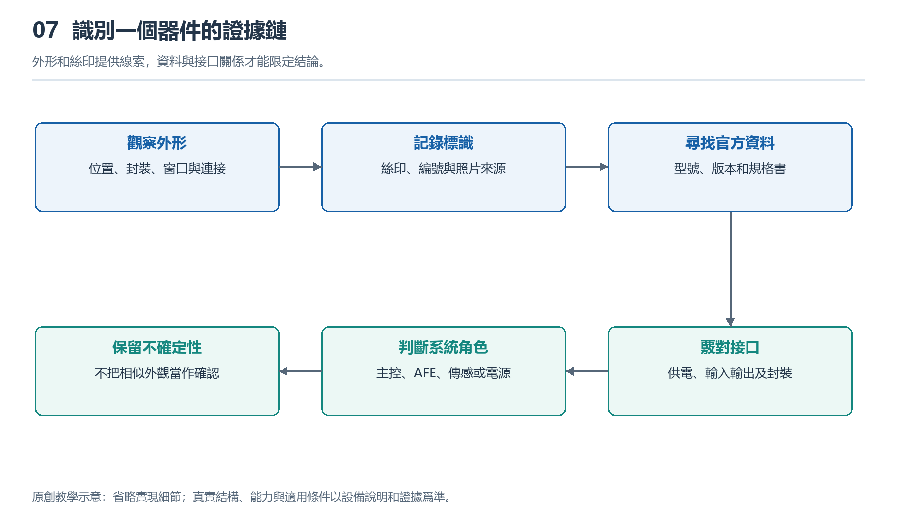

# 7.1 看拆解圖先看什麼：建立器件識別與證據標註圖

## 7.1.1 先認清照片裏的手錶

打開一張智能手錶拆解圖，最醒目的往往是電池和幾塊黑色封裝。你可能很快猜測：最大的是處理器，旁邊的是存儲器，靠近表底的是傳感器。但照片首先呈現的是外形與位置，不會自動告訴我們內部功能。器件識別的第一步，不是報出型號，而是確認這張圖究竟展示了什麼。

先查設備型號、尺寸版本、通信版本與圖片來源。同一系列的不同版本，可能採用不同主板、電池或天線佈局；外觀相似，也不能保證內部一致。再看照片拍攝的是主板正面、背面，還是已經移除屏蔽罩的某一層。若圖片被旋轉、裁切，甚至混用了不同設備的局部圖，後續判斷很容易失去依據。

可以先用錶冠、按鍵、背部窗口和錶帶連接處作爲方向參照，再觀察內部零件。這樣，照片裏的“左上角”才不只是畫面位置，而能對應到實物的某個區域。來源與版本不清楚時，應把它記爲未知，而不是用最像的產品名稱補齊。

{width=95%}

外形和絲印提供線索，資料與接口關係才能限定結論。


## 7.1.2 先分區域，再認單顆器件

面對密集的電路板，先找大區域比逐顆猜芯片更有效。電池通常佔據較大的連續空間；屏幕和背部傳感組件常通過柔性排線接入主板；金屬罩可能覆蓋對電磁干擾敏感的電路。不過，這些只是常見線索，具體結構仍需照片或資料支持。

觀察時可以沿連接關係追蹤：某條排線從哪裏來，插到哪裏；某個金屬接點是否接觸錶殼；某塊板是否緊貼光學窗口。位置與連接關係能夠幫助判斷系統角色，卻未必足以確定型號。例如，靠近光學組件的小芯片可能參與信號採集，也可能承擔供電、控制或其他任務。

尤其不要把“面積最大”直接等同於“主處理器”。照片中顯眼的黑色塊可能是系統級封裝，也可能只是屏蔽或保護結構。SiP是系統級封裝的名稱，其中可以整合多個器件，但外觀通常無法顯示全部內部組成。未看到獨立存儲芯片，也不意味着手錶沒有存儲器，它可能位於封裝內部或照片未展示的一面。

## 7.1.3 給每個判斷標明證據等級

一張有用的識別圖，應同時回答兩個問題：你認爲它是什麼，以及你憑什麼這樣認爲。可以給標註採用三種狀態：“已確認”“合理推斷”和“未知”。狀態不是器件的重要性排名，而是當前證據能夠支持到什麼程度。

“已確認”需要相應依據。例如，清晰可讀的器件標記與官方標記說明、封裝資料相符，而且照片能確定屬於該版本設備。“合理推斷”則表示存在位置、外形或連接線索，但仍有其他解釋。“未知”表示信息不足，不能可靠歸類。未知不是識別失敗，而是避免把猜測寫成事實的必要位置。

證據等級還應隨結論的精細程度變化。你可能已經確認某部件是電池，卻不能確認其內部材料體系；也可能確認某處是封裝模塊，卻不知道里麪包含哪些裸芯片。不要因爲大類正確，就把關於型號、工藝和性能的細節一併視爲已知。

下面是一幅教學用標註示意，不對應任何真實型號，方框大小和位置也不代表實際尺寸：

```text
拆解照片的證據標註示意

┌───────────────┐
│ A：電池       │──已確認：標籤與連接關係相符
└───────────────┘
┌───────────────┐
│ B：黑色封裝   │──合理推斷：可能是集成計算模塊
└───────────────┘
┌───────────────┐
│ C：微小器件   │──未知：標記不可讀，連接不可見
└───────────────┘

每個編號另附：圖片來源、設備版本、證據與待查問題
```

圖中的關鍵不是三塊部件，而是每條結論後面都留有依據。若後續資料表明B只是某種保護結構，就修改判斷並保留修改原因，不必爲了維持最初答案而尋找牽強解釋。

## 7.1.4 絲印是檢索入口，不是完整答案

芯片表面的文字、數字或圖形標記，通常被稱作頂面標記，日常也常統稱爲絲印。它們可能包含廠商標識、器件簡稱、批次或封裝追蹤信息，卻不一定直接寫出完整訂貨型號。同樣的短字符，在不同廠商的產品中也可能有不同含義。

讀圖時應先逐字記錄可見內容，把模糊字符寫成問號，不要自動補全。隨後檢索廠商資料，比較標記規則、封裝外形、尺寸和引腳佈置。若照片缺少比例尺，尺寸也只能估計；屏幕上的像素長度，不能直接當成器件的毫米尺寸。

官方規格書描述的是某型號器件的能力，並不能單獨證明某隻手錶使用了它。例如，TI的AFE4404產品資料可幫助理解光學測量中的LED驅動與模擬前端，但不能據此認定照片裏靠近光學窗口的芯片就是AFE4404。還需要設備照片與器件身份之間的證據鏈。

同樣，一張X光圖能夠揭示某些封裝或連接結構，卻未必能直接說明電路功能。多張圖片若都轉載自同一份拆解，也不是多個獨立來源。覈對來源關係，往往比繼續增加圖片數量更重要。

## 7.1.5 不拆機完成第一張識別圖

可以選擇一組來源明確、標註了設備版本的公開拆解照片，在副本上圈出五個對象：電池、主板、一個連接器、一塊封裝和一個尚不認識的部件。爲它們依次編號，分別記錄“看到了什麼”“據此推斷什麼”“還缺什麼證據”。不要直接在第一欄填入猜測的型號。

例如，“看到黑色矩形封裝及一行模糊字符”是觀察；“可能承擔計算任務”是推斷；“需要清晰標記和對應資料”是待查事項。若資料明確證明其身份，再更新標註。記錄來源鏈接或文檔名稱與訪問日期，能讓別人複查，也方便自己發現版本混淆。

這項任務不需要打開自己的手錶，更不需要加熱、撬殼或處理電池。完成後，你得到的不應是一張貼滿確定名稱的圖片，而是一張能區分已知、推斷與未知的證據圖。接下來辨認具體器件時，始終沿用這條順序：先定位對象，再尋找線索，最後讓結論停在證據允許的位置。
