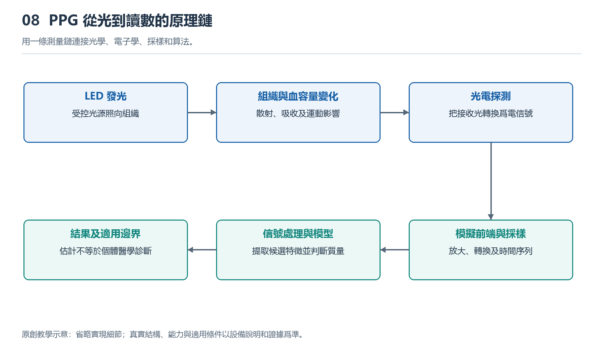

# 8.1 光爲何攜帶身體信息：吸收、散射與光電轉換

## 8.1.1 從表背的一點綠光說起

夜間摘下手錶時，你可能瞥見表背閃過綠光。貼在皮膚上的光源沒有拍攝血管，卻能幫助手錶估計脈搏。這是因爲光進入組織後，一部分被吸收，一部分改變方向，還有一部分返回表背。返回光的強弱隨組織狀態變化，便攜帶了可供分析的信息。

這裏的“攜帶”並不意味着每束光都標好了心率。探測器收到的是皮膚、血液、接觸狀態和環境光共同作用的結果。手錶必須從混合信號中尋找與脈搏相關的變化。理解這條鏈路，要先分清三個過程：吸收改變有多少光能夠留下，散射改變光往哪裏走，光電轉換則把收到的光變成電信號。

{width=95%}

用一條測量鏈連接光學、電子學、採樣和算法。


## 8.1.2 吸收：不同波長受到不同對待

把光照向一杯有色溶液，有些顏色容易穿過，有些顏色被明顯削弱。這種選擇性來自物質對不同波長光的吸收差異。被吸收的光能轉移給物質，不再以原來的光繼續傳播。人體組織中，血紅蛋白、黑色素和水等成分都參與吸收，只是各自在不同波長下的作用不同。

血紅蛋白結合氧前後，吸收光的特性有所不同。這是利用多種波長估計血氧飽和度的重要基礎。但“吸收特性不同”不等於“看一眼光的顏色就知道血氧”。手錶收到的光還受到組織厚度、散射、血液分佈和器件結構影響，必須經過信號處理與校準，才能形成估計值。

對於均勻、散射可忽略的介質，朗伯—比爾定律描述了光強如何隨吸收物質的濃度和傳播距離增加而減弱。可以把它理解爲：路越長、沿途吸收者越多，最終通過的光通常越少。這個規律提供了理解入口，卻不能把手腕直接當作一杯透明溶液。真實皮膚並不均勻，光在其中走的也不是一條直線。

## 8.1.3 散射：返回的光走過彎曲路徑

想象車燈照進薄霧，原本集中的光束變得分散。組織中的細胞及其內部結構，也會使光不斷改變傳播方向，這就是散射。部分光經過多次轉向後，從入射位置附近返回，被表背的光電探測器接收。常見腕錶採用的反射式PPG，正是利用這種返回光開展測量。

因此，光源與探測器之間的表面距離，不等於光在組織中的實際路程。收到的光對應許多不同路徑，有的經過較淺區域，有的探入更深處。不同波長的吸收和散射特性也不同，不能簡單認定某種顏色只看某一層血管，更不能給所有手腕指定同一個穿透深度。

下面的示意圖把這段不可見的旅程展開：

```text
表背光源                           光電探測器
   ↓                                   ↑
────────────── 皮膚表面 ─────────────────
   ↘ 散射 → 再散射 → 部分光返回 ↗
       ↘ 被組織吸收
          ↘ 經含血液區域後繼續散射
```

圖中的箭頭只是可能路徑，不代表每束光都按同一線路前進。探測器看到的是大量路徑共同形成的結果。這也解釋了爲什麼佩戴鬆動會干擾測量：間隙與接觸位置變化，不僅可能放入環境光，還會改變光進入和離開組織的條件。

## 8.1.4 光電轉換：把微弱變化交給電路

返回的光到達光電二極管後，能夠產生與入射光相關的電流。可以把它看作一道轉換接口：前半段是光與組織相互作用，後半段是電路對微弱電流進行放大、處理和數字化。探測器本身並不認識“脈搏”，它只響應所接收的光。

在心臟搏動過程中，局部組織內與脈動相關的血容量發生變化，吸收條件隨之改變，返回光中便可能出現週期性起伏。這個起伏通常疊加在更大的背景之上。背景包括相對穩定的組織吸收、非脈動血液貢獻和平均照明水平；脈搏信息只是其中較小的變化成分。

電路既要避免強背景使信號超出可測範圍，又要保留細小起伏。有些系統會安排光源點亮和熄滅的時段，估計環境光貢獻並作補償。但這並不保證干擾都能消失。手腕擺動會改變接觸和組織受壓狀態，其造成的起伏也可能具有週期性。因此，一條規律波形並不天然就是可靠的脈搏證據。

## 8.1.5 從物理依據走向有條件的讀數

估計脈率時，系統主要尋找與脈動相關的時間規律；估計血氧時，還要比較不同波長下脈動成分相對於背景的變化。常見方法會構造紅光與紅外光的歸一化變化比值，再結合校準關係得到結果。它不是僅憑兩種光強、套入一條理想公式就能完成的直接測量。

這種區別很重要：物理規律解釋“爲什麼有可能測”，校準與驗證回答“在什麼條件下測得可信”。皮膚特徵、局部灌注、運動及佩戴狀態都可能影響結果，具體影響還取決於設備設計。FDA關於脈搏血氧儀的資料也提醒使用者注意測量侷限，不能據此把消費級腕錶等同於醫療血氧儀。

你可以在正常靜坐時，按說明書佩戴手錶，觀察它何時給出讀數、何時提示調整接觸；不必刻意壓緊錶帶，也不要用憋氣等方式製造變化。把“屏幕顯示了什麼”和“可能由什麼造成”分開記錄。沿着吸收、散射、光電轉換這條鏈路，我們得到的不是一扇直接看見身體內部的窗口，而是一種依賴條件、需要覈驗的間接觀察方法。
