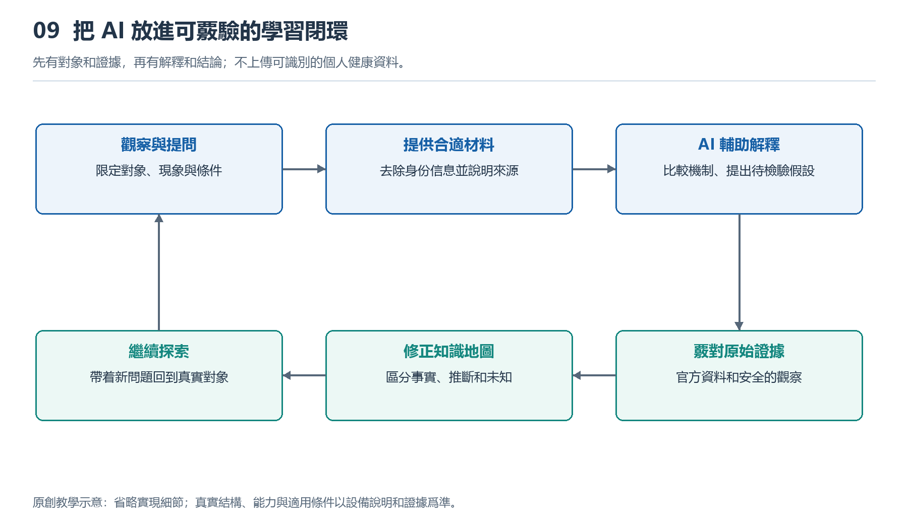

# 9.1 手錶算法與AI助手：分清兩類工具的角色

## 9.1.1 同一個問題，兩種不同的工作

散步回家後，你發現手錶上的心率曲線有一小段空白。手錶沒有給出那段時間的讀數，手機裏的AI助手卻能迅速列出解釋：佩戴鬆動、手腕活動、皮膚接觸變化，或者記錄尚未同步。回答條理清楚，但它與手錶實際做過的事情並不相同。

手錶算法面對的是傳感器信號、設備狀態和預先設定的任務；AI助手面對的通常是你輸入的文字、圖片或文件。前者可能判斷“這段信號不適合生成讀數”，後者則根據描述組織可能原因。除非獲得相應數據和工具權限，助手並沒有看見那段原始信號，更沒有重新測量你的身體。

理解兩類工具，首先要分清三個問題：誰接觸了測量數據，誰生成了結果，誰在解釋結果。它們可以協作，卻不能僅憑回答流暢程度相互替代。

{width=95%}

先有對象和證據，再有解釋和結論；不上傳可識別的個人健康資料。


## 9.1.2 手錶算法：在有限資源中完成特定任務

以光學心率爲例，光電探測器接收到的變化並不全來自脈搏，也包含環境光、接觸變化和運動干擾。手錶需要控制採集時序，對信號進行處理，檢查質量，再從可用片段中估計脈搏頻率。屏幕上的數字，是這一連串步驟的輸出，不是傳感器直接讀到的現成答案。

這裏的“算法”並不必然等於機器學習。閾值比較、濾波、峯值尋找、統計模型和訓練得到的模型，都可能參與工作。某項功能是否採用機器學習、模型在哪裏運行，需要查閱具體產品資料，不能因包裝上寫着“智能”就自行確定。

這些算法的任務通常比較明確，例如識別活動類型、估計心率或判斷是否發生跌倒。設計者需要在識別效果、響應速度、內存和電量之間取捨。部分處理在腕上完成，另一些可能交給手機或雲端，不能籠統地說所有判斷都由手錶獨立完成。

手錶也不總能給出可靠答案。腕上信號可能缺失，運動模式可能超出模型適用條件，個體差異也會影響表現。輸出空白有時正是質量控制的結果，比強行顯示一個看似精確的數字更誠實。

## 9.1.3 AI助手：整理語言，不等於重新測量

通用AI助手擅長把問題轉換成易讀的解釋，幫助讀者理解“光電探測器”“採樣”“運動僞影”等術語，也能按照給定材料整理功能依賴關係。它的優勢是跨越表達障礙，讓不熟悉專業語言的人找到繼續學習的入口。

但生成解釋與驗證事實是兩回事。助手可能把某款產品的結構套到另一款上，把常見方案說成唯一方案，甚至編出芯片型號或不存在的資料。要求它扮演“資深工程師”，可以改變回答風格，卻不能增加實際證據。

如果助手獲得聯網檢索或文件讀取工具，它能夠利用的資料會增加，但仍需檢查來源、版本及適用對象。讀到一份光學模擬前端規格書，只能說明這種器件能夠做什麼，不能證明你的手錶採用了它。看到心率曲線截圖，也不能據此斷定內部濾波器用了哪一種算法。

此外，有些腕上助手可能調用設備接口，讀取經過授權的運動記錄。這時它確實獲得了更多輸入，但權限範圍仍有邊界：能讀取彙總心率，不等於能讀取原始光學波形；能總結記錄，也不等於具備醫學診斷能力。

## 9.1.4 兩類工具怎樣接力

可以把兩類工具的關係畫成下面這張角色圖：

```text
身體與環境
    ↓
傳感器 → 手錶等系統算法 → 讀數、曲線、提示
                              ↓ 用戶選擇提供
資料與使用條件 ───────────→ AI助手
                              ↓
                       解釋、問題與待覈驗線索
                              ↓
                    用戶查資料、觀察與複覈
```

圖中的箭頭表示信息如何進入下一環，不表示可信程度自動提高。AI助手接到一條曲線後，能夠幫助解釋曲線的含義，卻不能沿着箭頭倒退，補出設備從未記錄的數據。它提出的原因仍須回到資料或觀察中核驗。

以散步記錄的空白爲例，助手可以建議先區分“腕上當時沒有讀數”和“手機暫未顯示記錄”。前者可能涉及採集與質量判斷，後者也可能涉及同步或展示。這個區分能縮小問題範圍，但在缺少證據時，兩者都只是待查方向。

較好的協作方式，是讓助手說明每種解釋需要什麼證據，以及什麼現象會削弱該解釋，而不是要求它立即選出一個唯一原因。這樣，回答越深入，證據要求也越明確，而不是術語越來越多、結論越來越肯定。

## 9.1.5 做一次不涉及診斷的角色覈對

打開一條普通步行記錄，選取其中一個你能直接確認的現象，例如路線少了一段，或某段沒有心率數據。先寫下“屏幕實際顯示了什麼”，不要立刻寫“傳感器壞了”。前一句是觀察，後一句已經是歸因。

隨後可以向助手提問：“請區分設備記錄、一般原理和原因推測，說明僅憑這張圖還不能知道什麼。”若使用截圖，先遮去姓名、精確住址、賬號和不必要的健康信息；也可以只用文字描述，不上傳整份記錄。

檢查回答時，特別留意它是否把推測寫成事實，是否把沒有提示解釋爲沒有風險，是否聲稱能恢復未採集的真實數據。遇到這些表述，應停止沿用結論，轉向產品說明或合適的專業渠道覈實。身體不適也不應交由這項觀察任務來判斷。

手錶算法負責在約束下形成特定結果，AI助手幫助人理解結果、整理疑問。把測量、判斷與解釋分開，纔是協同學習的起點：不是讓一個工具替另一個工具作保證，而是讓每一步都有清楚的角色和證據邊界。
