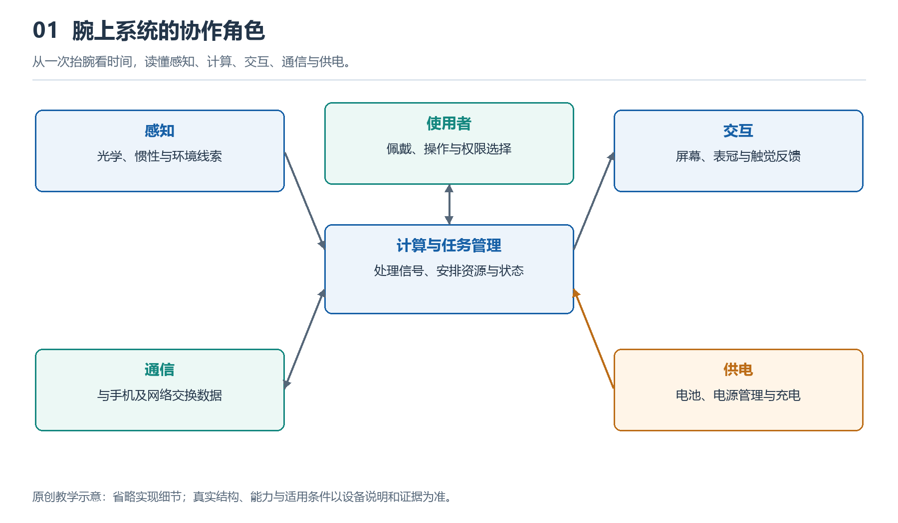

# 1.1 从抬腕看时间开始：智能手表是什么

## 1.1.1 一次抬腕，为什么不只是看时间

早晨出门，你抬起手腕，屏幕亮起，显示时间和一条消息。走到路口，手腕轻轻振动，提醒你转弯；散步结束后，屏幕又出现步数和活动时长。这些事情看似各自独立，却由同一只小设备完成。认识智能手表，可以从这个问题开始：它为什么能在需要的时候，把有关的信息送到手腕上？

普通手表也能计时，电子表也可能有闹钟和计步功能。因此，不能仅凭“有屏幕”或“能计步”判断一只手表是否智能。这里所说的智能手表，是以腕上佩戴为主要使用方式，把感知、计算、信息呈现和通信等能力组织起来的电子系统。它能够按照软件安排处理输入，并对身体活动、操作或外部信息作出回应。

这个定义强调的是协作，而不是功能数量。某款手表没有蜂窝通信，仍可能通过手机获得消息；另一款能够独立通话，也不意味着它在所有场景下都不再需要手机。理解对象，首先要看它怎样工作，而不是数宣传页上有多少个图标。

{width=95%}

从一次抬腕看时间，读懂感知、计算、交互、通信与供电。


## 1.1.2 它与手机相似，却不是简单缩小

智能手表和手机都使用芯片、软件、电池与无线连接，这种相似容易让人把前者当成缩小版手机。但同样一条消息，适合手机的处理方式，未必适合手腕。

在手机上，你可以阅读长段文字、查找附件，再用键盘回复。手表屏幕较小，抬腕姿势也不适合长时间保持，因此通常优先显示发送者、摘要和少量操作。语音、表冠、按键与振动，能够补充触摸操作。这不是说手表绝对不能输入长文本，而是说，完成同一任务所需的动作和注意力不同，系统必须据此作出取舍。

佩戴位置还改变了设备的工作条件。手表会随手臂反复运动，背部经常接触皮肤，表带松紧又影响稳定性。增加电池可能延长续航，却也占用空间、增加重量；提高计算负荷可能带来更丰富的功能，同时增加耗电和发热。工程设计要协调这些关系，不能用一个固定重量或温升数字概括所有产品的要求。

所以，手表不是把手机的各个零件按比例缩小，而是围绕“戴得住、看得清、及时回应”重新安排系统。

## 1.1.3 把一次回应拆成四种能力

再看抬腕亮屏这个动作。手腕姿态发生变化，运动传感器获得相关信号；系统根据一定规则判断是否需要亮屏；显示部分呈现时间；电池则为这些过程提供能量。即使只是看一眼表，也需要多个部分共同参与。不同设备还可能结合其他条件，减少无意动作造成的亮屏。

为了建立第一张认识地图，可以暂时把手表的工作归纳为感知、计算、呈现和连接四种能力，并把供电视为共同基础。

```text
身体活动与周围环境 → 感知 → 计算与保存 → 屏幕、声音或振动
                                  ↕
                             手机及网络服务

              电池与电源管理为上述工作提供能量
```

这是一幅功能关系示意图，不是表壳内部的零件位置图。箭头表示信息可以沿着哪些方向传递，也不意味着每次任务都要经过所有环节。比如，计时可以在手表本地完成，手机发来的消息则需要连接参与；有些运动记录可以先保存在手表中，稍后再同步。

图中的“计算”也不一定意味着复杂人工智能。判断按键是否按下、安排闹钟、整理运动样本，都属于计算。是否使用机器学习，要看具体功能与实现方式，不能因为产品名称里有“智能”，就认定每一步都有AI参与。

## 1.1.4 向外连接信息，向内观察活动

从使用者的角度看，智能手表有两个相互补充的方向。一个方向朝外：它把消息、导航或日程带到手腕，让人不必每次都拿出手机。另一个方向朝向佩戴者：利用贴近身体、随人活动的条件，记录运动和部分生理相关信号。

这种位置优势并不等于能够完整了解人体。以常见的光学脉搏测量为例，表背光源照向皮肤，探测器接收返回的光，系统从光强变化中提取与脉搏有关的信息，再估计心率。它不是直接看见心脏跳动，更不是仅凭一个数字判断身体是否健康。

持续佩戴也不等于所有传感器始终连续测量。设备可能根据运动状态、电量、设置和信号质量调整工作方式。某些功能还需要使用者主动开启，或者满足地区与授权条件。屏幕上有读数时，应当追问它来自什么测量；没有提示时，也不能据此排除健康问题。

同样，跌倒检测或紧急呼叫只能在产品规定的条件下发挥辅助作用，不能保证识别每一次事件或完成每一次求助。连接、设置和电量，都可能影响结果。

## 1.1.5 从自己的手表建立认识

现在可以做一个不拆机的小观察：在安全静止的位置，分别通过抬腕和按键查看时间，留意两种方式是否都能唤醒屏幕；再打开一个已有的活动记录，看看它显示的是当日累计值，还是一次活动的结果。不要为了测试而剧烈甩腕，也不必刻意制造异常情境。

把观察分成三类记录：“我看见的”“我据此推测的”和“目前不知道的”。例如，抬腕后屏幕亮起是直接观察；系统可能利用运动传感器判断姿态，是有原理依据的推测；具体用了哪些器件和判断规则，仅凭外观还不能确定。

这一区分是理解智能手表的起点。它既是一件贴身用品，也是一个不断接收输入、作出处理并给出回应的微系统。先看清它为谁工作、在什么条件下工作，再逐步认识各个组成部分，腕上的小屏幕才会成为理解系统的入口，而不只是功能清单。
