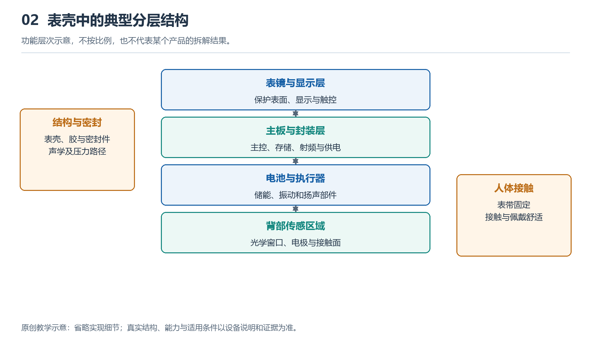

# 2.1 从外部接口向内看：建立系统模块图

把手表从腕上取下，放在柔软、干燥的桌面上。正面是屏幕，侧面可能有表冠、按键和小孔，背面则有透明窗口、金属接触面或充电触点。这些位置不仅是外观细节，也是理解内部系统的入口。无需打开表壳，只要追问“这里让什么进入，又让什么出来”，就能逐步建立一张系统模块图。

## 2.1.1 从接口提出问题，而不是猜测零件

这里所说的“接口”，不只指插头和插座，还包括手表与人体、环境及其他设备交换信息或能量的位置。手指按下按键，机械动作进入系统；屏幕亮起，信息以光的形式输出；背部光源照向皮肤，组织返回的光又进入探测器。看不见的无线连接，同样是一种接口。

观察时，先描述现象，再提出内部需要具备的能力。例如，“按下按键后屏幕亮起”是可以直接确认的现象；“内部存在识别按键并控制显示的电路”是有依据的推断；至于由哪颗芯片处理、经过哪条线路，则需要进一步查证。三种表述不能混为一谈。

侧面的小孔尤其容易引起误判。它可能与麦克风、扬声器或气压感知有关，但仅凭孔的大小和形状，通常不能确定用途。查阅对应型号的使用说明，比拿针探孔更可靠，也不会损伤内部薄膜或密封结构。接口观察的目的，是提出可验证的问题，而不是凭外形给每个位置强行命名。

{width=95%}

功能层次示意，不按比例，也不代表某个产品的拆解结果。


## 2.1.2 把复杂内部归成六类模块

面对一只功能繁多的手表，可以先按职责把内部归成六类：感知、计算与控制、存储、交互、通信、供电。这里的“模块”是为理解系统建立的功能单元，不意味着表壳里必然有六块独立零件。

感知模块接收身体与环境的变化，包括光学检测、电极测量以及运动感知等。计算与控制模块安排任务、处理数据，并决定何时点亮屏幕或发出提醒。存储模块保存程序、设置和记录，其中既有运行时暂存的数据，也有断电后仍需保留的内容。

交互模块负责让人看见、听见、感受到结果，也接收触摸和按键操作。通信模块负责与手机、无线网络或卫星信号建立相应联系。供电模块则把电池储存的能量转换、分配给各部分，并参与充电和保护管理。

实际器件可能承担多项职责。例如，一颗高度集成的芯片可以同时包含处理能力和无线通信电路；一个显示总成则可能包含显示面板、触控结构及相关驱动。因此，模块图回答的是“谁承担什么任务”，不是“里面有多少颗芯片”。

## 2.1.3 用连线表示协作关系

画图时，先把计算与控制放在中央，将其他模块安排在周围，再把人体、手机和充电器画在系统边界之外。下面是一张用于入门的功能示意图，不代表某一型号的真实布局。

```text
人体与环境 → [感知] → [计算与控制] ↔ [存储]
                           ↕
手指操作   →           [交互] → 光、声音、振动
                           ↕
手机等设备 ↔           [通信]

充电器 → [供电] → 感知、计算与控制、存储、交互、通信
```

图中上半部分主要表示信息联系，最下面一行表示供能关系。箭头连接的是功能，不是表壳中的距离。感知模块可能贴近底壳，也可能位于电路板上；通信电路与天线还可能分布在不同位置。不能因为图上两个方框相邻，就认为对应器件在实物中挨在一起。

图中的双向箭头也有具体含义：计算模块可以读取记录，也可以写入记录；通信模块既能发送数据，也能接收指令。感知部分为简洁只画出了数据送出的方向，实际工作时，它通常还需要接收启动、停止或调整工作方式的控制命令。图可以简化，但应当知道简化了什么。

## 2.1.4 用一个动作检查模块是否齐全

现在轻按一次按键，观察屏幕响应。这个普通动作可以帮助检验模块图。按键把动作转换为电信号，控制逻辑识别事件，程序决定显示什么，显示相关电路驱动屏幕，电源系统为这些过程提供能量。如果界面需要读取上次运动摘要，存储模块也会参与。

这里不必立即加入通信模块。许多本地操作无需手机或云端介入。只有当界面需要获取尚未保存在本机的信息，或执行同步等任务时，通信才成为这条功能链的一部分。模块图的价值，正在于区分“手表具备某模块”与“本次操作必须使用某模块”。

反过来，屏幕没有亮起，也不能直接证明屏幕损坏。电量不足、锁定状态、按键设置或软件异常，都可能改变结果。一条功能链经过多个环节，末端表现异常只能提示沿链检查，不能单凭结果锁定某颗器件。系统视角能减少这种过早下结论的错误。

## 2.1.5 给模块图留下证据和空白

可以在纸上为自己的手表画一张图，并用三种标记区分证据：“已观察”“资料确认”“尚未知”。屏幕能够显示内容，可以标为已观察；是否支持独立卫星定位，应根据对应型号的官方资料确认；具体采用何种封装、天线藏在哪里，如果没有可靠材料，就保留未知。

不要为了让图显得完整，照搬另一款手表的内部结构。同一系列的不同版本，也可能在蜂窝通信、传感器或充电方式上存在差异。记录完整型号和资料日期，有助于以后核对。观察过程中，不拆壳、不触碰电池、不向孔洞插入物品，也不以浸水方式验证结构。

最终得到的并非一张精确电路图，而是一张有证据支撑的理解地图：外部接口提示交换对象，功能模块解释任务分工，连线说明协作关系，空白则标出下一步需要查证的问题。此后认识处理器、传感器或电源器件时，就能把新知识放回系统，而不是只记住一串孤立的名称。
