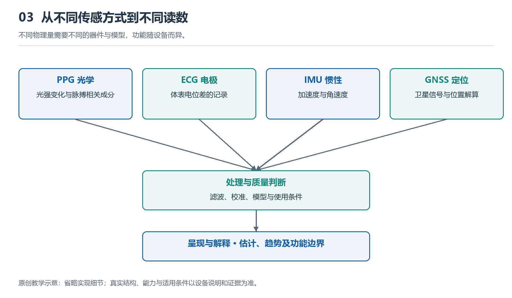

# 3.1 光怎样读出脉搏：PPG与心率、血氧估计

## 3.1.1 腕背的灯光在寻找什么

夜里摘下手表时，你可能瞥见背面闪过的绿光。它不是照明灯，也不是在给血管拍照，而是一次光学测量的起点。光从背部窗口进入皮肤，一部分被吸收，一部分经过多次散射后返回，由旁边的光电探测器接收。手表要寻找的，是返回光强中随脉搏起伏的微小变化。

这种方法称为光电容积脉搏波描记，简称PPG。这里的“容积”指组织中与血液容量有关的变化，不意味着手表能直接量出某根血管装了多少血。每次心脏搏动推动血液进入外周血管，腕部组织的光学性质随之发生细微变化，返回的光也带上了节律信息。

因此，PPG首先得到的是光强随时间变化的信号，而不是现成的心率数字。由光到读数，中间还要经过电信号转换、干扰处理和算法估计。背部灯亮，只说明光源正在工作，不能证明此次测量已经可靠。

{width=95%}

不同物理量需要不同的器件与模型，功能随设备而异。


## 3.1.2 从返回的光里分出脉搏

腕部PPG通常采用反射式结构：光源与探测器位于皮肤同一侧。光进入组织后，并不是沿一条整齐的弧线折返，而是在复杂的散射路径中传播，最终只有一部分到达探测器。

探测器接收的光包含较大的背景成分，其中叠加着较小的搏动成分。前者与皮肤、组织和非搏动血液等因素有关；后者与动脉血容量随心搏发生的变化有关。“背景”也不是永远不变，手腕一动、接触压力一变，它就可能明显起伏。

下面的示意图表示信息转换关系，并非真实组织剖面，也不表示光只走一条路径。

```text
光源发光 → 皮肤与组织中的吸收、散射 → 光电探测器
                    ↑                       ↓
             血容量随脉搏变化          光强变成电信号
                                            ↓
                                  采样、质量判断与估计
                                            ↓
                                    心率／血氧估计值
```

图中向上的箭头说明，血容量变化会影响光的传播；下方的处理链则说明，屏幕数字是多个环节共同产生的结果。探测器把光转成电信号后，采集电路再把它转成数字样本。算法需要从这些样本中寻找可信的周期，同时识别运动、漏光或接触变化造成的干扰。

## 3.1.3 心率为何常用绿光估计

不少手表在心率监测时使用绿光，因为血红蛋白对这一波段有较强吸收，配合合适的光源与接收结构，能够获得可用于分析的搏动信号。但这不是“绿光天然不会受运动影响”，也不是所有设备在所有状态下都只用绿光。波长、光源布局、皮肤条件和功耗预算都参与设计取舍。

当信号质量足够好时，算法可以识别连续脉搏之间的时间间隔，或分析一段波形中的主要重复频率，再换算成每分钟的脉搏次数。例如，理想情况下每秒出现一次可信的脉搏波，对应每分钟约六十次。这只是换算示例，不是判断健康的标准。

日常界面常把这个结果标为“心率”，但PPG直接观察的是外周脉搏相关变化，不是心脏的电活动。在部分心律异常、外周灌注不足或运动干扰条件下，两者不能简单等同。屏幕更新也不必与每次搏动同步，设备可能综合一段时间的数据，换取更稳定的显示。

## 3.1.4 血氧估计为什么需要不同颜色

只知道脉搏的节奏，还不能知道血红蛋白携氧的情况。血氧估计利用的是另一条线索：氧合血红蛋白与还原血红蛋白，对不同波长光的吸收特性不同。常见方案采用红光和近红外光，分别观察它们在组织中传播后的变化。

不过，比较两种光“谁更亮”并不足够。光源强弱、皮肤特性和传播路径都会改变接收光量。常见方法是分别提取每种波长中的搏动成分，并与各自的背景成分作比较，再比较这两个相对变化，结合经过标定的关系估计血氧饱和度。

这一步同时依赖光学测量和标定模型，不是直接数出血液里的氧分子。腕部反射测量的条件也不同于夹在手指上的透射测量。消费级手表的功能，不能因为同样显示百分比就自动等同于医疗血氧仪。

血氧估计尤其需要稳定、可用的脉搏信号。低温导致末梢血流减少、手腕运动、佩戴不合适等，都可能使结果偏离或无法生成。FDA关于脉搏血氧仪的说明也提醒，皮肤色素、循环状况等因素会影响测量；这类局限不应被一个看似精确的数字遮住。

## 3.1.5 一次安全观察能说明多少

可以在日常室内环境中做一次简单观察：先按产品说明佩戴手表，安静坐下，让前臂自然支撑在桌面，再启动设备支持的心率测量。记录是否出数、等待多久，以及是否出现质量提示。不必追求某个数字，更不要通过憋气或剧烈运动制造变化。

随后可在正常生活中留意，走动时的记录是否比安静时更容易中断。若出现差异，合理的初步解释是测量条件改变了；仅凭这一现象，还不能确定是摆臂、接触变化还是算法策略起主要作用。也不要为了“增强信号”把表带勒得更紧，贴合应以说明书和舒适、安全为前提。

PPG的价值，是以较低负担持续提供脉搏相关线索；它的边界，是光学信号始终受到身体与环境条件约束。理解读数时，应同时看测量条件、质量提示和持续趋势。无提示不等于排除疾病，有明显不适时，也不能让腕表数字替代及时的专业评估。
