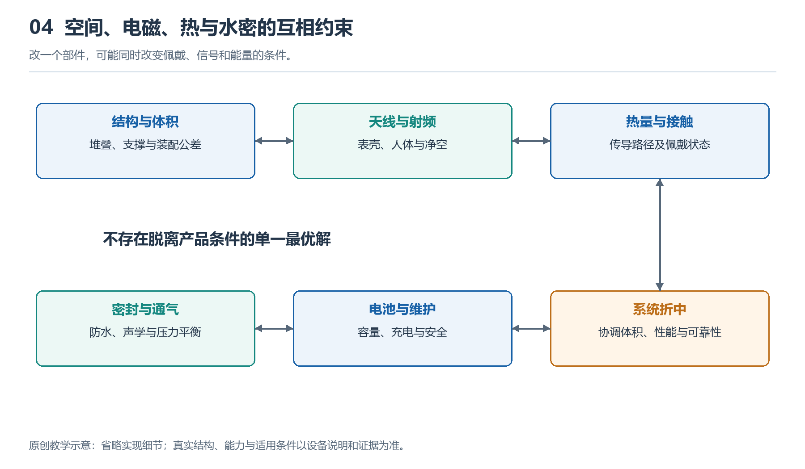

# 4.1 表壳里的空间分配：从剖面图理解层叠布局

## 4.1.1 从侧面看，手表并不是一个空盒子

把手表摘下，侧放在桌面上，你会看到表镜、边框和略微凸起的背部窗口。外观只是几条轮廓，内部却要容纳屏幕、电池、电路板、传感器、扬声器和振动部件。它们不仅需要放得进去，还要留下连接、固定和保护所需的空间。

理解这种安排，可以先想象沿表壳中央竖直切开，再从切面观察。这就是剖面图的基本思路。它让被外壳遮住的上下关系显露出来：什么靠近眼睛，什么贴近皮肤，什么夹在中间。但真实手表不能为了观察而自行切割或撬开，我们借助的是结构示意图和有来源的公开资料。

剖面图不是内部照片的简单替代，而是一种有选择的表达。它突出高度、厚度和接触关系，却未必能显示部件向左右延伸的完整形状。

{width=95%}

改一个部件，可能同时改变佩戴、信号和能量的条件。


## 4.1.2 沿着屏幕到皮肤，建立层叠印象

靠近使用者视线的一侧，通常是表镜与显示、触控相关结构。表镜负责承受日常接触，显示结构产生图像，触控结构感知操作。它们可能紧密贴合，不能仅凭外观就判断是几片独立组件。

中间区域往往留给电池和主要电路。电池通常需要较大且连续的体积，电路板则可以通过异形轮廓、局部堆叠或环绕布局利用剩余区域。两者不一定严格上下排列，也可能并排，或在部分区域相互重叠。

靠近皮肤的一侧，需要为光学窗口、电极以及相关传感结构安排位置。光源发出的光要到达皮肤，返回的光也要进入探测器，因此这条路径不能被电池或不透明支架挡住。背部凸起有时与传感结构、接触条件和内部空间有关，不能简单归结为某一个器件太厚。

下面的原创示意图只表达空间关系，不对应具体型号，也不按比例绘制。

```text
                  朝向视线
          ┌──────────────────┐
          │ 表镜及显示、触控结构 │
      ┌───┴──────────────────┴───┐
      │ 侧边部件 │ 电路区域          │
      │          ├───────────────┤
      │ 连接通路 │ 电池占用区域      │
      │          └───────────────┤
      │ 支撑、固定与传感相关结构      │
      └────────┬─────────┬───────┘
               │ 背部窗口 │
               └─────────┘
                  朝向皮肤
```

图中的连接通路提示我们：上层与下层之间必须能传递电能和信号。图中没有画出全部零件，并不意味着那些零件不存在；实际产品也可能交换电池与电路的位置。

## 4.1.3 为什么不能把每一处空隙都填满

收纳行李时，空隙似乎越少越好；设计手表却不能只追求塞满。部件尺寸存在制造偏差，装配时也需要定位和操作空间。如果设计尺寸刚好相抵，实际生产中就可能出现挤压、装不上或受力不均。

电池尤其不能被当作可以随意压紧的填充块。它需要可靠固定，并满足产品针对尺寸变化、机械保护和安全的设计要求。具体余量由电芯、结构与验证条件共同决定，没有适用于所有手表的统一间隙数字。

连接器、排线转弯处和密封结合面同样占据空间。图纸上看似没有电子功能的支架、胶层和垫片，可能承担抗冲击、绝缘、定位或密封任务。删掉它们，未必能得到一只同样可靠的薄表。

还要区分内部净空与外部厚度。表镜、壳底和支撑结构本身都有厚度，背部凸起也会影响佩戴时的接触。只比较宣传页上的厚度数值，不能完整判断哪只表内部更宽裕，或戴起来一定更舒适。

## 4.1.4 同一体积，为什么会有不同布局

设想两只外形相近的手表：一只强调较长续航，另一只增加了独立通信和更多交互功能。前者可能把较多空间交给电池，后者则需要为新增电路、连接结构及相关部件腾出位置。这只是说明取舍方向，不能据此推断某款产品的真实设计。

布局还受到部件工作方式的限制。屏幕要朝外，光学传感窗口要朝向皮肤，按键要能从侧面操作，扬声器需要合适的声学空间。这些部件不像积木一样可以任意调换位置。

圆形与方形表壳也会形成不同约束。常见电池和电路区域不一定恰好填满圆形轮廓，边缘可能形成适合小部件利用的区域；方形外形也不意味着没有空间损失，因为圆角、紧固位置和侧壁仍会占用体积。因此，外观面积相近，不代表可用内部体积相同。

空间分配最终是一组协商结果：增加一个部件，可能不仅占去自身大小，还需要连带调整固定方式、连接路线与周围结构。

## 4.1.5 带着证据读图，而不是凭形状猜测

阅读公开剖面图时，可以先找三个锚点：显示面、背部传感窗口和表壳边界，再辨认电池与电路区域。随后观察谁与谁重叠，哪些部件位于边缘，哪些通路需要跨越不同高度。这样比一开始逐个猜芯片名称更容易建立整体认识。

还要核对图片的性质。宣传渲染图可能省略胶层与紧固件；专利图展示的是技术方案，不保证已经用于某款产品；拆解照片更接近实物，却可能因拍摄角度遮住下方结构。爆炸图把部件拉开，是为了说明装配关系，不能把图上的距离当作真实间隙。

你可以在纸上画出自己手表的侧面轮廓，先标注能直接看到的表镜、按键和背部窗口，再用虚线补画推测的内部区域。旁边分别写上“实物可见”“资料确认”和“尚未确定”，不要为了图面完整而填满未知。

读懂层叠布局，关键不是记住一套固定顺序，而是看清每个位置为何被占用，以及这种占用限制了什么。表壳里的每一层，都同时服务于功能、装配和可靠性。
