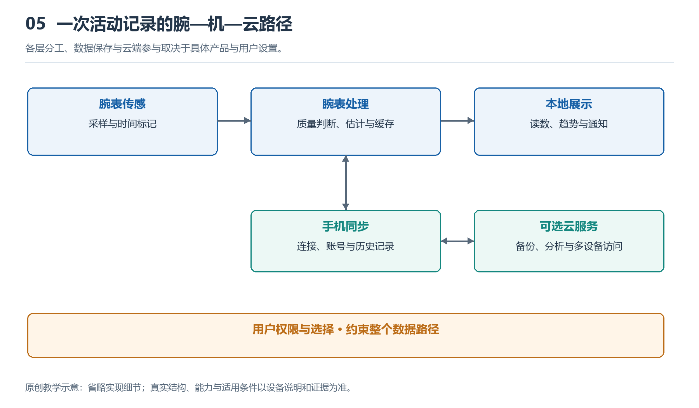

# 5.1 从充电器到各模块：电能怎样流动

## 5.1.1 贴上充电座，电从哪里进入

晚上把手表放上充电座，屏幕亮起充电符号。这个动作看似只是“给电池装电”，实际却启动了一条经过接收、转换、调节和保护的能量通路。电能并不是沿一根导线直接灌进电池，也不是由电池不加区分地分给所有器件。

先看表背与充电座的接触方式。有些产品通过金属触点导电，有些依靠线圈之间的电磁耦合传递能量。磁铁往往只负责定位，让触点或线圈对准；因此，“磁吸充电”描述的是吸附体验，并不能单独说明电能怎样跨过表壳。

使用触点时，电流经过接点进入手表的输入电路。使用感应式充电时，充电座线圈产生变化的磁场，手表接收线圈中出现感应电压，再经过整流和调节，形成内部可利用的直流电。两种路径都有损耗，所以适配器输出的能量不会全部成为电池储存的能量。

{width=95%}

各层分工、数据保存与云端参与取决于具体产品与用户设置。


## 5.1.2 充电管理不是一只开关

进入手表的电能，通常先受到充电管理电路的约束。它需要结合输入能力、电池电压、温度以及设备正在消耗的功率，决定允许多大的充电电流。具体功能可能集成在电源管理芯片中，也可能由几颗器件共同承担，并不存在所有手表通用的固定结构。

常见锂离子电池的充电过程包含不同阶段。电池电量很低时，系统可能先以较小电流进行预充；条件合适后进入较稳定的电流阶段；接近充满时，电压受到限制，电流逐渐减小。因此，前半段充得快、接近满电时变慢，往往是正常控制过程，不宜只凭电量百分比判断故障。

充电时手表也可能继续显示时间、连接手机或执行后台任务。具备相应电源路径管理的设计，可以把输入功率同时分配给系统和电池，而不是必须先把所有能量存进电池，再取出来使用。如果输入功率不足，或温度达到产品设定的限制，充电速度就可能降低，甚至暂时停止。

## 5.1.3 电池之后，是多条供电支路

离开充电座后，电池把储存的化学能转变为电能，支撑整只手表运行。但电池输出电压会随电量、负载和温度变化，各模块所需的供电条件也不同。处理器、显示屏、传感器和无线电路，不能简单地全部直接接到同一电压上。

电源管理电路就像一座分配站：某些支路需要降压，某些可能需要升压，还有些需要进一步减小电压波动。开关式转换电路通常具有较高的转换效率，但会产生需要控制的开关噪声；线性稳压电路结构和噪声特性有所不同，却会把一部分能量转化为热。实际设计常按负载需求组合使用。

下面的示意图表达功能关系，不代表某款手表的具体接线：

```text
充电器／充电座
      ↓
触点输入，或线圈接收与整流
      ↓
充电与电源路径管理 ←→ 电池
      ↓
稳压、分配与支路控制
      ├→ 处理与存储
      ├→ 传感与采集
      ├→ 显示与交互
      └→ 无线通信
```

图中的分支提醒我们：屏幕熄灭不等于整机断电。显示支路可以减少工作，计时、部分传感或连接维护仍可能继续。电流还必须通过回路返回；图中省略了返回路径，不能把箭头理解成电荷只进不出的单行道。

## 5.1.4 短时用电高峰怎样被接住

抬腕亮屏、收到振动提醒、开始无线发送，都会改变负载。电池和供电线路无法在任何瞬间都维持完全不变的电压，电池内部与连接路径上的阻抗，会使较大的电流需求带来电压下降。电池老化、温度偏低等条件，也可能使这种影响更加明显。

模块附近的电容可以暂时储存电荷，在负载快速变化时帮助稳定局部电压；稳压电路随后调整输出。电容更像短时缓冲池，而不是第二块续航电池。它无法独自支撑持续通话，也不能消除所有欠压风险。必要时，系统还会限制性能、暂停部分功能或关机保护。

这里需要区分功率与能量。功率描述某一时刻消耗能量的快慢，能量则要把一段时间内的消耗累积起来。一次很短的振动可能功率较高，却未必比长时间定位更耗电。不同电压支路的电流值也不能直接横向比较；讨论耗电，还应同时考虑电压、持续时间与转换损耗。

## 5.1.5 用一次充电观察认识边界

可以在正常室温下，用厂商认可或符合要求的充电设备，观察一次日常充电。开始前记录剩余电量、连接方式、屏幕状态，以及是否正在下载更新。随后在几个时间点记录电量变化，并留意系统是否显示温度或充电暂停提示，不必为了实验把电池耗到自动关机。

观察时让手表与充电座保持干燥、通风，不用衣物覆盖，也不要故意加热、冷却或反复错位充电。如果出现异常发热、异味或外壳鼓起，应停止使用并按厂商指引处理，而不是继续验证某种猜想。

这样的记录能说明“这些条件下电量显示怎样变化”，却不能直接测出电池内部电流或各支路功率。百分比是系统估计，表面温感也不是精密温度测量。理解电能流动，关键不在猜出一个瞬时数字，而在认清输入、储存、转换、分配与保护之间的关系：每一次亮屏和测量，都以这条能量通路能够稳定工作为前提。
