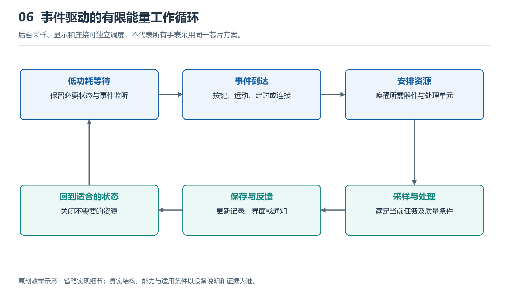

# 6.1 从休眠到唤醒：系统如何切换工作状态

## 6.1.1 屏幕暗下去，手表并没有停止工作

把手腕放下，屏幕可能熄灭，也可能留下简化的时间显示。过一会儿，消息到来，手表又会振动；再次抬腕，完整表盘重新出现。看起来只是屏幕亮暗变化，内部却涉及传感器、处理器、存储器和显示电路的配合。

理解这一过程，首先要分清“看不见活动”与“没有活动”。息屏只是显示状态，不能据此断定处理器已经休眠；常亮也不意味着整套系统一直全速运转。手表会根据当前任务，让不同模块处于不同工作状态：有的继续监测，有的降低活动频率，有的暂时停止，等待需要时再恢复。

这种安排不是把整只手表反复开关，而是把有限的电量花在当下需要的工作上。读懂它，关键不在于记住某个芯片名称，而在于追问：谁还在工作，谁在等待，什么事件会改变这种分工？

{width=95%}

后台采样、显示和连接可独立调度，不代表所有手表采用同一芯片方案。


## 6.1.2 休眠有深浅，也有不同的范围

日常语言中的“休眠”容易让人想到完全停工，电子系统中的含义却更细。较浅的低功耗状态可能只是暂停处理器执行指令，仍保留内存和部分接口；更深的状态可能关闭某些电路的时钟，甚至切断部分模块的供电。保留得越少，通常越有节能空间，但恢复时需要完成的准备也可能越多。

时钟可以理解为推动数字电路按节拍工作的信号。暂时不需要计算时，停止相关时钟，能够减少电路反复切换产生的耗能。但停止时钟并不等于完全断电，电路仍可能存在漏电等消耗。因此，“待机不耗电”并不准确。

深度休眠前，系统还要决定哪些状态值得保存。例如当前界面、尚未处理的数据和连接信息，可能需要留在保持供电的存储区域，或写入其他存储器。恢复时再利用这些信息继续工作。具体保存位置与方式取决于硬件和软件，不能从屏幕熄灭这一现象直接推断。

## 6.1.3 谁负责等候下一次事件

如果主处理器减少活动，手表怎样知道用户抬起了手腕？一种常见思路是让耗能较低的检测路径继续运行。例如，运动传感器或低功耗处理单元分析动作，发现可能需要亮屏的事件后，再通知其他模块恢复工作。

这里的“通知”常通过中断实现。它类似门铃：处理器不必持续追问“有没有新情况”，而是在事件到来时收到请求。但门铃本身也需要值守条件。触控能否唤醒，取决于相应检测电路是否保持工作；无线消息能否到达，则与连接状态和通信安排有关。

定时器也是唤醒来源。系统可以提前约定，在某个时刻恢复部分活动，完成闹钟、维护或数据处理。用户按键、充电器接入等，也可能触发状态变化。

承担这些工作的结构并不统一。有的设备采用主处理器与独立低功耗控制器协作，有的把不同处理单元集成在同一芯片内，也有设备依靠单个处理器的多种低功耗模式。不能把某一种“双芯接力”图当作所有手表的内部实况。

## 6.1.4 唤醒是一段有顺序的恢复过程

收到唤醒请求后，系统未必立刻让所有模块进入高性能状态。它通常先确认事件需要什么，再恢复相应电源、时钟和接口，处理必要的数据，最后更新显示或发出反馈。部分步骤可以并行，另一些必须等待前面的条件满足。

例如，按下表冠后，系统可能需要先恢复处理器运行，读取此前保存的界面状态，再准备画面并交给显示电路。用户感受到的亮屏速度，是这条链路共同作用的结果，不只是处理器算得快不快。

下面的教学图表示一种简化逻辑，不对应特定产品：

```text
低活动状态
  ├─ 按键、动作、消息或定时事件
  ↓
确认请求，恢复必要模块
  ↓
处理任务，显示或反馈
  ↓
检查仍需持续的工作
  ├─ 有任务 → 保持相应活动
  └─ 无任务 → 保存必要状态 → 返回低活动状态
```

图中的“必要模块”是重点：查看时间通常不需要同时启动定位和录音；持续运动记录时，即使屏幕变暗，部分感知与计算仍需继续。系统状态更像多个开关的组合，而不是只有“全开”和“全关”两个挡位。

状态切换本身也有代价。恢复电源、重新建立通信或搬运数据，都可能消耗时间和能量。如果一个模块刚睡下就被叫醒，频繁切换未必划算。因此，系统往往会短暂等待，或把不紧急的工作集中处理，再回到较低活动状态。这解释了为什么放下手腕后，屏幕与内部模块不一定同时进入低功耗状态。

## 6.1.5 从亮屏行为观察状态，而不是猜芯片

可以在正常室内环境中做一次简单观察：先查看是否启用了抬腕亮屏、常亮显示和省电模式，再分别记录按键唤醒、抬腕唤醒以及放下手腕后的显示变化。无需反复快速摆臂，也不要为了测试而触发紧急呼叫。

观察时，把现象与解释分开写。“按键后出现完整表盘”是可见事实；“系统恢复了显示相关工作”是合理推断；“某颗独立芯片把显示控制权交给另一颗芯片”则需要产品资料才能确认。仅凭肉眼，也不能准确测出内部唤醒耗时或判断处理器是否断电。

若某次抬腕没有亮屏，原因可能包括动作未满足识别条件、相关设置关闭，或当前模式限制亮屏，不能立即归结为芯片故障。休眠与唤醒的核心，是在及时响应和减少无用活动之间安排好状态。屏幕只是观察这套安排的一扇窗口，而不是全部系统的工作指示灯。
