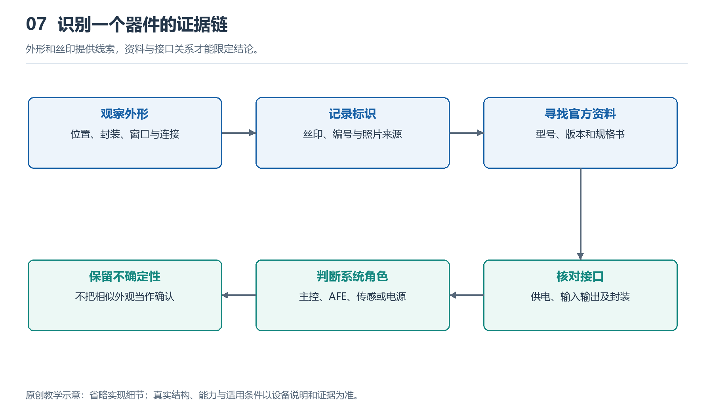

# 7.1 看拆解图先看什么：建立器件识别与证据标注图

## 7.1.1 先认清照片里的手表

打开一张智能手表拆解图，最醒目的往往是电池和几块黑色封装。你可能很快猜测：最大的是处理器，旁边的是存储器，靠近表底的是传感器。但照片首先呈现的是外形与位置，不会自动告诉我们内部功能。器件识别的第一步，不是报出型号，而是确认这张图究竟展示了什么。

先查设备型号、尺寸版本、通信版本与图片来源。同一系列的不同版本，可能采用不同主板、电池或天线布局；外观相似，也不能保证内部一致。再看照片拍摄的是主板正面、背面，还是已经移除屏蔽罩的某一层。若图片被旋转、裁切，甚至混用了不同设备的局部图，后续判断很容易失去依据。

可以先用表冠、按键、背部窗口和表带连接处作为方向参照，再观察内部零件。这样，照片里的“左上角”才不只是画面位置，而能对应到实物的某个区域。来源与版本不清楚时，应把它记为未知，而不是用最像的产品名称补齐。

{width=95%}

外形和丝印提供线索，资料与接口关系才能限定结论。


## 7.1.2 先分区域，再认单颗器件

面对密集的电路板，先找大区域比逐颗猜芯片更有效。电池通常占据较大的连续空间；屏幕和背部传感组件常通过柔性排线接入主板；金属罩可能覆盖对电磁干扰敏感的电路。不过，这些只是常见线索，具体结构仍需照片或资料支持。

观察时可以沿连接关系追踪：某条排线从哪里来，插到哪里；某个金属接点是否接触表壳；某块板是否紧贴光学窗口。位置与连接关系能够帮助判断系统角色，却未必足以确定型号。例如，靠近光学组件的小芯片可能参与信号采集，也可能承担供电、控制或其他任务。

尤其不要把“面积最大”直接等同于“主处理器”。照片中显眼的黑色块可能是系统级封装，也可能只是屏蔽或保护结构。SiP是系统级封装的名称，其中可以整合多个器件，但外观通常无法显示全部内部组成。未看到独立存储芯片，也不意味着手表没有存储器，它可能位于封装内部或照片未展示的一面。

## 7.1.3 给每个判断标明证据等级

一张有用的识别图，应同时回答两个问题：你认为它是什么，以及你凭什么这样认为。可以给标注采用三种状态：“已确认”“合理推断”和“未知”。状态不是器件的重要性排名，而是当前证据能够支持到什么程度。

“已确认”需要相应依据。例如，清晰可读的器件标记与官方标记说明、封装资料相符，而且照片能确定属于该版本设备。“合理推断”则表示存在位置、外形或连接线索，但仍有其他解释。“未知”表示信息不足，不能可靠归类。未知不是识别失败，而是避免把猜测写成事实的必要位置。

证据等级还应随结论的精细程度变化。你可能已经确认某部件是电池，却不能确认其内部材料体系；也可能确认某处是封装模块，却不知道里面包含哪些裸芯片。不要因为大类正确，就把关于型号、工艺和性能的细节一并视为已知。

下面是一幅教学用标注示意，不对应任何真实型号，方框大小和位置也不代表实际尺寸：

```text
拆解照片的证据标注示意

┌───────────────┐
│ A：电池       │──已确认：标签与连接关系相符
└───────────────┘
┌───────────────┐
│ B：黑色封装   │──合理推断：可能是集成计算模块
└───────────────┘
┌───────────────┐
│ C：微小器件   │──未知：标记不可读，连接不可见
└───────────────┘

每个编号另附：图片来源、设备版本、证据与待查问题
```

图中的关键不是三块部件，而是每条结论后面都留有依据。若后续资料表明B只是某种保护结构，就修改判断并保留修改原因，不必为了维持最初答案而寻找牵强解释。

## 7.1.4 丝印是检索入口，不是完整答案

芯片表面的文字、数字或图形标记，通常被称作顶面标记，日常也常统称为丝印。它们可能包含厂商标识、器件简称、批次或封装追踪信息，却不一定直接写出完整订货型号。同样的短字符，在不同厂商的产品中也可能有不同含义。

读图时应先逐字记录可见内容，把模糊字符写成问号，不要自动补全。随后检索厂商资料，比较标记规则、封装外形、尺寸和引脚布置。若照片缺少比例尺，尺寸也只能估计；屏幕上的像素长度，不能直接当成器件的毫米尺寸。

官方规格书描述的是某型号器件的能力，并不能单独证明某只手表使用了它。例如，TI的AFE4404产品资料可帮助理解光学测量中的LED驱动与模拟前端，但不能据此认定照片里靠近光学窗口的芯片就是AFE4404。还需要设备照片与器件身份之间的证据链。

同样，一张X光图能够揭示某些封装或连接结构，却未必能直接说明电路功能。多张图片若都转载自同一份拆解，也不是多个独立来源。核对来源关系，往往比继续增加图片数量更重要。

## 7.1.5 不拆机完成第一张识别图

可以选择一组来源明确、标注了设备版本的公开拆解照片，在副本上圈出五个对象：电池、主板、一个连接器、一块封装和一个尚不认识的部件。为它们依次编号，分别记录“看到了什么”“据此推断什么”“还缺什么证据”。不要直接在第一栏填入猜测的型号。

例如，“看到黑色矩形封装及一行模糊字符”是观察；“可能承担计算任务”是推断；“需要清晰标记和对应资料”是待查事项。若资料明确证明其身份，再更新标注。记录来源链接或文档名称与访问日期，能让别人复查，也方便自己发现版本混淆。

这项任务不需要打开自己的手表，更不需要加热、撬壳或处理电池。完成后，你得到的不应是一张贴满确定名称的图片，而是一张能区分已知、推断与未知的证据图。接下来辨认具体器件时，始终沿用这条顺序：先定位对象，再寻找线索，最后让结论停在证据允许的位置。
