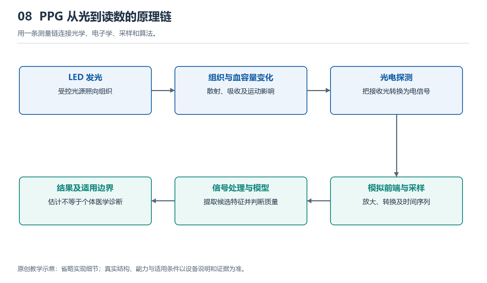

# 8.1 光为何携带身体信息：吸收、散射与光电转换

## 8.1.1 从表背的一点绿光说起

夜间摘下手表时，你可能瞥见表背闪过绿光。贴在皮肤上的光源没有拍摄血管，却能帮助手表估计脉搏。这是因为光进入组织后，一部分被吸收，一部分改变方向，还有一部分返回表背。返回光的强弱随组织状态变化，便携带了可供分析的信息。

这里的“携带”并不意味着每束光都标好了心率。探测器收到的是皮肤、血液、接触状态和环境光共同作用的结果。手表必须从混合信号中寻找与脉搏相关的变化。理解这条链路，要先分清三个过程：吸收改变有多少光能够留下，散射改变光往哪里走，光电转换则把收到的光变成电信号。

{width=95%}

用一条测量链连接光学、电子学、采样和算法。


## 8.1.2 吸收：不同波长受到不同对待

把光照向一杯有色溶液，有些颜色容易穿过，有些颜色被明显削弱。这种选择性来自物质对不同波长光的吸收差异。被吸收的光能转移给物质，不再以原来的光继续传播。人体组织中，血红蛋白、黑色素和水等成分都参与吸收，只是各自在不同波长下的作用不同。

血红蛋白结合氧前后，吸收光的特性有所不同。这是利用多种波长估计血氧饱和度的重要基础。但“吸收特性不同”不等于“看一眼光的颜色就知道血氧”。手表收到的光还受到组织厚度、散射、血液分布和器件结构影响，必须经过信号处理与校准，才能形成估计值。

对于均匀、散射可忽略的介质，朗伯—比尔定律描述了光强如何随吸收物质的浓度和传播距离增加而减弱。可以把它理解为：路越长、沿途吸收者越多，最终通过的光通常越少。这个规律提供了理解入口，却不能把手腕直接当作一杯透明溶液。真实皮肤并不均匀，光在其中走的也不是一条直线。

## 8.1.3 散射：返回的光走过弯曲路径

想象车灯照进薄雾，原本集中的光束变得分散。组织中的细胞及其内部结构，也会使光不断改变传播方向，这就是散射。部分光经过多次转向后，从入射位置附近返回，被表背的光电探测器接收。常见腕表采用的反射式PPG，正是利用这种返回光开展测量。

因此，光源与探测器之间的表面距离，不等于光在组织中的实际路程。收到的光对应许多不同路径，有的经过较浅区域，有的探入更深处。不同波长的吸收和散射特性也不同，不能简单认定某种颜色只看某一层血管，更不能给所有手腕指定同一个穿透深度。

下面的示意图把这段不可见的旅程展开：

```text
表背光源                           光电探测器
   ↓                                   ↑
────────────── 皮肤表面 ─────────────────
   ↘ 散射 → 再散射 → 部分光返回 ↗
       ↘ 被组织吸收
          ↘ 经含血液区域后继续散射
```

图中的箭头只是可能路径，不代表每束光都按同一线路前进。探测器看到的是大量路径共同形成的结果。这也解释了为什么佩戴松动会干扰测量：间隙与接触位置变化，不仅可能放入环境光，还会改变光进入和离开组织的条件。

## 8.1.4 光电转换：把微弱变化交给电路

返回的光到达光电二极管后，能够产生与入射光相关的电流。可以把它看作一道转换接口：前半段是光与组织相互作用，后半段是电路对微弱电流进行放大、处理和数字化。探测器本身并不认识“脉搏”，它只响应所接收的光。

在心脏搏动过程中，局部组织内与脉动相关的血容量发生变化，吸收条件随之改变，返回光中便可能出现周期性起伏。这个起伏通常叠加在更大的背景之上。背景包括相对稳定的组织吸收、非脉动血液贡献和平均照明水平；脉搏信息只是其中较小的变化成分。

电路既要避免强背景使信号超出可测范围，又要保留细小起伏。有些系统会安排光源点亮和熄灭的时段，估计环境光贡献并作补偿。但这并不保证干扰都能消失。手腕摆动会改变接触和组织受压状态，其造成的起伏也可能具有周期性。因此，一条规律波形并不天然就是可靠的脉搏证据。

## 8.1.5 从物理依据走向有条件的读数

估计脉率时，系统主要寻找与脉动相关的时间规律；估计血氧时，还要比较不同波长下脉动成分相对于背景的变化。常见方法会构造红光与红外光的归一化变化比值，再结合校准关系得到结果。它不是仅凭两种光强、套入一条理想公式就能完成的直接测量。

这种区别很重要：物理规律解释“为什么有可能测”，校准与验证回答“在什么条件下测得可信”。皮肤特征、局部灌注、运动及佩戴状态都可能影响结果，具体影响还取决于设备设计。FDA关于脉搏血氧仪的资料也提醒使用者注意测量局限，不能据此把消费级腕表等同于医疗血氧仪。

你可以在正常静坐时，按说明书佩戴手表，观察它何时给出读数、何时提示调整接触；不必刻意压紧表带，也不要用憋气等方式制造变化。把“屏幕显示了什么”和“可能由什么造成”分开记录。沿着吸收、散射、光电转换这条链路，我们得到的不是一扇直接看见身体内部的窗口，而是一种依赖条件、需要核验的间接观察方法。
