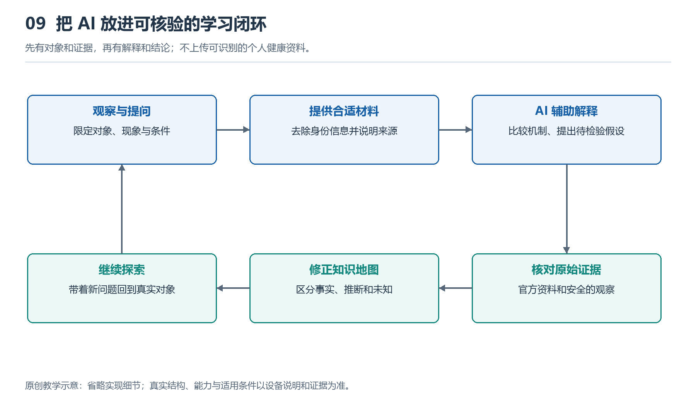

# 9.1 手表算法与AI助手：分清两类工具的角色

## 9.1.1 同一个问题，两种不同的工作

散步回家后，你发现手表上的心率曲线有一小段空白。手表没有给出那段时间的读数，手机里的AI助手却能迅速列出解释：佩戴松动、手腕活动、皮肤接触变化，或者记录尚未同步。回答条理清楚，但它与手表实际做过的事情并不相同。

手表算法面对的是传感器信号、设备状态和预先设定的任务；AI助手面对的通常是你输入的文字、图片或文件。前者可能判断“这段信号不适合生成读数”，后者则根据描述组织可能原因。除非获得相应数据和工具权限，助手并没有看见那段原始信号，更没有重新测量你的身体。

理解两类工具，首先要分清三个问题：谁接触了测量数据，谁生成了结果，谁在解释结果。它们可以协作，却不能仅凭回答流畅程度相互替代。

{width=95%}

先有对象和证据，再有解释和结论；不上传可识别的个人健康资料。


## 9.1.2 手表算法：在有限资源中完成特定任务

以光学心率为例，光电探测器接收到的变化并不全来自脉搏，也包含环境光、接触变化和运动干扰。手表需要控制采集时序，对信号进行处理，检查质量，再从可用片段中估计脉搏频率。屏幕上的数字，是这一连串步骤的输出，不是传感器直接读到的现成答案。

这里的“算法”并不必然等于机器学习。阈值比较、滤波、峰值寻找、统计模型和训练得到的模型，都可能参与工作。某项功能是否采用机器学习、模型在哪里运行，需要查阅具体产品资料，不能因包装上写着“智能”就自行确定。

这些算法的任务通常比较明确，例如识别活动类型、估计心率或判断是否发生跌倒。设计者需要在识别效果、响应速度、内存和电量之间取舍。部分处理在腕上完成，另一些可能交给手机或云端，不能笼统地说所有判断都由手表独立完成。

手表也不总能给出可靠答案。腕上信号可能缺失，运动模式可能超出模型适用条件，个体差异也会影响表现。输出空白有时正是质量控制的结果，比强行显示一个看似精确的数字更诚实。

## 9.1.3 AI助手：整理语言，不等于重新测量

通用AI助手擅长把问题转换成易读的解释，帮助读者理解“光电探测器”“采样”“运动伪影”等术语，也能按照给定材料整理功能依赖关系。它的优势是跨越表达障碍，让不熟悉专业语言的人找到继续学习的入口。

但生成解释与验证事实是两回事。助手可能把某款产品的结构套到另一款上，把常见方案说成唯一方案，甚至编出芯片型号或不存在的资料。要求它扮演“资深工程师”，可以改变回答风格，却不能增加实际证据。

如果助手获得联网检索或文件读取工具，它能够利用的资料会增加，但仍需检查来源、版本及适用对象。读到一份光学模拟前端规格书，只能说明这种器件能够做什么，不能证明你的手表采用了它。看到心率曲线截图，也不能据此断定内部滤波器用了哪一种算法。

此外，有些腕上助手可能调用设备接口，读取经过授权的运动记录。这时它确实获得了更多输入，但权限范围仍有边界：能读取汇总心率，不等于能读取原始光学波形；能总结记录，也不等于具备医学诊断能力。

## 9.1.4 两类工具怎样接力

可以把两类工具的关系画成下面这张角色图：

```text
身体与环境
    ↓
传感器 → 手表等系统算法 → 读数、曲线、提示
                              ↓ 用户选择提供
资料与使用条件 ───────────→ AI助手
                              ↓
                       解释、问题与待核验线索
                              ↓
                    用户查资料、观察与复核
```

图中的箭头表示信息如何进入下一环，不表示可信程度自动提高。AI助手接到一条曲线后，能够帮助解释曲线的含义，却不能沿着箭头倒退，补出设备从未记录的数据。它提出的原因仍须回到资料或观察中核验。

以散步记录的空白为例，助手可以建议先区分“腕上当时没有读数”和“手机暂未显示记录”。前者可能涉及采集与质量判断，后者也可能涉及同步或展示。这个区分能缩小问题范围，但在缺少证据时，两者都只是待查方向。

较好的协作方式，是让助手说明每种解释需要什么证据，以及什么现象会削弱该解释，而不是要求它立即选出一个唯一原因。这样，回答越深入，证据要求也越明确，而不是术语越来越多、结论越来越肯定。

## 9.1.5 做一次不涉及诊断的角色核对

打开一条普通步行记录，选取其中一个你能直接确认的现象，例如路线少了一段，或某段没有心率数据。先写下“屏幕实际显示了什么”，不要立刻写“传感器坏了”。前一句是观察，后一句已经是归因。

随后可以向助手提问：“请区分设备记录、一般原理和原因推测，说明仅凭这张图还不能知道什么。”若使用截图，先遮去姓名、精确住址、账号和不必要的健康信息；也可以只用文字描述，不上传整份记录。

检查回答时，特别留意它是否把推测写成事实，是否把没有提示解释为没有风险，是否声称能恢复未采集的真实数据。遇到这些表述，应停止沿用结论，转向产品说明或合适的专业渠道核实。身体不适也不应交由这项观察任务来判断。

手表算法负责在约束下形成特定结果，AI助手帮助人理解结果、整理疑问。把测量、判断与解释分开，才是协同学习的起点：不是让一个工具替另一个工具作保证，而是让每一步都有清楚的角色和证据边界。
