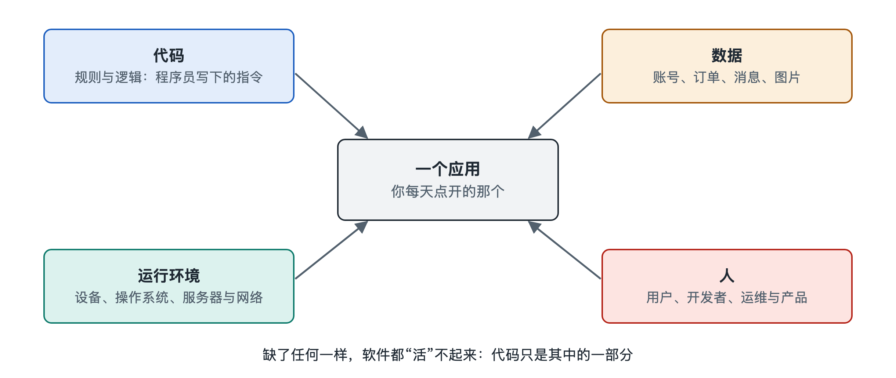

# 1.2 软件系统是什么：代码、数据、运行环境与人

把手机上的一个记账应用删掉，再从应用商店重新装回来，你会发现一件有意思的事：应用的图标、按钮、菜单一模一样地回来了，可如果你之前没有登录账号、也没有开启同步，那几年的账目就再也找不回来了。反过来，如果你换了一部新手机，登录同一个账号，账目全都在，界面却可能因为系统版本不同而略有差异。

这个小实验说明，我们平时说的“一个应用”，其实不是一个单一的东西。删掉又装回来的，是一部分；跟着账号走的，是另一部分；随着手机变化的，又是一部分。软件系统（software system）正是由这几类性质不同的部分共同构成的。本节把它们拆成四个要素：代码、数据、运行环境与人。

## 1.2.1 代码：写好的“做事步骤”

代码（code）是软件中描述“怎样做事”的部分。点“记一笔”按钮时弹出输入框，输入金额后自动归入“餐饮”类别，月底生成一张饼图——这些行为都事先由程序员用编程语言写成了一条条指令。

代码有两个重要特点。第一，它是**可以复制的**。同一份代码可以同时装在千千万万部手机上，每一份都完全相同，这也是重装应用后界面“原样回来”的原因。第二，它是**相对稳定的**。在两次更新之间，代码不会自己改变；只有开发者发布新版本，你点了“更新”，代码才会被替换。

不过，读者在手机上下载的通常不是程序员写下的原始文本，而是经过翻译和打包的结果。人写的叫源代码（source code），机器执行的是另一种形式，这个转换过程会在第二章详细展开。这里只需记住：代码是软件的“行为说明书”。

## 1.2.2 数据：被处理、被保存的“内容”

如果说代码是菜谱，那么数据（data）就是食材和做好的菜。你记下的每一笔账、你的账号昵称、你设置的预算上限、应用记住的“上次停留在哪一页”，都是数据。

和代码相比，数据的性质恰好相反：

| 对比项 | 代码 | 数据 |
|---|---|---|
| 是谁产生的 | 开发者编写 | 用户操作和系统运行中不断产生 |
| 是否人人相同 | 同一版本对所有用户相同 | 每个用户各不相同 |
| 变化频率 | 随版本更新而变，频率较低 | 每次操作都可能变化 |
| 丢了能否恢复 | 重新下载即可 | 没有备份就可能永久丢失 |

这张表解释了开头的实验：重装应用能找回代码，却找不回只存在本机的数据。也正因为数据独一无二、难以重建，软件工程里有大量技术专门用来保存、复制和保护数据，后面关于数据库、持久化与事务的章节都围绕这一点展开。

还要注意，数据不一定都放在你的手机里。开启同步后，账目会被送到开发者的服务器上保存，手机里只是一份副本。数据放在哪里、怎样在多处之间保持一致，是理解现代软件的关键问题之一。

## 1.2.3 运行环境：让代码真正动起来的“舞台”

有了代码和数据，软件还不能自己运转。代码需要一个地方被执行，这就是运行环境（runtime environment）。它至少包括这样几层：

- **硬件**：处理器、内存、存储、屏幕、网络芯片等，提供实际的计算和存储能力。
- **操作系统**（operating system，OS）：如手机上的安卓（Android）和苹果的 iOS，电脑上的 Windows、macOS 和各种 Linux 发行版。它负责分配内存、管理文件、调度程序运行，并为应用提供调用摄像头、网络、通知等功能的统一入口。操作系统内部如何工作，本系列另有专册讨论，本书只在需要时点到为止。
- **运行时与支撑软件**：一些程序需要额外的“翻译官”或“底座”才能运行，例如浏览器之于网页应用；服务器那一端还会有数据库软件、网络服务等。
- **网络与远端服务**：许多应用离开网络只能完成一部分功能，因为另一半代码和数据在远方的服务器上运行。

同一份代码放在不同环境里，表现可能不同。开发者常说的“在我电脑上明明是好的”，往往就是运行环境的差异造成的。换手机后界面略有变化，原因也在这里。

## 1.2.4 人：让软件存在并持续变化的力量

前三个要素都是“物”，但一个软件系统如果只有物，就只是一个静止的文件。真正让它诞生、运转和演进的，是人。

围绕一个应用的人大致有两类。一类是**使用者**：普通用户产生数据、发出操作、反馈问题，管理员配置规则和权限。另一类是**建造者和维护者**：产品经理决定做什么功能，设计师决定界面怎么呈现，开发者编写代码，测试人员检查质量，运维人员保证服务器稳定运行。一个中等规模的应用，背后往往有几十到上百人在持续工作，大型互联网服务则可能是成千上万人协作的结果（具体人数因公司而异）。

把人算进系统，并不是修辞。软件的大量问题来自人与人之间的协作：需求说得不清楚，代码就写偏；两个团队对接口理解不同，系统就出错；上线流程不严谨，一次更新就可能让服务中断。第四章和第五章会专门讨论这些“人”的连接与流动。

## 1.2.5 四个要素合在一起

把四个要素放回开头的记账应用，可以得到一个简单的整体图景：

> **人**编写和更新**代码**，代码在**运行环境**中执行，读取和改写**数据**；用户又通过操作产生新的数据、提出新的需求，推动人去修改代码。

这是一个循环，而不是一条单行道。所以，与其把软件看成“一个装在手机里的程序”，不如把它看成一个由代码、数据、运行环境和人共同组成、持续运转并不断演化的系统。

以后遇到任何软件现象，都可以先问四个问题：这是代码的行为，还是数据的状态？它依赖什么运行环境？背后是谁的决定？很多看似神秘的问题，用这四个问题一拆，就有了头绪。下一节将沿着这个思路继续追问：这四个要素分布在哪里——哪些在你的设备上，哪些在服务器上，哪些又来自第三方。
